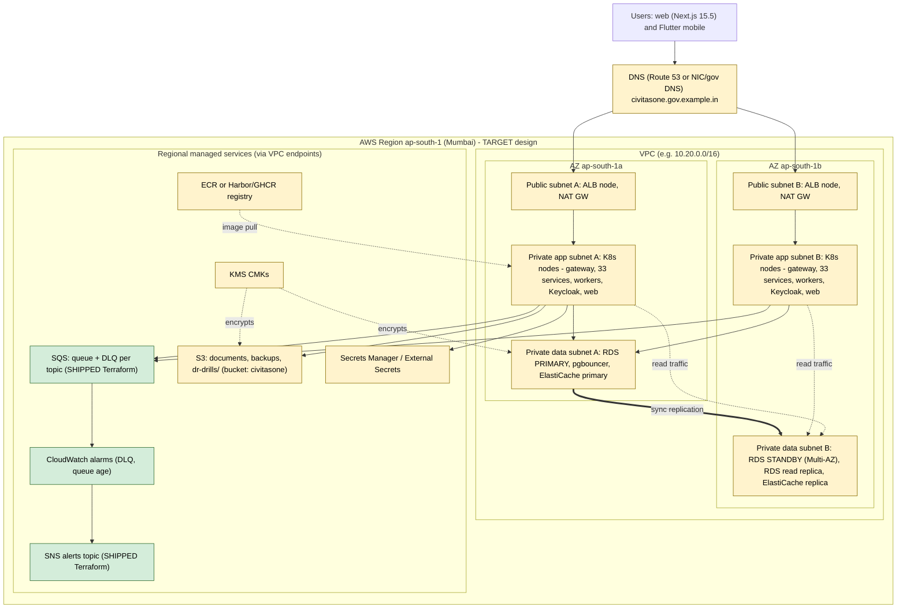
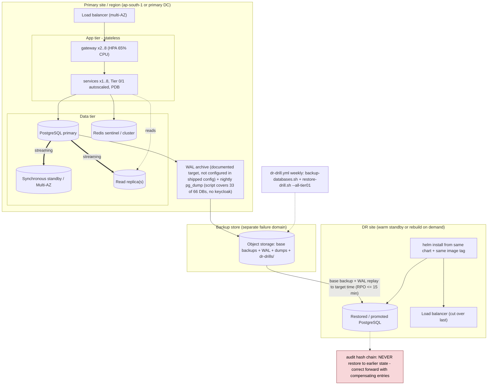

# CivitasOne Suite - Cloud Architecture

| | |
|---|---|
| **Document** | Cloud Architecture (formal design document) |
| **System** | CivitasOne Suite (multi-tenant governance ERP for Government, PSU, Section-8, cooperative and small-office tenants) |
| **Baseline** | `civitasone-suite` @ commit `0a5843762` (UAT build 2026-11-19/20) |
| **Companion** | `INFRA-NETWORK.md` (infrastructure and network architecture) |
| **Status** | Draft for review. Grounded in repository documents and IaC; see the evidence legend below |

## Evidence legend

Every statement about the cloud estate is tagged by how it is backed. This matters because the repository ships *some* AWS infrastructure-as-code but not a full landing zone.

| Tag | Meaning |
|---|---|
| **[SHIPPED]** | Exists as runnable code/config in the repository (Terraform module, Helm template, compose file, workflow, script). Path cited. |
| **[DOCUMENTED]** | Stated in `docs/DEPLOYMENT.md`, `docs/SELF-HOSTING.md` or another doc, but no corresponding artifact was found (or the artifact contradicts the doc). |
| **[PATTERN]** | A recommended design in this document, extrapolated from the repository's patterns. Not implemented in the repo. Needs authoring before use. |

Source documents: `docs/DEPLOYMENT.md`, `docs/SELF-HOSTING.md`, `docs/SCALE-TO-1-LAKH-ANALYSIS.md`, `docs/architecture/CONNECTION-BUDGET.md`, `docs/operations/SLO-SLI-RUNBOOKS.md`, `infra/**`, `.github/workflows/**`, `ecosystem.config.js`.

---

## 1. Introduction

### 1.1 Purpose
This document defines the target cloud architecture for hosting CivitasOne on AWS (Mumbai region, `ap-south-1`) and the parallel on-premises / self-hosted option for Indian government data centres (State Data Centres, NIC-managed facilities, PSU IT wings). It tells platform engineers *what to build, what already exists, and what is still a gap*.

### 1.2 Scope
In scope: compute, data stores, ingress and DNS, high availability, disaster recovery, autoscaling and capacity, cloud security, CI/CD, and cost/sizing. Out of scope: application-level design (see `docs/ARCHITECTURE.md`), host/VM/network detail (see `INFRA-NETWORK.md`), and functional requirements.

### 1.3 System summary
- Fastify (Node 20 container runtime; root engines/CI Node 22, TypeScript) microservices. Documentation states **33 services** (`DEPLOYMENT.md` §1); the Helm chart defines **33 service entries** (32 DB-backed plus `queue`) plus `gateway` and `web`; the live shared environment's `ecosystem.config.js` currently defines **67 services (66 DB-backed + queue-service) / 134 PM2 processes** (66 HTTP + 66 workers + queue + web), ~66 databases (`CONNECTION-BUDGET.md` §2 said 65 / 132 as of 2026-09-08). Sizing in this document uses the documented 33-service platform and flags the larger fleet where it changes the numbers.
- Next.js 15.5 web app, Flutter mobile app.
- PostgreSQL 16 (database-per-service, `civitas_<service>`, Row-Level Security on `tenant_id`), Redis 7 (cache), SQS (command/event transport, with RabbitMQ and in-memory drivers), Keycloak (OIDC, RS256), Meilisearch/OpenSearch (search).
- CQRS: writes return `202 Accepted` and are processed asynchronously by workers via a transactional outbox (`SLO-SLI-RUNBOOKS.md` §1).

### 1.4 Cloud strategy
1. **AWS primary** for SaaS / managed offerings, region `ap-south-1` (Mumbai) for Indian data residency (DPDP). Additional Indian regions (Hyderabad, `ap-south-2`) are the DR/expansion path.
2. **On-prem / self-host option** for government tenants that cannot use public cloud. The same container images and the same Helm chart serve both (`infra/onprem/helm/civitasone`); only the backing services differ (managed RDS/ElastiCache/SQS vs. in-cluster or DC-hosted PostgreSQL/Redis/RabbitMQ). Air-gapped sites use RabbitMQ (`QUEUE_DRIVER=rabbitmq`) and Ansible-style VM deployment (a pattern only; see §3.4).
3. **Portability by construction**: no service depends on a proprietary AWS feature beyond SQS/S3, both abstracted (`@civitasone/queue`, S3-compatible client; LocalStack in dev).
4. **Multi-region / geo-routing is a roadmap item, not current capability** (`SCALE-TO-1-LAKH-ANALYSIS.md` gap 5: Geo-distribution 2/10).

### 1.5 Honest readiness statement
The repository ships a **container build, a Helm chart, an SQS/SNS/RDS-replica Terraform subset, Prometheus/Grafana/Alertmanager/Loki config, and DR drill automation**. It does **not** ship Terraform for the VPC, ALB, EKS/ECS, primary RDS, ElastiCache, S3, KMS or IAM. `infra/aws/envs/production/main.tf` has those module slots commented out ("expand per sprint"), and `infra/aws/modules/ecs-autoscaling/README.md` states the module is a design scaffold with no resources. Section 2 therefore marks the AWS topology as a **target design**.

---

## 2. Cloud Topology Overview

### 2.1 Target topology (AWS)

Green nodes are backed by shipped Terraform; amber nodes are target-design components that must still be authored.

### 2.2 Layering

| Layer | AWS component | Status |
|---|---|---|
| DNS | Route 53 (or NIC/government DNS for `.gov.in` zones) | [PATTERN] |
| Edge | ALB (TLS 1.2+, ACM or NICCA cert) in public subnets, or NGINX ingress behind an NLB; optional AWS WAF | [PATTERN] (chart ships NGINX `Ingress`, `templates/ingress.yaml` [SHIPPED]) |
| Compute | Amazon EKS (Helm chart) in private subnets across >= 2 AZs. ECS is an alternative; `module "ecs"` slot is commented out and the autoscaling module is a README-only scaffold | [PATTERN] (chart [SHIPPED]) |
| Identity | Keycloak (HA, 2+ replicas) with its own `keycloak` database; realm in `infra/keycloak/civitasone-realm.json` | realm [SHIPPED]; HA deployment [PATTERN] |
| Relational data | RDS PostgreSQL 16 Multi-AZ + 1..2 read replicas, fronted by pgbouncer | replica module [SHIPPED]; primary [PATTERN] |
| Cache | ElastiCache Redis (cluster mode disabled for small/medium; cluster for large) | [PATTERN] (chart sets `redis.architecture: sentinel` for in-cluster) |
| Messaging | SQS main queue + DLQ per topic, SNS alert topic, CloudWatch alarms | [SHIPPED] (`infra/aws/modules/sqs`, `sns-alerts`) |
| Object storage | S3 bucket `civitasone` (documents, `dr-drills/` reports, backups) | bucket name in config [SHIPPED]; Terraform [PATTERN] |
| Secrets/keys | Secrets Manager or External Secrets Operator to populate K8s Secret `civitasone-secrets`; KMS CMKs | [PATTERN] |
| Registry | GHCR (CI pushes there today) or ECR / Harbor | GHCR push [SHIPPED] (`ci.yml` `docker-build`) |

### 2.3 What is deployed today
`ecosystem.config.js` runs the live shared environment on a single EC2 host: PM2-managed Node processes (`BASE=/home/ec2-user/CivitasOne/civitasone-suite`) plus Docker containers for PostgreSQL, pgbouncer, Redis, Keycloak and LocalStack. `ecs-autoscaling/README.md` confirms "AWS production in this repo is currently deployed via `infra/docker-compose.prod.yml`, not ECS/EKS". This single-host form is suitable for UAT and small tier only, not the HA design below.

---

## 3. Compute

### 3.1 Container model [SHIPPED]
- One parametrised multi-stage root `Dockerfile` builds every service and worker (`--build-arg SERVICE ENTRY PORT`), Node 20.20.2 slim base, production-only dependency prune (SEC-004), non-root `node` user (uid 1000). `apps/web/Dockerfile` builds the Next.js image. Workers share the service image with `ENTRY=dist/worker.js`; `queue` uses `dist/server.js`.
- Ops surface on every service: `/health` (liveness), `/ready` (readiness; 503 on DB/Redis/SQS failure), `/metrics`, `/openapi.json`.

### 3.2 Kubernetes / Helm [SHIPPED]
Chart `infra/onprem/helm/civitasone` (v0.1.0). Verified by `helm template` with production values: **68 Deployments, 36 Services, 9 HorizontalPodAutoscalers, 1 NetworkPolicy, 1 ConfigMap, 1 ServiceAccount, 0 PodDisruptionBudgets**. **No Ingress renders by default**: `values.yaml` has `ingress.enabled: false` and `values.production.yaml` sets only host and tls; `--set ingress.enabled=true` yields 1 Ingress.

| Workload | Count | Notes |
|---|---|---|
| HTTP service Deployments | 32 (+ `queue`) | one per `values.yaml > services` entry, default 1-2 replicas |
| Worker Deployments (`dist/worker.js`) | 32 | `worker: true`, no Service |
| gateway, web | 2 Deployments | gateway `:8080` x2..8 (HPA 65%), web `:3000` x2 |
| pgbouncer | 1 Deployment | `templates/pgbouncer.yaml`, transaction mode, `maxClientConn 1000`, `defaultPoolSize 2` |

Probes: liveness `/health` (initialDelay 10s, period 15s), readiness `/ready` (period 10s, failureThreshold 3). Secrets come only from the pre-created Secret `civitasone-secrets` (`existingSecret`); the chart never templates secret values.

Service port map (from `values.yaml`): identity 3001, tenant 3002, policy 3003, audit 3004, install 3005, notification 3006, finance 3007, procurement 3008, contract 3009, estab 3010, stock 3011, hrms 3012, payroll 3013, project 3014, asset 3015, report 3016, plugin 3017, theme 3018, grant 3019, citizen 3020, legal 3021, admin 3022, billing 3023, crm 3024, inventory 3025, telephony 3026, helpdesk 3027, knowledge 3028, workflow 3029, queue 3030, analytics 3031, smarttransfer 3086, location 4012, gateway 8080, web 3000, pgbouncer 6432.

**Known chart defects (verified by rendering):**
1. **No PodDisruptionBudgets render.** `templates/pdb.yaml` keys on `$svc.enabled` and `$svc.replicaCount`, but `values.yaml` defines services with `replicas` and no `enabled`. `values.production.yaml` sets `pdb.enabled: true`, which no template reads. `DEPLOYMENT.md` §3 lists PDBs as a feature; today it is not delivered.
2. **`values.production.yaml` sets `hpa:`**, but `templates/hpa.yaml` reads `.Values.autoscaling` and per-service `autoscaling` blocks, so the overlay's HPA block is inert; only the per-service blocks in `values.yaml` take effect (9 HPAs). Its `resources` override is honoured (`deployment.yaml` reads `.Values.resources`).
3. **Stateful dependencies are flags only.** `postgresql.enabled`, `redis.enabled`, `meilisearch.enabled` have no sub-chart dependency (`Chart.yaml` has none; `infra/DEPLOY.md` confirms "referenced but not vendored"). Production must point `DATABASE_HOST`, `REDIS_URL`, `KEYCLOAK_URL` at managed endpoints.
4. **Keycloak has no Helm template**; the chart expects `civitasone-keycloak:8080` to exist.
5. `CONNECTION-BUDGET.md` §7 (PERF-012) records the pgbouncer template's env-var contract was corrected, but the chart still uses a single shared `civitasone` DB role, unlike the per-service roles of the compose/PM2 path.

### 3.3 Docker Compose single-host [SHIPPED]
`infra/docker-compose.prod.yml` (1,339 lines, 73 top-level service entries): infra (postgres 16.4, redis 7.4 with AOF, LocalStack 3.7, pgbouncer 1.21, Keycloak 25.0) + every service/worker + gateway + web. Every secret is `${VAR:?}`-guarded; per-service least-privilege DSN `DATABASE_URL_<SVC>` is required. Appropriate for staging and the Small tier only. **Drift:** this file's pgbouncer uses `AUTH_TYPE: md5`, `MAX_CLIENT_CONN: 500`, `DEFAULT_POOL_SIZE: 20`, whereas the authoritative `CONNECTION-BUDGET.md` and `infra/docker-compose.yml` use scram-sha-256 via `auth_query`, 1000 and 2. Keycloak is 25.0 here versus 24.0 in dev compose and docs.

### 3.4 On-prem VM pattern [PATTERN]
`DEPLOYMENT.md` §5 defines an Ansible role layout (postgres, pgbouncer, redis, keycloak, civitas_service systemd units, gateway, observability) and **explicitly states no playbook exists**. Retained here as the design for air-gapped data centres that reject Kubernetes. PM2 (`ecosystem.config.js`) is the only VM-style runner actually in the repo.

### 3.5 Compute decision
| Option | Recommendation |
|---|---|
| **EKS + shipped Helm chart** | Primary AWS target. Reuses the only complete deployment artefact; HPA/probes already authored. |
| ECS/Fargate | Alternative; requires authoring `modules/ecs` and `modules/ecs-autoscaling` (README mapping to Helm values provided). |
| Single EC2 + compose/PM2 | UAT / Small tier only. Single point of failure. |

---

## 4. Data Stores

| Store | Design | Status |
|---|---|---|
| **PostgreSQL 16** | Database-per-service (`civitas_<service>`), no cross-service FKs, Drizzle migrations, RLS on `tenant_id` with `app.tenant_id` GUC set via transaction-local `set_config`. Money columns are BigInt paise. Bootstrap SQL: `infra/db/bootstrap/*.sql`. Config: `pg_stat_statements` enabled; `max_connections = 200` (`infra/postgres/postgresql.conf`). | [SHIPPED] |
| **Read replica** | Terraform module `rds-replica`: `aws_db_instance` with `replicate_source_db`, `publicly_accessible=false`, `storage_encrypted=true` default, Performance Insights, default `db.t3.medium`. Endpoint feeds `DATABASE_REPLICA_URL`; `packages/db` `dbForRead()` falls back to the primary when unset. | [SHIPPED] (needs `primary_db_identifier`; **primary RDS is not defined**) |
| **PgBouncer** | Transaction pool mode. `server_reset_query_always=1`; `auth_user`/`auth_query` against `pg_authid`. Budget constraint: `(processes + scanner pools) x DB_POOL_MAX <= max_client_conn`; `pools x default_pool_size <= max_connections` with headroom. Today: 76 pools (65 main + 11 scanner), forward 84; `84 x 2 = 168` backend connections vs. 200. | [SHIPPED] |
| **Redis 7** | Read-through cache, TTL 1 s to 1 h; treated as rebuildable. Compose: AOF on. Helm: `architecture: sentinel` flag (no template). | [SHIPPED] (compose); ElastiCache [PATTERN] |
| **Queue** | `@civitasone/queue` embedded library. Drivers: `sqs`, `rabbitmq`, `memory`. Terraform: per-topic SQS queue + DLQ (`maxReceiveCount 5`, visibility 60 s, retention 4 d main / 14 d DLQ), CloudWatch alarms (DLQ non-empty; oldest message > 900 s) to SNS. **24 topics** declared in `main.tf`; keep in sync with `infra/localstack-init/01-create-sqs-queues.sh` (the file notes this manually). | [SHIPPED] |
| **Object storage** | S3 bucket `civitasone` (config `AWS_S3_BUCKET`); LocalStack S3 in dev (`02-create-s3-buckets.sh`); DR drill reports published to `dr-drills/`. | usage [SHIPPED]; bucket Terraform [PATTERN] |
| **Search** | Meilisearch v1.11.3 (default, dev compose) or OpenSearch (`SEARCH_ENGINE`). | dev [SHIPPED]; managed OpenSearch [PATTERN] |
| **Keycloak DB** | Separate `keycloak` database on the same Postgres (`keycloak_bootstrap.sql`). | [SHIPPED] |

**Scale limits stated by the repository** (`SCALE-TO-1-LAKH-ANALYSIS.md`): all pool-mode tenants share one Postgres per service; no tenant-aware connection routing or horizontal sharding exists (3/10). Overall hyperscale readiness is **4.2/10: ready for ~1,000 tenants, not 100,000**. The data-store design above is correct for that envelope.

---

## 5. Networking and Ingress

(Detailed subnet, firewall and port matrices are in `INFRA-NETWORK.md` §3.)

- **Ingress path:** Client -> DNS -> ALB/ingress (TLS terminated, TLS 1.2+, prefer 1.3) -> **gateway `:8080`** -> services. Helm `Ingress` (renders only with `ingress.enabled=true`; 0 Ingress by default) routes `/api` to the gateway and `/` to the web app, with `ingressClassName: nginx` and a TLS secret (`civitasone-tls` in production values). The gateway is the only north-south entry point; it verifies RS256 JWTs against Keycloak's JWKS and applies per-tenant rate limiting (`@fastify/rate-limit`, SEC-008).
- **East-west:** services call each other over cluster DNS, authenticated by `INTERNAL_SERVICE_SECRET` (shared secret). mTLS / service mesh is **recommended but not implemented** (`SELF-HOSTING.md` §3).
- **TLS/certificates:** ACM certificate on ALB for AWS; NICCA-issued or government CA certificate for `.gov.in` hostnames; cert-manager is a [PATTERN] (not in chart). Keycloak must be HTTPS in production (chart default `http://civitasone-keycloak:8080` is in-cluster only).
- **DNS:** `civitasone.<dept>.gov.in` -> ALB alias; staging host `civitasone-staging.example.gov.in`. Per-region geo-DNS is roadmap only.
- **Private connectivity:** S3 gateway endpoint and SQS/STS/ECR/KMS/Secrets Manager interface endpoints keep traffic off the NAT and the internet [PATTERN]. `rds-replica` already forces `publicly_accessible=false`.

---

## 6. High Availability and Multi-AZ

| Tier | HA mechanism | Status |
|---|---|---|
| Load balancer | ALB is multi-AZ by design; nodes in 2 public subnets | [PATTERN] |
| Gateway / Tier-0 | min 2 replicas, HPA 2..8 at 65% CPU (gateway, identity, queue) | [SHIPPED] |
| Tier-1 | min 2 replicas, HPA 2..6 at 70% CPU (finance, estab, workflow, hrms, payroll, audit) | [SHIPPED] |
| Other services | 1-2 fixed replicas (no HPA) | [SHIPPED] |
| Pod placement | **Topology spread / anti-affinity across AZs is not set in the chart**; add `topologySpreadConstraints` on `topology.kubernetes.io/zone` | [PATTERN] |
| Node drains | PDB `minAvailable: 1` intended; **currently not rendered** (see §3.2 defect 1) | [DOCUMENTED] |
| Failure isolation | `/ready` returns 503 on dependency failure so the pod leaves Endpoints | [SHIPPED] |
| PostgreSQL | RDS Multi-AZ (synchronous standby, automatic failover) + read replica; on-prem: Patroni-style primary + replicas (Medium: 1 replica, Large: 2) | [PATTERN]; sizes [DOCUMENTED] |
| Redis | Rebuildable; sentinel/cluster for Medium/Large | [DOCUMENTED] |
| SQS | Regional multi-AZ service; DLQ + redrive; outbox pattern means broker loss does not lose committed events | [SHIPPED] |
| Keycloak | >= 2 replicas, shared Postgres, sticky sessions not required for token validation (RS256 verified locally) | [PATTERN] |

**Single points of failure to retire:** one `civitasone-postgres` container and one `civitasone-pgbouncer` in the compose/PM2 environment; pgbouncer Deployment is hard-coded `replicas: 1` in the chart (`templates/pgbouncer.yaml:26`); no Keycloak template.

---

## 7. Disaster Recovery

**Targets (Charter §28.3, `SELF-HOSTING.md` §4): RPO <= 15 minutes, RTO <= 4 hours (canonical; the GIGW checklist 1 h / 30 min and "quarterly" drill wording is stale: the DR drill is weekly).**

### 7.1 Backup strategy [DOCUMENTED + SHIPPED scripts]
| Asset | Method | Source |
|---|---|---|
| PostgreSQL (all `civitas_*` DBs) | Nightly logical `pg_dump -Fc` per database (`scripts/ops/backup-databases.sh`, retention `BACKUP_RETENTION_DAYS` default **7**); continuous WAL archiving with `archive_timeout=300` and periodic `pg_basebackup` for PITR (documented in SELF-HOSTING §4.1 as the means to the 15-minute RPO; **[DOCUMENTED], not shipped**: `infra/postgres/postgresql.conf` has no `wal_level`/`archive_*` and prod compose sets only `pg_stat_statements`. The RPO ≤ 15 min is a target, not an evidenced capability). **Coverage gap:** `backup-databases.sh` hard-codes 33 of the 66 DBs and excludes the keycloak DB | SELF-HOSTING §4.1 [DOCUMENTED] |
| AWS equivalent | RDS automated backups + PITR (set retention >= 7-35 d), cross-region snapshot copy; **no Terraform for the primary RDS exists, so retention is currently undefined in code** | [PATTERN] |
| Redis | Not backed up for DR; AOF/RDB for warm-up only | SELF-HOSTING §4.2 |
| SQS | DLQ + redrive; durable record lives in Postgres outbox | SELF-HOSTING §4.3 |
| Audit chain | Back up like any DB; **never restore to an earlier state**; correct forward with compensating entries (IT Act s.65B admissibility) | SELF-HOSTING §4.4 |
| Keycloak | Postgres `keycloak` DB plus realm export (`infra/keycloak`) | [SHIPPED] |
| Config/images | Git + registry tags; Helm release history | [SHIPPED] |

### 7.2 Recovery runbook (RTO <= 4 h)
1. Provision standby data zone or promote warm replica.
2. Restore Postgres: latest base backup + WAL replay to target time.
3. Start pgbouncer, Redis (cold cache is acceptable).
4. `helm upgrade --install` the chart at the same image tag pointed at the restored DB.
5. Verify `/ready` = 200 everywhere, gateway JWKS, SQS draining.
6. Smoke test, then reconnect the load balancer / flip DNS.

### 7.3 Proof of recoverability [SHIPPED]
`.github/workflows/dr-drill.yml` runs weekly (Sunday 03:00 UTC) and on demand: `backup-databases.sh` then `restore-drill.sh --all-tier01`, verifying table-count and sample-row checks for every Tier-0/1 database, publishing a `Drill_Report` to GitHub artifacts (400-day retention) and `dr-drills/` in object storage, and alerting via `scripts/ops/notify-alert-channel.mjs`. **Caveat:** the drill runs against an ephemeral CI Postgres, so it proves script and dump integrity, not RDS PITR or cross-region failover.

### 7.4 Cross-region DR
Described as Phase 4 in `SCALE-TO-1-LAKH-ANALYSIS.md` ("Cross-region disaster recovery"). Until then DR is **same-region multi-AZ plus backups restorable in a second region** (S3 cross-region replication of backup bucket, RDS cross-region snapshot copy) [PATTERN]. RTO of 4 h is plausible for rebuild-from-backup; warm-standby would be needed to go lower.

---

## 8. Autoscaling and Capacity

### 8.1 Pod autoscaling [SHIPPED]
9 HPAs (CPU utilisation): gateway, identity, queue (2..8 @ 65%); audit, finance, estab, hrms, payroll, workflow (2..6 @ 70%). ECS equivalent is specified in `ecs-autoscaling/README.md` as target-tracking (`scale_in_cooldown 300`, `scale_out_cooldown 60`), min/max pass-through from Helm values [PATTERN]. Node autoscaling (Cluster Autoscaler/Karpenter) [PATTERN].

### 8.2 Capacity tiers (`SELF-HOSTING.md` §1)
| Tier | Users | App nodes | PostgreSQL | Redis | AWS mapping [PATTERN] |
|---|---|---|---|---|---|
| Small | <= 5,000 | 2 x (8 vCPU/16 GB) | 1 x 8 vCPU/32 GB/500 GB SSD | 1 x 4 GB | RDS `db.m6i.2xlarge` Multi-AZ; 2 x m6i.2xlarge |
| Medium | <= 50,000 | 4-6 x (8 vCPU/32 GB) | Primary + 1 replica, 16 vCPU/64 GB/2 TB NVMe | 2 x 8 GB HA | RDS `db.r6i.4xlarge`; 4-6 x r6i.2xlarge |
| Large | <= 1,000,000 | 10+ autoscaled x (16 vCPU/64 GB) | Primary + 2 replicas, 32 vCPU/128 GB/4 TB+ | cluster 3 x 16 GB | RDS `db.r6i.8xlarge`; 10+ x r6i.4xlarge |

Performance targets: ~1,000 TPS at the Large tier; p95 < 500 ms (GET) and < 1000 ms (POST) per `SELF-HOSTING.md`; add ~20% headroom for month-end/payroll spikes. **Database is the bottleneck, not app CPU**: add read replicas before app nodes.

### 8.3 Connection budget (`CONNECTION-BUDGET.md`)
| Parameter | Value | Reason |
|---|---|---|
| `DB_POOL_MAX` per process | 5 | client pool to pgbouncer |
| `max_client_conn` | 1000 | (130 DB processes + <= 19 scanner pools) x 5 = 745 worst case, ~25% headroom |
| `default_pool_size` | 2 | 84 pools x 2 = 168 backend conns vs. Postgres `max_connections` 200 |
| `min_pool_size` / `reserve_pool_size` | 1 / 1 | reserve could exceed 200 only if all domains spike simultaneously; alert on `pg_stat_activity` near 180 |
| Pool mode | transaction | `set_config(...,true)` inside transactions, `pg_advisory_xact_lock` only, `prepare:false` |

**Scaling implication:** adding app pods does not add Postgres connections beyond `pools x default_pool_size`; scale pgbouncer replicas and `max_connections` together. On RDS, set `max_connections` via parameter group (instance-class dependent) and size `default_pool_size` accordingly. Per-database pool tuning waits on production `pg_stat_statements` data (PERF-010).

### 8.4 Multi-tenant scale gaps (roadmap, not built)
Tenant-aware connection routing and sharding, per-tenant resource quotas, gateway rate limiting at tenant level (partially present per SEC-008), automated provisioning (<30 s), canary rings, multi-region routing, usage metering (`SCALE-TO-1-LAKH-ANALYSIS.md` §Roadmap Phases 1-4).

---

## 9. Cloud Security

### 9.1 Identity and access (IAM)
- **Workload identity:** each Helm workload gets a ServiceAccount (`templates/serviceaccount.yaml`, annotations hook for IRSA). `DEPLOYMENT.md` states services authenticate to SQS via IRSA; no IAM role/policy Terraform exists [PATTERN]. Target: one IAM role per service group with least-privilege on only its own queues/prefixes (SQS `Send/Receive/Delete` on named ARNs; S3 prefix-scoped).
- **Human access:** SSO to AWS via IAM Identity Center, MFA, break-glass role; Terraform state bucket in S3 (`backend "s3" {}` configured per environment) with versioning, KMS and DynamoDB/S3 locking [PATTERN].
- **Application identity:** Keycloak OIDC RS256; Keycloak realm roles synced by `scripts/ops/sync-keycloak-realm-roles.mjs`; MFA configurable (`configure-mfa-keycloak.sh`).
- **Database identity:** per-service least-privilege roles `<svc>_svc` and scanner (BYPASSRLS) roles for outbox maintenance only; `civitas_admin` is superuser and should not be used by services.

### 9.2 Network security (security groups)
| SG | Inbound | From |
|---|---|---|
| `alb` | 443 | CIDR allow-list / 0.0.0.0/0 (public) or gov NAT ranges |
| `app` (EKS nodes/pods) | 8080 gateway, 3000 web, service ports | `alb`; east-west from `app` itself |
| `pgbouncer` | 6432 | `app` |
| `rds` | 5432 | `pgbouncer` only (and break-glass admin) |
| `redis` | 6379 | `app` |
| `obs` | 9090/9093/3100/3001 | admin VPN / bastion only |
No inbound from the internet to any private subnet. Kubernetes `NetworkPolicy` (Helm, `networkPolicy.enabled`) is a coarse default-deny: ingress only from same-release pods and the `ingress-nginx` namespace; egress to same-release pods, DNS (53) and **non-RFC1918 destinations** (blocks 10/8, 172.16/12, 169.254/16). The documented "service -> its DB/Redis/SQS egress" fine-grained policy is **not** in the template; a managed RDS or ElastiCache endpoint in RFC1918 space (the normal AWS case) is not matched by the egress rules and needs an explicit egress rule added.

### 9.3 Secrets and encryption
- **Secrets:** never in git. Required: `INTERNAL_SERVICE_SECRET`, `DEVICE_TRUST_SECRET`, `DATABASE_PASSWORD`, `MFA_ENC_KEY`, `PII_ENC_KEY`, `CITIZEN_PII_KEY`, `CRM_PII_KEY`, `METRICS_TOKEN`, `AUDIT_HASH_SEED`. Delivered through a pre-created K8s Secret (`civitasone-secrets`) [SHIPPED model]; back it with Secrets Manager + External Secrets Operator and rotate on a schedule [PATTERN]. Compose uses `${VAR:?}` env file.
- **In transit:** TLS 1.2+ at the edge; Keycloak over HTTPS; RDS `rds.force_ssl=1`; ElastiCache in-transit encryption [PATTERN, unimplemented: no Terraform for primary RDS or ElastiCache]. TLS version is **not enforced by any shipped config** (policy 1.2+, prefer 1.3).
- **At rest:** RDS and replica storage encryption (replica module defaults `storage_encrypted=true`, optional `kms_key_id`); S3 SSE-KMS; EBS encryption; **SQS queues in the shipped module set no explicit `sqs_managed_sse_enabled`/`kms_master_key_id`** (relies on AWS default SQS-managed encryption), whereas `DEPLOYMENT.md` §4 claims "encryption" - add explicit SSE-KMS [PATTERN]. SNS topic `alerts` also has no KMS key.
- **Application-level:** PII fields AES-256-GCM (`PII_ENC_KEY`); append-only SHA-256 audit chain.
- **KMS:** only touchpoint in IaC is the optional `kms_key_id` variable in `rds-replica`. Define separate CMKs for data (RDS/S3), queues, and secrets with key rotation [PATTERN].

### 9.4 Compliance mapping
DPDP (data residency in Mumbai), CERT-In (>= 180-day log retention), GFR-2017, CSMOP, IT Act s.65B (immutable audit chain). Pipeline security: secret scan, CodeQL, Trivy container scans, OWASP ZAP DAST, dependency audit (`security.yml`).

---

## 10. CI/CD and Environments

```mermaid
flowchart LR
    DEV["Developer: feature branch -> PR"] --> CI

    subgraph CI["GitHub Actions ci.yml (PR + push)"]
        L["typecheck-lint, secret-scan"]
        T["unit + integration tests, arch-guard, contract-tests"]
        W["web-build, verify-screens, accessibility, e2e, mobile"]
        Q["quality-gates-schema/domain, mutation, coverage-gate"]
        RG["release-gate (evidence audit, main enforces)"]
        L --> T --> W --> Q --> RG
    end

    CI --> SEC["security.yml: dependency audit, CodeQL, Trivy container, ZAP baseline vs mock gateway (non-blocking)"]
    RG -->|merge to main| BM["docker-matrix: derive services from tree + ecosystem.config.js"]
    BM --> BP["docker-build: build and push one image per service (root Dockerfile) to ghcr.io, tags latest + version"]
    BP --> REL["release.yml (workflow_run on CI success): QA score >= 95, production-readiness score, staging /health probe, GitHub Release"]
    REL --> MIG["Run DB migrations FIRST (expand phase): pnpm -r run db:migrate / bootstrap Job"]
    MIG --> ROLL{"Target"}
    ROLL -->|Kubernetes| HELM["helm upgrade --install civitasone (values.staging.yaml / values.production.yaml)"]
    ROLL -->|Single host| DC["docker compose -f infra/docker-compose.prod.yml pull and up -d"]
    ROLL -->|Bare VM| PM2["PM2 ecosystem.config.js (current EC2 fleet)"]
    HELM --> VER["Verify: /ready 200 on all services, gateway JWKS, SQS draining, SLOs"]
    DC --> VER
    PM2 --> VER
    VER -->|fail| RB["helm rollback / re-pin previous image tag (migrations are backward compatible)"]
    VER -->|pass| DONE["Contract phase later, once stable"]
    NIGHT["nightly.yml 03:00 UTC, perf-k6.yml 05:00 UTC, dr-drill.yml Sun 03:00 UTC"] -.-> VER
```

### 10.1 Pipeline [SHIPPED]
- `ci.yml` (PR + push): typecheck/lint, secret scan, unit and integration tests, arch-guard, contract tests, web build, screen verification, accessibility, e2e, mobile, live-stack verification (main only), coverage gate, mutation testing, quality gates (schema, domain), `release-gate` evidence audit (enforced on main).
- On push to `main`: `docker-matrix` derives the build matrix from `services/` and `ecosystem.config.js`; `docker-build` builds and pushes one image per service to **GHCR** (`ghcr.io/<repo>/<service>:latest` and `:<version>`).
- `release.yml` (triggered by successful CI on `main`): QA readiness score >= 95, production readiness score, staging `/health` probe (if `STAGING_URL` secret set), creates a GitHub Release.
- Scheduled: `nightly.yml` (03:00 UTC: three-way-match live, Lighthouse, accessibility), `perf-k6.yml` (05:00 UTC), `security.yml` (Mondays 02:00 UTC), `dr-drill.yml` (Sundays 03:00 UTC).

### 10.2 Deployment [PARTLY SHIPPED]
There is **no automated CD job** that runs `helm upgrade` or Terraform; deployment is an operator step (`DEPLOYMENT.md` §3, §9). Recommended: GitOps (Argo CD / Flux) or a gated `helm upgrade --atomic` job with environment approval [PATTERN]. Image tag is the release unit (`image.tag`).

### 10.3 Release safety
- Migrations first, **expand -> migrate -> contract**, backward compatible; app rollback = `helm rollback` without reversing schema (`DEPLOYMENT.md` §9).
- Forward-only audit chain; `scripts/ops/migrate-rollback.sh` for prepared down-migrations.
- Canary / blue-green / deployment rings: **not implemented** (`SCALE-TO-1-LAKH-ANALYSIS.md` gap 6). Interim: staging Helm install, then production rolling update gated by readiness probes.

### 10.4 Environments
| Env | Platform | Config | Notes |
|---|---|---|---|
| Dev | `infra/docker-compose.yml`, LocalStack, hot reload | `.env.example` | Postgres 16, Redis 7, Meilisearch, Keycloak 24 |
| CI | GitHub runners with ephemeral Postgres + LocalStack | `ci.yml` | |
| Staging | Helm `values.staging.yaml` (1 replica, no HPA/PDB, no TLS) or `docker-compose.prod.yml` | real SQS | |
| Production | Helm `values.production.yaml` (2 replicas, TLS ingress) on EKS | managed data stores | UAT currently on single-host PM2/compose |
Terraform environments: only `infra/aws/envs/production`; no `staging` env root exists [PATTERN].

---

## 11. Cost and Sizing Considerations

Costs below are directional drivers, not quotes; price with the AWS Pricing Calculator for `ap-south-1`.

| Driver | Observation | Lever |
|---|---|---|
| **RDS** (largest line) | Database is the scaling bottleneck; Multi-AZ doubles instance cost; replicas add cost per replica | Right-size per tier (§8.2); reserved instances or Savings Plans; add replicas only when read load proves it; `db.t3.medium` default replica is development-grade |
| **Compute (EKS nodes)** | 33 service entries (32 DB-backed + queue) + 32 workers + gateway + web + pgbouncer = 68 Deployments (queue and gateway have no worker); ~68 pods at 100-500m CPU / 192-512 Mi requests base (`values.yaml`) | Bin-pack small services onto few nodes; Karpenter + Spot for stateless Tier-2 workers; Graviton (arm64) requires multi-arch image builds (not in CI today) |
| **NAT Gateway** | Per-AZ NAT plus data-processing charge | VPC endpoints for S3/SQS/ECR/STS/KMS/Secrets Manager |
| **ElastiCache** | Cache only, rebuildable | Smallest HA footprint; no Multi-AZ for Small tier |
| **SQS** | Per-request pricing; 24+ topic queues | Long polling, batch send/receive |
| **S3 / backups** | Dumps + WAL + drill reports | Lifecycle to IA/Glacier; WAL and dumps retained per RPO/audit needs; logs >= 180 days |
| **Observability** | Self-hosted Prometheus/Loki/Grafana avoid per-metric fees but need storage and ops | Loki to S3; Prometheus 15 d retention (shipped) + remote-write for long term |
| **Licensing** | AGPL-3.0, no per-seat fees; Keycloak, Postgres, Redis OSS | |
| **Environments** | Non-prod can run single-AZ, 1 replica (staging overlay), scheduled scale-to-zero overnight | |
| **On-prem alternative** | CapEx per `SELF-HOSTING.md` tier table; NIC/SDC hosting may be provisioned rather than billed | |

Fleet growth risk: the live fleet is already 67 services / 134 processes (CONNECTION-BUDGET said 65 / 132 on 2026-09-08); the 33-service budget above underestimates pods, DB pools and connection counts by roughly 2x if all are deployed (re-derive using `scripts/ops/lib/fleet-topology.mjs` as `CONNECTION-BUDGET.md` §5 prescribes).

---

## Appendix A - Gaps and recommended next actions

| # | Gap | Evidence | Action |
|---|---|---|---|
| 1 | No Terraform for VPC, ALB, EKS/ECS, primary RDS, ElastiCache, S3, KMS, IAM | `main.tf` commented slots; `ecs-autoscaling/README.md` | Author modules; `DEPLOYMENT.md` §4 overstates ("VPC wiring, EKS/RDS references") |
| 2 | `rds_replica` cannot apply without a primary | `primary_db_identifier` default `""` | Add `modules/rds` first |
| 3 | PDBs and production HPA overlay do not render | `helm template` output; key mismatch | Fix `pdb.yaml` keys (`replicas`, drop `enabled`) and `values.production.yaml` (`autoscaling`) |
| 4 | Keycloak, Postgres, Redis, Meilisearch have no chart templates/dependencies | `Chart.yaml`, `infra/DEPLOY.md` | Add subcharts or document managed endpoints |
| 5 | No AZ topology spread; pgbouncer single replica | `deployment.yaml`, values | Add spread constraints and 2+ pgbouncer |
| 6 | pgbouncer config drift (prod compose md5/500/20 vs. scram/1000/2) | compose vs. CONNECTION-BUDGET | Align `docker-compose.prod.yml` |
| 7 | SQS/SNS lack explicit KMS SSE | `modules/sqs`, `sns-alerts` | Add `kms_master_key_id` |
| 8 | No automated CD, canary, or rings | workflows | Add GitOps or gated `helm --atomic` |
| 9 | DR drill uses ephemeral Postgres; no cross-region proof | `dr-drill.yml` | Add RDS PITR restore test and cross-region copy |
| 10 | Service-count inconsistency (33 docs / 33 chart / 67 services and 134 PM2 processes in code) and 60 of 65 DBs bootstrapped at 2026-09-22 | `CONNECTION-BUDGET.md` §2, §9 | Reconcile before final capacity sign-off |
| 11 | East-west auth is a shared secret only; mTLS not implemented | `SELF-HOSTING.md` §3 | Service mesh or per-service mTLS for Medium/Large |
| 12 | No multi-region, sharding, tenant quotas | `SCALE-TO-1-LAKH-ANALYSIS.md` | Follow Phase 1-3 roadmap |
| 13 | Shipped backup script `scripts/ops/backup-databases.sh` hard-codes 33 of 66 DBs and **excludes keycloak** (IdP DB un-backed-up); any "all DBs backed up" claim is false | `backup-databases.sh` DATABASES array | Regenerate list from `fleet-topology.mjs`; add keycloak |
| 14 | WAL archiving / PITR not configured in shipped config (no `archive_*` in `infra/postgres/postgresql.conf`); RPO ≤ 15 min is a TARGET [DOCUMENTED]; DR drill uses ephemeral Postgres | `postgresql.conf`, `docker-compose.prod.yml`, `dr-drill.yml` | Add archive config + basebackup automation; test PITR restore |
| 15 | Keycloak runs HTTP-enabled (`--http-enabled=true --hostname-strict=false`, image 25.0) in prod compose | `docker-compose.prod.yml:141` | Enforce HTTPS/hostname behind TLS proxy (INFRA gap 11) |
| 16 | ZAP/DAST runs against a mock gateway and is non-blocking; Trivy covers only gateway/finance/hrms images | `security.yml` | Real authenticated DAST; widen image scans |
| 17 | Alertmanager receivers ship empty | `alertmanager.yml` (INFRA gap 7) | Inject receivers at deploy |
| 18 | TLS version unenforced in shipped config (policy 1.2+, prefer 1.3); `rds.force_ssl`/Redis TLS are [PATTERN] only | ingress, helm, compose | Pin ssl-protocols / minTLS |

*Gap count: the "14 gap items" figure quoted earlier did not match the 12 actually listed here and 12 in INFRA-NETWORK Appendix A; this appendix now lists 18 (12 original + 6 added by review). INFRA-NETWORK lists 18 as well, numbered 13-18 with the same additions.*
