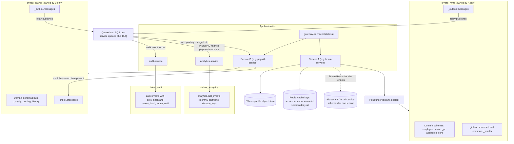
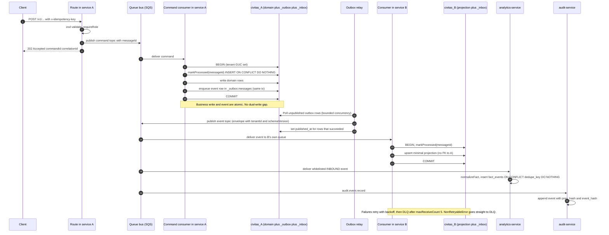
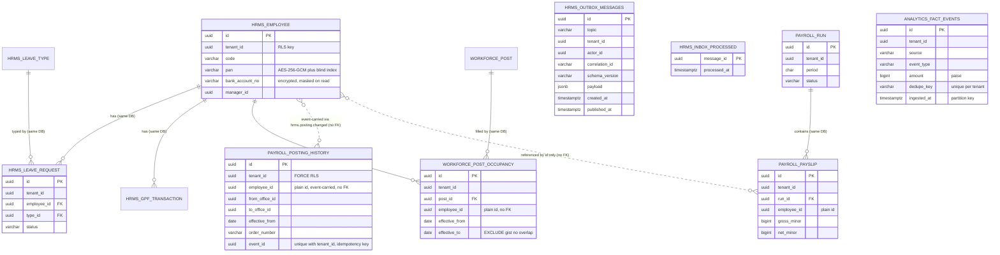

# CivitasOne Suite — Data Architecture

| | |
|---|---|
| **Document** | Data Architecture (formal design document) |
| **System** | CivitasOne Suite |
| **Baseline** | `civitasone-suite` @ `0a5843762` (main) |
| **Status** | Draft for review. Descriptive of the baseline code and docs. |
| **Companions** | `SECURITY-ARCH.md`, `INTEGRATION-ARCH.md` |
| **Evidence convention** | Docs cited by path; code verified by source path. Where doc and code disagree the code wins; disagreements are listed in Appendix A. |

---

## 1. Introduction

### 1.1 Purpose and scope
This document defines how CivitasOne owns, organises, isolates, moves, protects and retires data. It covers the operational databases (Postgres 16), caches (Redis), the message transport as a data path (SQS), object storage, the analytics projection, and backup/DR.

### 1.2 Data principles
| # | Principle | Consequence |
|---|---|---|
| D1 | **A service owns its data exclusively** | Database-per-service; no cross-database SQL, joins or foreign keys |
| D2 | **State moves by events, not by shared tables** | Transactional outbox → queue → idempotent inbox consumer → local projection |
| D3 | **Tenant is a first-class dimension of every row** | `tenant_id uuid` on tenant-scoped tables, FORCE RLS, tenant-keyed cache, tenant in every event |
| D4 | **Money is exact** | `bigint` minor units (paise); wire form is a decimal string ending `Minor`; no floats |
| D5 | **Time is `timestamptz`** | UTC instants; IST conversion at presentation (`shared/ist.ts`) |
| D6 | **Evidence is append-only** | Audit chain, posting ledger, frozen notings are insert-only, trigger/hash protected |
| D7 | **Eventual consistency across services is a stated contract** | Writes are `202 Accepted`; clients poll or subscribe |

---

## 2. Database-per-service strategy

### 2.1 Topology
Each DB-backed service connects as its own login role (`<service>_svc`, `NOSUPERUSER NOBYPASSRLS`) to its own database `civitas_<service>` (for example `civitas_grant OWNER grant_svc`; hyphens become underscores, e.g. `civitas_ai_agent`). All connections go through **PgBouncer** (`infra/pgbouncer/pgbouncer.ini`, `auth_type=scram-sha-256` with `auth_query` against `pg_authid`, so no per-role userlist) to a shared Postgres 16 cluster in the default deployment; a service can be moved to its own cluster by changing one DSN (`ESTAB_DATABASE_URL` is the documented example). `docs/architecture/CONNECTION-BUDGET.md` derives the connection budget from `ecosystem.config.js`: roughly 130 DB-backed processes with a default pool of 10 each, plus a second "scanner" pool in 19 services, are what PgBouncer exists to multiplex (against `max_connections=200`).

A second pool in some services uses a **`*_scanner` role with BYPASSRLS** for cross-tenant maintenance loops (outbox relay, scheduled purge). It is the only intended RLS bypass for application code.

### 2.2 Inventory
The repo contains **68 directories under `services/`**; **66 carry SQL migrations** (all except `adapters` and `queue-service`; `gateway-service` carries 3 migrations for its `catalogue` module). `docs/DATABASE-SCHEMA.md` still lists 32 databases / 33 services (Appendix A, A1). The table groups the current set; `n` is the number of numbered migration files.

| Cluster | Services (database `civitas_<name>`, n) |
|---|---|
| **Platform** | identity (34), tenant (35), policy (15), audit (40), install (18), notification (54), admin (61), plugin (18), theme (17), metadata (7), gateway-catalogue (3) |
| **Finance and procurement** | finance (129), procurement (54), contract (24), billing (26), revenue (25), grant (17), refund (4), vendor (4), catalogue (9), works (31) |
| **People** | hrms (195), payroll (94), estab (60, eOffice), smarttransfer (2) |
| **Assets and stores** | asset (43), stock (13), inventory (27), project (28), inspection (35), building (6) |
| **Citizen and municipal** | citizen (46), legal (38), court (20), meeting (18), visitor (19), document (9), location (30), advertisement (7), animal (3), crematorium (3), drainage (3), fire (4), market (4), parking (3), parks (3), roadcut (4), sewerage (6), shop (5), swm (6), trade (6), event (3) |
| **Customer and engagement** | crm (123), helpdesk (43), telephony (21), knowledge (18), cdp (12), journey (7), loyalty (6), recommendation (9), field (3) |
| **Intelligence and reporting** | analytics (22), report (21), ai-agent (4), ml (2) |
| **Orchestration** | workflow (51) |
| **No database** | queue-service (embedded bus library and server), adapters (India Post adapter scaffold) |

Documented ports and prefixes live in `docs/SERVICES.md`; the gateway registry (`services/gateway-service/src/registry.ts`) maps `/api/v1/<svc>` to the upstream and honours `GATEWAY_<NAME>_URL` overrides.

### 2.3 Rules the topology imposes
1. No service reads another service's database. Cross-service reads are (a) event-carried local projections (§6) or (b) synchronous internal HTTP with the service secret, wrapped in a circuit breaker with timeout (for example hrms → payroll F&F tax, `shared/payroll-client.ts`: 5 s timeout, breaker opens after 5 failures for 30 s).
2. Each service migrates only its own database (no cross-database migration).
3. Reference data shared by all tenants (module registry, bundles, org profiles in admin; currency-like lookups) is **global** and carries no `tenant_id` and no RLS — a documented, reviewed exception.
4. Any service can be extracted to a separate server/VPC/air-gapped instance by changing its DSN and gateway URL, because it already owns its database and talks to peers only through events and the gateway. The eOffice design uses this explicitly for government-controlled hosting (`EOFFICE-INTEGRATION-ARCHITECTURE.md` §7).

### 2.4 Diagram — data architecture overview

---

## 3. Schema organisation, naming and migration conventions

### 3.1 Schema layout within a database
A service groups tables into **per-module PostgreSQL schemas** plus two mandatory infrastructure schemas:

| Schema | Purpose |
|---|---|
| Domain schemas, one per module | e.g. finance `gl`, `budget`, `treasury`, `payments`; hrms `employee`, `leave`, `gpf`, `pension`, `recruitment`, `attendance`, `contracts`, `workforce_core`; payroll `run`, `payslip`, `bank`, `posting_history` |
| `_outbox` | `messages`: transactional outbox rows |
| `_inbox` | `processed`: dedup ledger (`message_id uuid PK`, `processed_at`); `command_results`: terminal outcome per command (`succeeded | rejected | failed`) so a `202` caller can look the result up |
| Helper function | `current_tenant_id()` is created in the service's first schema (e.g. `budget.current_tenant_id`, `payroll.current_tenant_id`) |

Drizzle schema definitions (`pgSchema("…")`) live in each module's `schema.ts`; the **SQL migration files are the deployed truth**.

### 3.2 Naming conventions
- Database `civitas_<service>`, role `<service>_svc`, scanner role `<service>_scanner`.
- Schema = module name; tables snake_case. Some services prefix tables with the module (`hrms_contracts`) where the module schema is shared.
- Standard columns: `id uuid PK default gen_random_uuid()`, `tenant_id uuid NOT NULL`, `created_at/updated_at timestamptz`, `created_by/updated_by uuid`, optimistic-concurrency `version int`.
- Money: `<name>_minor bigint` (CHECK `>= 0` where applicable) with a `currency` column (default `INR`). Points and similar counters that can exceed 2^53 are `bigint` and **serialised as decimal strings**.
- Status/enum columns are `varchar` with domain validation in zod/`domain.ts`; some services add CHECK constraints (analytics `0008_check_constraints_status_columns.sql`, `0012_…`), others deliberately do not (field, recommendation).
- Effective-dated data uses `[effective_from, effective_to)` plus `EXCLUDE USING gist` for no-overlap (workforce_core `post_occupancy`).
- Event topics `{service}.{aggregate}.{pastTense}`; commands `{service}.{aggregate}.{action}`; derived queue name = topic with dots→dashes truncated to 45 characters (`TOPIC_BASE_MAX`).

### 3.3 Migration conventions
- **Hand-written, idempotent, forward-only SQL**, numbered `NNNN_description.sql`, applied in filename order by `scripts/dev/migrate-all.mjs` (dev) and `scripts/ci/bootstrap-postgres.sh` (CI/bootstrap). Never edit a released migration; correct with a new number.
- Idempotence idioms: `CREATE … IF NOT EXISTS`, `ADD COLUMN IF NOT EXISTS`, `DROP POLICY IF EXISTS` then `CREATE POLICY`, guarded `DO $$` blocks.
- Safety idioms: `SET lock_timeout = '5s'`; backfills and partition conversions scheduled for maintenance windows (analytics `0007`, `0009`).
- Every tenant-scoped table ships `ENABLE` + `FORCE ROW LEVEL SECURITY` and the `tenant_isolation` policy **in the same migration** (691 migration files do so at the baseline).
- **Rollback**: no migration ledger exists (no `schema_migrations`/drizzle journal), so "current state" is the database itself. Each migration carries a `-- Rollback:` header comment (63 of 65 services at the time of the count, now 66 migration-bearing); `scripts/ops/migrate-rollback.sh` + `scripts/ops/MIGRATION-ROLLBACK.md` formalise reversal. Take `pg_dump` or confirm WAL archiving (documented, not configured in shipped config) before any contract-phase migration (`DEPLOYMENT.md`). Expand/contract is the expected pattern for destructive change.
- Silo tenants add a dimension: each migration must be fanned out to the shared database *and* every silo tenant database, recorded per (tenant, service); this orchestrator is partially built (`provision-silo-tenant.mjs` applies all services' migrations once; the recurring fan-out job is an open item in MULTI-TENANCY §5).
- Drift protection: `scripts/ops/verify-fleet-reconciled.mjs` (fleet reconciliation), `check-fleet-dsns.mjs` (DSN sanity), and the CI bootstrap asserts no `*_svc` role can bypass RLS. A migration-drift check that RLS is enabled+forced on every tenant-scoped table is specified in `RLS-ENGAGEMENT-RUNBOOK.md` Step 5 (not verified as built).

---

## 4. Multi-tenant data model

### 4.1 Row model
Every tenant-scoped table has `tenant_id uuid NOT NULL`, usually indexed first in composite indexes (`(tenant_id, …)`; PERF-016 added missing tenant indexes). Uniqueness that is business-meaningful is **per tenant** (`UNIQUE (tenant_id, code)`, `(tenant_id, contract_no)`, `(tenant_id, period)`, `(tenant_id, dedupe_key)`).

### 4.2 Isolation mechanisms in the data tier
| Mechanism | Detail |
|---|---|
| Application predicate | `WHERE tenant_id = $ctx.tenantId` on every query — primary control |
| FORCE RLS | `USING`/`WITH CHECK (tenant_id = current_tenant_id())`; `current_tenant_id()` is missing-ok (NULL ⇒ deny) |
| GUC transport | `set_config('app.tenant_id', tenant, true)` at the start of each transaction from `AsyncLocalStorage` (request: verified `tid`; consumer: `runWithTenant(msg.tenantId, …)`); transaction-local ⇒ safe with pooled connections |
| Roles | `*_svc` are NOBYPASSRLS; `*_scanner` bypass for cross-tenant maintenance |
| Cache | keys `{service}:{tenant}:{resource}:{id}`; `delByPrefix` invalidation per tenant+resource |
| Queue | envelope carries `tenantId`; invalid envelope ⇒ DLQ |
| Idempotency | `idempotentId` hashes `tenantId:key` |

Full control description: `SECURITY-ARCH.md` §4.

### 4.3 Pool versus silo
| | Pool (default) | Silo |
|---|---|---|
| Data location | Shared per-service database | One dedicated database per tenant holding **every service's pg schemas** |
| Routing | Shared client | `TenantRouter.sqlFor(tenantId)`; cached client per silo DSN, LRU-capped; resolver reads `tenant.isolation_tier`, `db_dsn_ref`, `kms_key_ref`, `region` |
| Schema | Unchanged — silo reuses the same `pgSchema` names, so Drizzle models are identical | |
| Migrations | N services | N services × silo tenants |
| Backup/erasure/residency/BYOK | Scoped | Trivial (back up, place, encrypt, or drop the database) |
| Cross-tenant analytics | One query | Fan-out |
| State | In use | Router, registry and provisioning state machine built; only estab converted to `dbFor(tenantId)`; outbox relay and consumers must resolve the tenant database per message (open); Redis-backed resolver, BYOK and residency open |

### 4.4 Tenant catalogue
`tenant-service` (`civitas_tenant`) holds `org.tenant` (tier, status), org units (self-referential tree), `config.setting`, and effective-dated `plans.plan_prices` (FORCE RLS, close-and-insert). `tenant.tenant.created` provisions hrms and workflow; `tenant.tenant.isolation_changed` drives install-service silo provisioning. Tenant entitlements and profiles live in admin (`composition.tenant_entitlement`, `tenant_profile`, FORCE RLS).

---

## 5. Data classification and retention

### 5.1 Classification
The platform has no single machine-readable classification registry; classification is expressed by control. The working model below is derived from the Threat Model crown jewels, `SECURITY.md` §4, `COMPLIANCE.md` and the code.

| Class | Examples | Controls |
|---|---|---|
| **C4 Restricted — secrets** | `INTERNAL_SERVICE_SECRET`, `PII_ENC_KEY`, `CONFIG_ENC_KEY`, integration credentials, signing keys, webhook secrets | Env/secret manager only; AES-GCM sealed in the integration registry; never logged, never in events |
| **C3 Sensitive personal (DPDP)** | PAN, Aadhaar reference, bank account/IFSC, mobile, UAN, medical/disability/category/spouse (SmartTransfer), interview recordings and transcripts | Field-level AES-256-GCM + blind index; masked by default; audited reveal with reason; excluded from event payloads (`pii: []` declared per contract; sensitive attributes stay in the snapshot); consent flags on recordings |
| **C3 Financial** | Ledgers, sanctions, vouchers, payroll, bank files, tender bids | `bigint` paise; maker-checker; immutable audit; signed bank files; 3-way match |
| **C3 Government records** | eOffice files and notings with classification `public | confidential | secret | top_secret` | Operator clearance gate; frozen notings hash-chained and trigger-protected; denial audited |
| **C2 Internal** | Operational master data, configuration, workflow definitions | Tenant isolation, RBAC |
| **C1 Public** | Published careers, public verification routes, accessibility/policy pages | Anonymous allow-list routes, no tenant identity trusted |
| **Evidence** | `audit` events, posting ledger, command results | Append-only; hash chain; retention below |

Event payload rule (ADR-0019): money is a string ending `Minor` with `currency`; every contract lists its `pii` fields explicitly so DPDP erasure can target them.

### 5.2 Retention
| Data | Retention | Enforcement |
|---|---|---|
| Audit events | `retain_until` = occurred + **180 days** (CERT-In minimum); legal retention longer by tenant policy | Column set at ingest by audit consumer |
| Security/application logs (pino JSON) | ≥ 180 days in rollover-protected central store | Operational (`SELF-HOSTING.md` §6) |
| Published outbox rows | 7 days (`purgeOutbox`, `retentionDays=7`); audit-topic rows 30 days (`AUDIT_OUTBOX_RETENTION_DAYS`) | Scheduled purge using the scanner role |
| Inbox `processed` and `command_results` | Purged with the same retention window (not shorter than outbox) | `purgeOutbox` |
| Backups | `BACKUP_RETENTION_DAYS`, default 7 | `scripts/ops/backup-databases.sh` |
| eOffice files | Records "30+ years" as a design requirement (separable storage lifecycle) | Design intent; no purge path built |
| Session denylist | TTL = access-token lifespan | Redis expiry |
| Personal data past purpose | Erase by anonymisation (`eraseFields` modes null/tombstone/hash; ids and audit preserved) subject to `legalHold` | `packages/data-governance/src/retention.ts` — pure helpers; per-service scheduling is the service's job |
| Silo tenant | Drop database on erasure | Procedure in MULTI-TENANCY §7 |
| Fact events | No retention stated; partitioned by month for cheap drop | `0007_partition_fact_events.sql` |

### 5.3 Data-subject rights
Consent capture/status, rectification and erasure workflows are described in `COMPLIANCE.md` §2; the erasure *event* stays in the audit chain, the PII does not. Pool-tier erasure is scoped delete plus crypto-shredding; silo is database drop.

---

## 6. Cross-service referential integrity

### 6.1 Rule
There are **no cross-database foreign keys**. A reference to another service's entity is a **plain `uuid` column** (for example payroll `employee_id`, inventory `grn_id`/`po_id`/`invoice_id`, journey/loyalty `profile_id`, estab `employee_ref`). Referential integrity across services is *eventual* and maintained by events, not by the database engine. Within a service, normal FKs apply (payslip → run, leave_request → employee, post_occupancy → post).

### 6.2 Event-carried state transfer
The owner emits a past-tense event containing the minimum fields consumers need; the consumer projects them into its own table, with an idempotency key.

Example (SmartTransfer ST-M01-11): `hrms.posting.changed` carries `employeeId, fromOfficeId, toOfficeId, station, state, cityClass, ddo?, effectiveFrom, orderNumber`; payroll's consumer writes `payroll.posting_history` (FORCE RLS) with `UNIQUE (tenant_id, event_id)` so redelivery is a no-op, and exposes an as-of read API. It does *not* compute pay from it (decision D-ST-13 still open), and is flag-gated (`PAYROLL_POSTING_CONSUMER_ENABLED`, default off).

### 6.3 Integrity patterns and their limits
| Concern | Pattern |
|---|---|
| Dangling reference after owner deletes | Owners soft-delete/deactivate and emit events; consumers tolerate a missing target (tolerant reader) |
| Stale projection | Version/`updated_at` carried in events; reconciliation jobs (`scripts/ops/reconcile-billing-gl.mjs`, `packages/reconciliation`) |
| Cross-service uniqueness | Not enforced; use deterministic ids/`refType+refId` (eOffice) or tenant-scoped numbering (`packages/numbering`) |
| Distributed transaction | None — a saga of commands/events; compensation by forward events, never history rewrite |
| Orphaned decision callbacks | eOffice SDK `DECISION_CONSUMED_REF_TYPES` fail-closed: a ref type without a consuming service is refused at raise time |
| Contract drift | `defineContract` (zod, `enforce`) for SmartTransfer, `ap-intake`, `tenant-lifecycle` topics; cross-service-events contract test ratchet |

Known live gaps from the queue audit (`QUEUE-EVENT-AUDIT.md`) bear on integrity: admin and billing still publish `notification.alert.send` while notification-service subscribes to `notification.send` (messages unconsumed); four eOffice callback ref types have no consumer; `identity.user.deactivated` has no cross-service subscriber (sessions in other services live to token expiry unless the `sid` denylist is written).

### 6.4 Synchronous reads
Where a user-facing read needs another service's data and a projection is not justified, services call an internal endpoint with `x-internal` plus `x-service-secret` (service-to-service only; the gateway never forwards it) through a circuit breaker with a short timeout and degrade gracefully when the breaker is open. These are the exception, not the integration style.

---

## 7. Consistency and the outbox pattern

### 7.1 CQRS write path
1. Route validates (zod) and checks role, then **publishes a command** to the queue and returns `202 Accepted {commandId, correlationId}`.
2. A **durable consumer** processes the command in **one database transaction**: `markProcessed(messageId)` (insert into `_inbox.processed … ON CONFLICT DO NOTHING`; a duplicate aborts), writes domain rows, and `enqueue()`s event rows into `_outbox.messages` — all atomically ("DB committed ⇒ event will be delivered").
3. The **outbox relay** (`packages/outbox`, `relayOnce`) polls unpublished rows, publishes them with bounded concurrency (default 20), and marks `published_at` only for rows whose publish succeeded; a poison row is isolated, logged and counted (`outbox_relay_failures_total`), not allowed to block the batch. Ordering inside a batch is not guaranteed; consumers are order-tolerant and idempotent. FIFO topics (suffix `.fifo`) dedupe on `messageId`.
4. **Subscribers** (other services) consume events from their own per-service queue, repeat the `markProcessed` + write + enqueue transaction, and project state.
5. `getCommandOutcome(tenantId, messageId)` answers "what happened to my 202": `succeeded`, `rejected` (NonRetryableError, e.g. a maker-checker violation), `failed` (retries exhausted), or null while in flight. `_inbox.command_results` has no RLS, so the tenant filter is explicit.

`_outbox.messages` columns (code): `id, topic, event_type, tenant_id, actor_id, correlation_id, schema_version, payload jsonb, created_at, published_at`. `schema_version` is captured at enqueue from a per-topic registry, not at relay time. A reserved payload key stashes `causationId` and is lifted to the envelope on relay. High-volume outbox tables can be converted to monthly partitions (`scripts/ops/partition-outbox.sql`, `create-future-partitions.sh`).

### 7.2 Guarantees and trade-offs
| Property | Provided | Mechanism |
|---|---|---|
| Atomic write + event | Yes | Same-transaction outbox |
| At-least-once delivery | Yes | Relay retry; SQS redelivery |
| Effectively-once effect | Yes | `markProcessed` in the consumer transaction |
| Ordering | Per-topic FIFO only when the topic is `.fifo` | Otherwise none |
| Read-your-writes | **No** | Reads served from cache/replica may lag the `202`; client polls the resource or command outcome |
| Poison messages | DLQ after `maxReceiveCount` (default 5) or immediately on `NonRetryableError` | `bus.ts` |

### 7.3 CQRS read side and projections
- **Reads** are `GET` from the service's own tables via a Redis read-through cache (`getOrLoad`, key `{svc}:{tenant}:{resource}:{id}`); writes invalidate by `delByPrefix`.
- **Projections** are ordinary tables owned by the consumer: payroll `posting_history`, analytics `fact_events`, global search indexes, and the minimal employee fields payroll/estab hold (`DATABASE-SCHEMA.md` §6). Each is rebuildable from replayed events if the producer retains or can re-emit them.
- **Audit sink**: every consumer enqueues `audit.event.record`; audit topics use `requireSubscribers` and extended outbox retention so audit events are not lost.

### 7.4 Diagram — outbox and CQRS data flow

### 7.5 Representative ER model
The ER below combines three services to show the three kinds of relationship: real foreign keys inside a service, event-carried plain-id references across services, and the infrastructure outbox/inbox tables. Column names are taken from the migrations/schema files (`posting_history` from payroll migration 0087; outbox from `packages/outbox`; `fact_events` from analytics `facts/schema.ts`).

---

## 8. Backup, restore and data lifecycle

### 8.1 Targets
**RPO ≤ 15 minutes, RTO ≤ 4 hours** for critical data (`SELF-HOSTING.md` §4, `SLO-SLI-RUNBOOKS.md` §1; a steering-file figure of 1 h / 30 min cited in the GIGW checklist is not reconciled — Appendix A, A6).

### 8.2 Strategy
| Layer | Mechanism |
|---|---|
| Logical | Nightly `pg_dump -Fc` (`scripts/ops/backup-databases.sh`, **hard-coded array of 33 of 66 DBs; keycloak excluded**); outcome per DB is `success | failed | skipped`; the run fails only if a **Tier-0/Tier-1** DB fails |
| Physical / PITR **[DOCUMENTED, not shipped]** | Documented: continuous WAL archiving (`wal_level=replica`, `archive_timeout=300` s) with periodic `pg_basebackup`. No shipped config enables it (no `archive_*` in `infra/postgres/postgresql.conf`); the 15-minute RPO is a target, not an evidenced capability |
| Redis | Cache and denylist only — never the source of truth; AOF/RDB optional for warm-up |
| Audit chain | Restored like any DB but **never rolled back to an earlier state**; corrections are forward entries |
| Object storage | Provider versioning/replication (deployment-defined) |
| Per-tenant (silo) | Backup, restore or drop the tenant database independently |

### 8.3 Proof
`.github/workflows/dr-drill.yml` runs **weekly (Sunday 03:00 UTC)**: backs up a fresh Postgres, restores every Tier-0/Tier-1 service backup (`scripts/ops/restore-drill.sh --all-tier01`), publishes the Drill Report to durable object storage and as an audit event, and pages the alert channel on Tier-0/1 failure. A quarterly DR drill is documented as a release gate (the GIGW checklist and some docs say quarterly; the automated drill itself is weekly). After a restore, **replay the outbox** (unpublished rows republish; consumers dedupe) and verify audit-chain continuity.

### 8.4 DR runbook outline (RTO ≤ 4 h)
Declare incident → restore Postgres (base backup + WAL to target time) → restore/warm Redis → roll services via Helm (`infra/onprem/helm/civitasone`) against the restored DB → verify `/ready`, outbox backlog drain, audit chain → reconcile projections (`verify-fleet-reconciled.mjs`) → CERT-In report if applicable.

### 8.5 Data lifecycle
Create (command → consumer) → active (versioned rows, optimistic `version`) → superseded/closed (effective-dated close-and-insert; frozen notings; period close for attendance and finance) → archived/anonymised (retention helpers) → purged (outbox/inbox/backup windows; silo DB drop). Partitioned tables (`fact_events`, optionally `_outbox.messages`) allow cheap retirement by partition.

---

## 9. Reporting and analytics data flow

### 9.1 Principle
Analytics and reporting never read operational databases. They consume events into their **own projection** and run only whitelisted queries over it.

### 9.2 Analytics
- `analytics-service` (`civitas_analytics`, schema `analytics`) subscribes to a fixed `INBOUND` set — `finance.payment.made`, `grant.disbursement.completed`, `procurement.po.approved`, meeting (attendance, vote, completion), court (case registered/status changed, hearing scheduled), visitor (checked-in, overstay) — and writes `analytics.fact_events`.
- `fact_events` columns: `tenant_id, source, event_type, category, status, amount bigint (paise), occurred_at, dedupe_key, version, ingested_at`; **monthly partitions on `ingested_at`** (current + 3 months ahead, helper `create_future_partitions()`), unique `(tenant_id, dedupe_key)` with `ON CONFLICT DO NOTHING`, plus `markProcessed` — two-level idempotency. FORCE RLS on tenant isolation (migrations 0003, 0005); a platform bypass read (0019) serves platform-level views.
- The query builder (`registry/builder.ts`) is whitelist-based: no user SQL and no access to another service's data. Dashboards, widgets, KPIs, exports (including scheduled exports) are modules of the same service. Ingestion also emits `audit.event.record` and invalidates the tenant's fact cache.
- **Warehouse**: no separate warehouse or lake is built; `fact_events` is the warehouse-in-service. The Bharat Sampark RTM rates "unified data lake bidirectional integration (CR-INT-01)" **Partial** — a governed CDC pipeline is still to build.

### 9.3 Reporting
`report-service` (`civitas_report`) owns report definitions and runs; operational reports are produced from the owning service's API or from analytics facts. Statutory documents (PDF, XLSX) are rendered by `@civitasone/render` and can be DSC-signed (`SECURITY-ARCH.md` §6.4). Exports are role-gated, audited and tenant-scoped (Threat Model T10).

### 9.4 Known data-flow defects (from the queue audit, as of its date)
The 2025 audit found analytics INBOUND topics `finance.payment.released` and `grants.release.processed` never emitted; the current `INBOUND` map subscribes to `finance.payment.made` and `grant.disbursement.completed` instead, and a grep of services finds no remaining references to the dead topics — this item appears **fixed**. Workflow events (`workflow.task.completed`, `workflow.instance.created`) still have no analytics consumer.

### 9.5 Data egress
Tenant webhooks (HMAC-SHA256) and exports are the sanctioned egress; both are audited. Cross-tenant fan-out for silo tenants is a query-time concern for platform analytics and is not yet implemented.

---

## Appendix A — Documented drift and gaps (verify before relying)

| # | Topic | Observation |
|---|---|---|
| A1 | Service/DB counts | `DATABASE-SCHEMA.md`, `ARCHITECTURE.md`: 33 services / 32 DBs. Repo: 68 service dirs, 66 with migrations (66 DB-backed services incl. gateway + queue-service with no DB + `adapters/` container), ~66 databases, 134 PM2 processes; `CONNECTION-BUDGET.md` (2026-09-08) said 65 DB-backed services / 132 processes. `DATABASE-SCHEMA.md` omits the later municipal, CEP, SmartTransfer and similar services. |
| A2 | `gateway` owns no DB | `DATABASE-SCHEMA.md` says so; `gateway-service` has its own database `civitas_gateway` (migrations incl. api_catalogue, outbox_inbox), counted in the ~66 databases. |
| A3 | `_inbox.processed` shape | Doc: `message_id text PK, tenant_id, topic`. Code (`packages/outbox`): `message_id uuid PK, processed_at`. |
| A4 | `_outbox.messages` shape | Doc: `delivered_at`. Code: `event_type, actor_id, correlation_id, schema_version, published_at`. |
| A5 | Outbox RLS | `_outbox.messages` is not RLS-protected in services that applied `*_outbox_messages_drop_rls.sql`; others rely on the `*_scanner` BYPASSRLS role. Live dev DBs have been observed with RLS enabled despite the migration history. |
| A6 | RPO/RTO | 15 min / 4 h canonical (SELF-HOSTING, SLO doc; targets, WAL archiving not configured in shipped config) versus 1 h / 30 min and "quarterly" drill (GIGW checklist citing a steering file): stale. |
| A12 | Backup coverage | `backup-databases.sh` hard-codes 33 of 66 DBs and excludes keycloak. |
| A13 | Crypto-shredding | Not implemented; pool-tier erasure is `eraseFields` anonymisation; KMS is a local-provider stub. |
| A14 | Evidence tags | This document cites paths inline and does not use the `[SHIPPED]`/`[DOCUMENTED]`/`[PATTERN]` scheme of CLOUD/INFRA; non-shipped items are tagged inline. |
| A7 | Pagination | `STANDARDS.md` mandates cursor pagination; `API-GUIDE.md` shows limit/offset. |
| A8 | Retention | No machine-enforced retention schedule for operational data beyond outbox/inbox/backups and audit `retain_until`; eFile 30-year retention is design intent. |
| A9 | Classification | No formal registry; the table in §5.1 is derived. |
| A10 | Silo tier | Only estab-service is converted to `dbFor`; the relay and consumers do not yet resolve per-tenant DBs. |
| A11 | Warehouse | No separate warehouse; CDC/data-lake integration is Partial in the RTM. |
