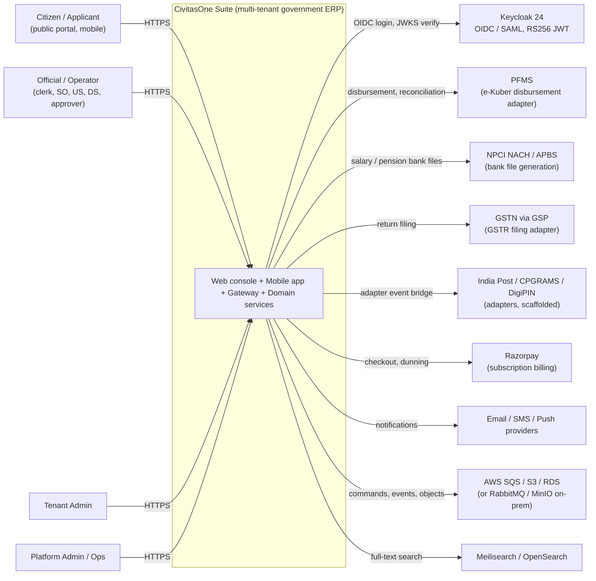
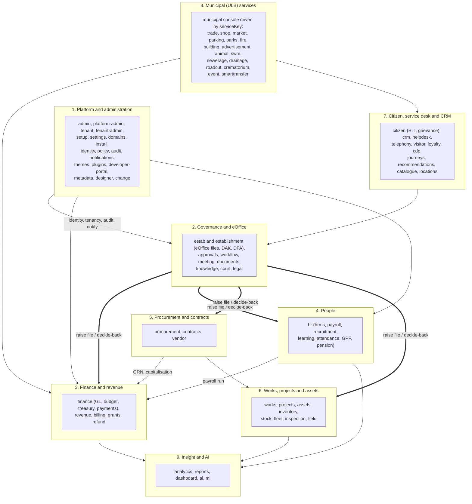
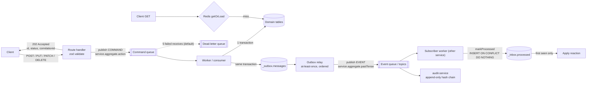
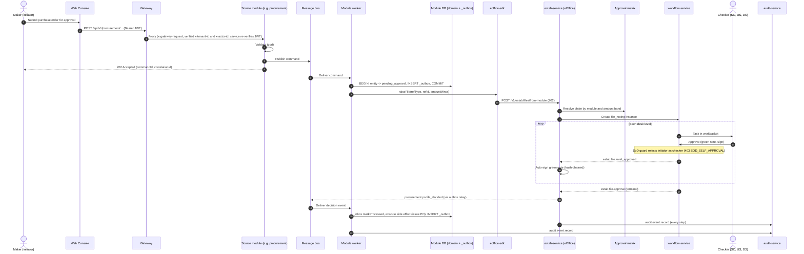
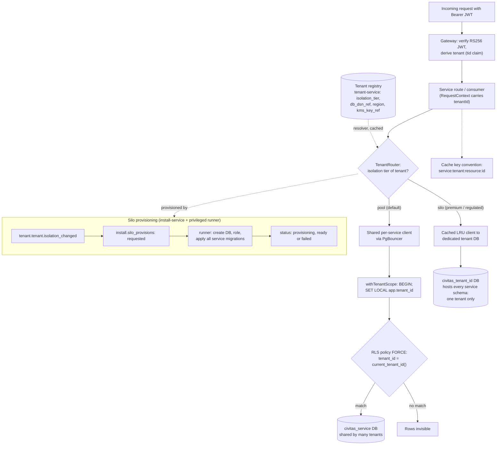

# CivitasOne Suite — High-Level Design (HLD)

| Item | Value |
|---|---|
| Document | High-Level Design |
| System | CivitasOne Suite — multi-tenant ERP for Indian Government, PSU and urban local bodies (ULBs) |
| Baseline build | `0a5843762` (repository `civitasone-suite`, branch state at 2026-11-21) |
| Status | Submission draft, derived from repository documents and code (read-only synthesis) |
| Companion | `SAD.md` (Solution Architecture Document) |

> **Evidence convention.** Every statement is traced to a repository source: `[ARCH]` docs/ARCHITECTURE.md, `[ERP-HLA]` docs/architecture/ERP-HIGH-LEVEL-ARCHITECTURE.md, `[PLAT]` docs/PLATFORM-ARCHITECTURE.md, `[MT]` docs/architecture/MULTI-TENANCY.md, `[SVC]` docs/SERVICES.md, `[STD]` docs/STANDARDS.md, `[SCALE]` docs/SCALE-TO-1-LAKH-ANALYSIS.md, `[SEC]` docs/SECURITY.md, `[COMP]` docs/COMPLIANCE.md, `[PERF]` docs/PERFORMANCE.md, `[SELF]` docs/SELF-HOSTING.md, `[DEP]` infra/DEPLOY.md, `[CONN]` docs/architecture/CONNECTION-BUDGET.md, `[CLAUDE]` repository CLAUDE.md, `[CODE]` direct inspection of source at the baseline build. Where the older architecture documents and the code disagree, the code wins and the discrepancy is recorded in section 9.4.

---

## 1. Introduction

### 1.1 Purpose
This HLD describes the logical architecture of CivitasOne Suite: what the system is for, how it is decomposed into modules and services, how those parts exchange data, and which cross-cutting mechanisms (multi-tenancy, security, eventing, observability) apply across them. It is the entry-level architectural reference; deeper design is in the Solution Architecture Document (SAD) and the per-service documents.

### 1.2 Scope
In scope: the web console (Next.js), the mobile app (Flutter), the edge gateway, the domain, platform and supporting services, the data and messaging infrastructure, identity, and deployment targets. Out of scope: low-level table design (see `docs/DATABASE-SCHEMA.md`), per-endpoint contracts (see `docs/api/openapi.yaml`), and UI/UX design.

### 1.3 Audience
Government IT and procurement evaluators, security and compliance reviewers, enterprise and solution architects, and engineering and operations teams.

### 1.4 References
`docs/ARCHITECTURE.md`, `docs/architecture/ERP-HIGH-LEVEL-ARCHITECTURE.md`, `docs/PLATFORM-ARCHITECTURE.md`, `docs/architecture/MULTI-TENANCY.md`, `docs/SERVICES.md`, `docs/STANDARDS.md`, `docs/SECURITY.md`, `docs/COMPLIANCE.md`, `docs/PERFORMANCE.md`, `docs/SELF-HOSTING.md`, `docs/SCALE-TO-1-LAKH-ANALYSIS.md`, `docs/architecture/CONNECTION-BUDGET.md`, `docs/architecture/EOFFICE-VS-NIC-INTEGRATED-DESIGN.md`, `infra/DEPLOY.md`, repository `CLAUDE.md`.

### 1.5 Definitions
| Term | Meaning |
|---|---|
| ULB | Urban local body (municipal corporation, council) |
| eOffice | The platform's integrated file/noting/DAK decision module (`estab-service`), modelled on the Government of India eFile/eOffice procedure (CSMOP) |
| CQRS | Command Query Responsibility Segregation: writes go through a command queue, reads are served cache-first |
| Outbox / Inbox | Per-database tables guaranteeing atomic event publication and idempotent consumption |
| Pool / Silo | Tenancy tiers: shared database with Row-Level Security, or dedicated database per tenant |
| Paise | Minor currency unit; all money is stored as `bigint` paise |
| SoD | Segregation of duties (maker is never checker) |

---

## 2. Business context and goals

### 2.1 Product context
CivitasOne Suite is a unified enterprise suite for Government departments, PSUs, Section-8 companies, cooperatives and small offices `[ARCH §header][CLAUDE §1]`. It is a greenfield build with no legacy carry-over. Editions (Small Office, PSU, Govt Department) are delivered through theme and entitlements at install time, not code forks `[CLAUDE §1]`; the packages `module-licence`, `tenant-profile` and `feature-flags` provide the supporting mechanisms `[CODE: packages/*]`.

### 2.2 Business goals
| ID | Goal | Source |
|---|---|---|
| BG-1 | One platform covering finance, HR/payroll, procurement, works, assets, citizen services, legal and eOffice for a department or ULB | `[SVC][ERP-HLA]` |
| BG-2 | Make eOffice the decision backbone: every financial/HR/procurement decision is raised as a file, routed by an approval matrix, and the decision executes automatically in the originating module | `[ERP-HLA §3]` |
| BG-3 | Comply with the Indian regulatory stack (DPDP Act 2023, CERT-In directions, GFR 2017, CSMOP, IT Act §65B, RBI/PFMS norms) | `[COMP]` |
| BG-4 | Serve many organisations as multi-tenant SaaS while allowing physical isolation (silo) for regulated tenants and on-premises self-hosting for data residency | `[MT][COMP §2]` |
| BG-5 | Offer a ULB citizen-service surface (municipal services, grievances, RTI) | `[CODE: apps/web municipal module; services trade/shop/market/parking/...]` |

### 2.3 Primary capabilities (as built)
Finance (GL, budget, treasury, payments), payroll and HRMS (employee, leave, GPF, pension, recruitment), procurement and contracts, works and projects, assets and inventory, grants, legal and court, citizen (RTI, grievances), CRM/helpdesk/telephony, meetings, analytics and reporting, and a platform layer (identity, tenant, policy, audit, notification, workflow, billing, plugins, themes) `[SVC][CODE]`.

---

## 3. Non-functional requirements

Targets below are quoted from repository documents; where a target is only a design intent, this is stated.

| ID | Category | Requirement | Source / status |
|---|---|---|---|
| NFR-1 | Scale (tenants) | The scale analysis targets **100,000+ tenants ("1 lakh deployments")**. Current assessed readiness is ~1,000 tenants (hyperscale score 4.2/10). The "1 lakh" figure counts tenant deployments, not end users. | `[SCALE]` — design target, not delivered |
| NFR-2 | Throughput | ~1,000 TPS sustained platform goal; 10M users referenced in standards | `[PERF §1][STD §6]` — target |
| NFR-3 | Latency | p95 GET < 500 ms, p95 POST < 1000 ms at the gateway; write-ack < 500 ms and read < 200 ms are the stricter engineering-standard gates | `[PERF §1][STD §6]` |
| NFR-4 | Error rate | < 1% | `[PERF §1]` |
| NFR-5 | Availability | No numeric availability percentage (e.g. 99.9%) is stated in the source documents. Resilience is by independent service deployment, HPA scaling, retry/DLQ, and DR targets RPO ≤ 15 min and RTO ≤ 4 h | `[SELF §4]`; **gap: no uptime SLA defined** |
| NFR-6 | Tenant isolation | Logical (RLS, FORCE) in Pool tier; physical (dedicated DB) in Silo tier | `[MT]` |
| NFR-7 | Security | OIDC RS256 at edge, AES-256-GCM PII field encryption, TLS in transit, secrets from a secret manager and fail-closed in non-development environments | `[SEC][COMP][CODE: ecosystem.config.js]` |
| NFR-8 | Auditability | Every mutation emits an audit event; audit trail is append-only and SHA-256 hash-chained | `[CLAUDE §3][COMP §1]` |
| NFR-9 | Data protection | DPDP Act 2023: consent, erasure/correction, residency (self-hosting), breach detectability | `[COMP §2]` |
| NFR-10 | Accessibility | WCAG 2.2 AA on changed UI; GIGW 3.0 self-assessment checklist maintained (formal STQC audit still required) | `[STD §3.4][docs/GIGW-COMPLIANCE-CHECKLIST.md]` |
| NFR-11 | Money correctness | `bigint` paise only; no floating point for currency | `[ARCH][STD §8]` |
| NFR-12 | Retention / logs | CERT-In: security logs retained at least 180 days, NTP time-sync, 6-hour incident reporting | `[SEC §6][COMP §3]` |
| NFR-13 | Operability | Every service exposes `/health`, `/ready`, `/metrics`; structured JSON logs; Prometheus alerting | `[CLAUDE §3.5][DEP][CODE: infra/observability]` |
| NFR-14 | Testability | Coverage ≥ 80% on changed code; contract tests for cross-service calls | `[STD §5]` |

---

## 4. System context

*Figure: system-context (source: `diagrams/system-context.mmd`)*

### 4.1 Actors
| Actor | Interaction | Channel |
|---|---|---|
| Citizen / applicant | Municipal service requests, RTI, grievances, public careers pages | Web public routes (`/careers`, municipal portal), mobile `[PLAT][CODE]` |
| Official / operator | Day-to-day ERP work, file noting, approvals | Web console `[ARCH]` |
| Tenant administrator | Organisation, roles, module configuration, policies | Web console (tenant-admin) `[SEC §3]` |
| Platform administrator / ops | Tenant lifecycle, isolation tier, platform operations | Web console (platform-admin), ops endpoints `[MT §4][CODE]` |

### 4.2 External systems
| System | Role | Status in source |
|---|---|---|
| Keycloak 24 | OIDC/SAML identity provider, RS256 JWT, realm `civitasone` | Built `[ARCH][PLAT]` |
| PFMS (e-Kuber) | Disbursement initiation and reconciliation via `gov-adapters` | Adapter exists; **default `PFMS_MODE=mock`**, sandbox/production env-gated, fail-closed `[CODE: packages/gov-adapters/src/pfms.ts]` |
| NPCI NACH / APBS | Fixed-width bank file generation for bulk salary/pension | Adapter exists; mock by default `[CODE: nach.ts]` |
| GSTN via GSP | GSTR-1 / 3B filing | Adapter exists; mock by default `[CODE: gstn.ts]` |
| India Post, CPGRAMS, DigiPIN, DREAM, Dak Karmayogi | Event-bus bridge adapters | `apt-adapter` scaffolded, others **placeholders** `[CODE: services/adapters/india-post/README.md]` |
| Razorpay | Subscription and checkout payment | Integrated in billing `[PLAT]` |
| Email / SMS / push providers | Outbound notifications via notification-service | `[ARCH][SVC]` |
| AWS SQS / S3 / RDS or RabbitMQ / MinIO | Message transport, object storage | Driver chosen by `QUEUE_DRIVER`; adapter pattern `[ARCH §12][CLAUDE §2]` |
| Meilisearch / OpenSearch | Full-text search via `@civitasone/search`, PostgreSQL ILIKE fallback | `[ARCH]` |

> **NIC eOffice.** CivitasOne does not integrate with the NIC eOffice/eFile product as an external system. NIC eFile (Ver 7.0) was studied as a functional reference, and CivitasOne implements its own integrated eOffice (`estab-service`) covering DAK diarisation, files and noting, DFA drafts, dispatch and migration of paper files `[docs/architecture/EOFFICE-VS-NIC-INTEGRATED-DESIGN.md][CODE: services/estab-service]`. Interoperability with NIC eOffice is not evidenced in the source.

---

## 5. Logical architecture and module decomposition

### 5.1 Layering
1. **Presentation:** Next.js 15.5 web console (App Router, React 18, Tailwind, `@civitasone/ui-kit`) and Flutter mobile app (offline-first) `[PLAT][CLAUDE §2]`.
2. **Edge:** `gateway-service` (:8080) — JWT verification, module guard (403 for disabled modules), prefix-to-upstream routing, public-prefix bypass, API-key auth, quota, header stripping `[PLAT][CODE: services/gateway-service/src]`.
3. **Services:** Fastify 4 / Node 20 (container runtime; `engines` and CI use Node 22) / TypeScript services, each a bounded context with its own database and an asynchronous worker `[SVC][ARCH]`.
4. **Data and messaging:** PostgreSQL 16 (database-per-service), Redis 7, message bus (SQS or RabbitMQ), S3/MinIO, Meilisearch/OpenSearch.

### 5.2 Fleet size (counts re-derived from the repo at 0a5843762; CONNECTION-BUDGET figures are dated 2026-09-08 measurements)
| Measure | Value | Source |
|---|---|---|
| Service directories under `services/` | 68 (66 DB-backed services incl. gateway, + `queue-service` which has no DB, + `adapters/` which is a container directory for india-post, not a service) | `[CODE]` |
| Distinct DB-backed services (one database each) | 66 (~66 databases; the gateway has its own `civitas_gateway`) | `[CODE]` (supersedes the 65 in `[CONN §2]`, 2026-09-08) |
| PM2 processes (`ecosystem.config.js`) | 134 = 66 HTTP services + 66 workers + queue + web; 132 of them carry a `DATABASE_URL` | `[CODE: ecosystem.config.js]` (supersedes the 132-total in `[CONN §2]`) |
| Gateway route-table entries | ~100 prefixes | `[CODE: gateway-service/src/registry.ts]` |
| Web route groups under `(app)` | 61 | `[CODE: apps/web/src/app/(app)]` |
| Shared packages under `packages/` | 33 | `[CODE]` |

The older architecture documents describe 33 services and 32 databases `[ARCH][SVC][PLAT]`; the fleet has since grown (section 9.4).

### 5.3 Module groups
The 61 web route groups and the service fleet are grouped into nine domains. Group membership is derived from the web route names and the service directory names; the function of the newer ULB services is inferred from their names (see section 9.4).

*Figure: module-decomposition (source: `diagrams/module-decomposition.mmd`)*

| # | Domain | Web modules | Backing services (examples) |
|---|---|---|---|
| 1 | Platform and administration | admin, platform-admin, tenant, tenant-admin, setup, settings, domains, install, identity, policy, audit, notifications, themes, plugins, developer-portal, metadata, designer, change, help, library | identity, tenant, policy, audit, install, admin, notification, plugin, theme, metadata, billing |
| 2 | Governance and eOffice | estab, establishment, approvals, workflow, meeting, documents, knowledge, court, legal | estab, workflow, meeting, document, knowledge, court, legal |
| 3 | Finance and revenue | finance, billing, revenue, grants | finance, billing, revenue, grant, refund |
| 4 | People | hr, learning | hrms, payroll |
| 5 | Procurement and contracts | procurement, contracts | procurement, contract, vendor |
| 6 | Works, projects and assets | works, projects, assets, inventory, stock, fleet, inspection, field | works, project, asset, inventory, stock, inspection, field |
| 7 | Citizen, service desk and CRM | citizen, crm, helpdesk, telephony, visitor, loyalty, cdp, journeys, recommendations, catalogue, locations | citizen, crm, helpdesk, telephony, visitor, loyalty, cdp, journey, recommendation, catalogue, location |
| 8 | Municipal (ULB) services | municipal (single route group driven by a `serviceKey`) | trade, shop, market, parking, parks, fire, building, advertisement, animal, swm, sewerage, drainage, roadcut, crematorium, event, smarttransfer |
| 9 | Insight and AI | analytics, reports, dashboard, ai | analytics, report, ml, ai-agent |

Service tiers used by the legacy catalogue (Core ERP, Domain, Supporting, Platform) remain valid for the original 33 services `[SVC §2]`.

### 5.4 Intra-service structure
Each service follows one layout `[SVC §1]`: `routes.ts` (zod validation, publishes commands), `commands.ts`, `consumer.ts` (transactional handlers), `repo.ts`, `schema.ts` (Drizzle), `shared/topics.ts` (`COMMANDS` and `EVENTS` contracts). Larger services are split into modules under `src/modules/{module}/`, each owning its own PostgreSQL schema, with cross-module joins forbidden and checked in CI `[CLAUDE §3.4]`.

---

## 6. Key end-to-end data flows

### 6.1 Command / event flow (CQRS with transactional outbox)
All writes follow one path `[ARCH §4][STD §2]`:
1. Route validates the body with zod and publishes a **command** (`{service}.{aggregate}.{action}`), returning **202 Accepted** with `{id, status, correlationId}`.
2. A worker consumes the command; in **one DB transaction** it writes the domain tables and inserts an `_outbox` row.
3. The **outbox relay** publishes **events** (`{service}.{aggregate}.{pastTense}`), at-least-once and in insertion order.
4. Subscribers record the message in `_inbox` (`INSERT ... ON CONFLICT DO NOTHING`) before reacting, giving an exactly-once effect.
5. Reads are served cache-first through Redis `getOrLoad` (key `{service}:{tenant}:{resource}:{id}`, TTL clamped to 1 s–1 h).

*Figure: cqrs-outbox (source: `diagrams/cqrs-outbox.mmd`)*

### 6.2 eOffice noting spine and maker-checker
eOffice (`estab-service`) is the approval control point between an ERP intent and its execution `[ERP-HLA §3]`.
1. The source module (finance, procurement, hrms, grant, asset, legal, contract) moves the entity to `pending_approval` and calls `eoffice-sdk.raiseFile(...)` → `POST /v1/estab/files/from-module` (202 Accepted). Estab accepts it asynchronously; the raise is also expressible as the `estab.file.from_module` topic consumed by estab (`linkage/consumer.ts`). The decision returns on the module callback topic.
2. estab resolves an approval chain from an **approval matrix** keyed by module and amount band, and creates a `file_noting` instance in workflow-service (Section Officer → Under Secretary → Deputy Secretary).
3. Each level approval emits `estab.file.level_approved`; estab auto-signs a green note, **hash-chained**.
4. On the terminal approval estab emits `{module}.{entity}.file_decided`; the module consumes it (`parseDecisionCallback` / `onDecision`) and executes the side effect (issue PO, release payment, effect transfer, dispose asset, …).
5. Every step is audited. **Segregation of duties** is enforced: for procurement indent/PO/plan/PO-amendment, payroll run and meeting decision the initiator can never complete the checker task (403 `SOD_SELF_APPROVAL`; super_admin break-glass does not override) `[CODE: workflow-service/src/modules/tasks/sod.ts]`. This is the workflow-layer code; domain services (hrms leave, payroll, works, asset, crm, refund) return 403 `SELF_APPROVAL_FORBIDDEN` at their own layer (LLD 4.1).

Eleven decision types are wired end to end: finance sanction / payment / reappropriation, procurement PO, HR transfer / promotion / disciplinary, grant disbursement, asset disposal, legal opinion, contract award `[ERP-HLA §3]`.

*Figure: event-flow (source: `diagrams/event-flow.mmd`)*

### 6.3 Representative cross-module event flows
Procurement GRN accepted → finance bill and asset capitalisation; payroll run approved → finance; grant utilisation certificate submitted → finance; tenant created → workflow definitions and HR leave types seeded; every mutation → `audit.event.record` and `notification.send` `[ERP-HLA §4]`. Cross-service **reads** use HTTP; cross-service **writes** use the bus only `[ERP-HLA §2]`.

---

## 7. Technology stack

| Layer | Technology | Source |
|---|---|---|
| Backend | Node 20.20 container runtime (root `engines` and CI: Node 22), Fastify 4.27, TypeScript strict, Drizzle ORM 0.30, zod | `[ARCH §12][CLAUDE §2]` |
| Database | PostgreSQL 16 (database-per-service, RLS); PgBouncer (transaction mode) for pooling | `[ARCH][PERF §2]` |
| Cache / rate-limit | Redis 7 (Sentinel on-prem, ElastiCache on AWS) | `[CLAUDE §2]` |
| Messaging | `@civitasone/queue` adapter over SQS or RabbitMQ (`QUEUE_DRIVER`); LocalStack in development | `[ARCH §12][PLAT]` |
| Object storage | S3 / MinIO via adapter | `[CLAUDE §2]` |
| Search | Meilisearch or OpenSearch via `@civitasone/search` (`SEARCH_ENGINE`) | `[ARCH]` |
| Identity | Keycloak 24, OIDC/SAML, RS256 JWT, JWKS | `[ARCH]` |
| Web | Next.js 15.5 App Router, React 18.3, Tailwind, `@civitasone/ui-kit` | `[ARCH][CLAUDE]` |
| Mobile | Flutter (Riverpod, go_router, Dio), offline-first | `[CLAUDE §2][PLAT]` |
| Monorepo / build | pnpm workspaces, Turborepo | `[CLAUDE §2]` |
| Observability | pino JSON logs, OpenTelemetry trace context, Prometheus `/metrics`, Alertmanager, Grafana, Loki/Promtail | `[STD §7][CODE: infra/observability]` |
| Packaging / deploy | Docker (one parametrised multi-stage Dockerfile), Docker Compose, Helm chart, Terraform (AWS, partial), PM2 (host fleet) | `[DEP][CODE]` |
| Testing | vitest, Pact-style contracts, Playwright, k6 (supertest and testcontainers are named in `docs/STANDARDS.md` only; no package.json depends on them) | `[STD §5]` |

Shared packages (33) include: `auth`, `cache`, `db`, `queue`, `outbox`, `events`, `schemas`, `types`, `observability`, `circuit-breaker`, `eoffice-sdk`, `gov-adapters`, `connector-framework`, `kms`, `data-governance`, `rate-limit`, `module-licence`, `tenant-profile`, `feature-flags`, `numbering`, `reconciliation`, `storage`, `search`, `ocr`, `scanner`, `gst`, `render`, `ui-kit`, `plugin-sdk`, `client-core`, `integration-config`, `scan-link`, `security-headers` `[CODE: packages/]`.

---

## 8. Cross-cutting concerns

### 8.1 Multi-tenancy (tiered Pool + Silo)
- **Pool (default):** tenants share each service's database; every tenant-scoped table carries `tenant_id` and RLS with `FORCE ROW LEVEL SECURITY`; each request/consumer runs in a transaction that issues `SET LOCAL app.tenant_id`, and policies compare against `current_tenant_id()` `[ARCH §7][MT §3]`.
- **Silo (premium / regulated):** the tenant has a dedicated database hosting every service's PostgreSQL schema; same code, different connection target, chosen by `TenantRouter` in `@civitasone/db` `[MT §2]`.
- Tier is data (`tenant.isolation_tier`, `db_dsn_ref`, `region`, `kms_key_ref`), not a code fork; with no silo configured every tenant is Pool `[MT §4]`.
- Silo provisioning is orchestrated by install-service (`install.silo_provisions` state machine) and a privileged runner that applies all service migrations; the service itself holds no `CREATE DATABASE` credentials `[MT §5, §8]`.

*Figure: multi-tenancy (source: `diagrams/multi-tenancy.mmd`)*

**Status (from `[MT §8]`):** router, registry columns, install state machine and provisioning script are built; `estab-service` is the reference rollout; remaining services, Redis-backed resolver, and KMS/BYOK + residency wiring are open.

### 8.2 Security
- **Tenant isolation:** FORCE RLS keyed on the `app.tenant_id` GUC is a defence-in-depth backstop (effective only when the service role is NOBYPASSRLS); the application-layer `WHERE tenant_id` predicate remains the primary control. Not proven by counting migrations. `_outbox.messages` has RLS dropped (migration 0051); 11 BYPASSRLS scanner pools exist for cross-tenant loops. **Gap:** no runtime/startup assertion that service roles are NOBYPASSRLS; `_outbox` and command-result tables are exempt.
- **Edge:** gateway verifies RS256 JWT against JWKS (`iss`, `aud`), strips spoofable internal headers, enforces the module guard and public-prefix list `[ARCH §9][PLAT]`.
- **Service trust:** the gateway strips `x-service-secret`, `x-internal*` and `x-gateway-request` from inbound traffic and does **not** forward a secret on proxied client requests; each service re-verifies the JWT (`packages/auth` `authPlugin`/`verifyJwt`) and derives tenant from the signed `tid` claim (defence in depth). `x-service-secret` governs genuine internal service-to-service calls only, compared in constant time and fail-closed `[CODE: gateway-service/src/app.ts][ARCH §9]`. Secrets are never hard-coded; outside `development`/`test` environments a missing secret aborts configuration build (allow-list posture, SEC-017) `[CODE: ecosystem.config.js]`.
- **Authorisation:** `requireRole()` per route; policy-service for policy evaluation; maker-checker SoD in workflow `[PLAT][CODE]`.
- **Data protection:** AES-256-GCM field encryption for PAN, Aadhaar, bank and MFA TOTP data `[PLAT][COMP §1]`; TLS in transit.
- **Identity features:** MFA, WebAuthn passkeys, SAML, SCIM, device trust, break-glass, API keys exist as identity modules `[CODE: services/identity-service/src/modules]`.
- **Input standards:** zod at every boundary, uniform error envelope, SSRF and file-upload rules `[STD §2–3]`.
- **Assurance:** SAST release gate, secure-SDLC controls `[SEC §5, §8]`.

### 8.3 Eventing
Asynchronous commands and events are the default; synchronous HTTP is limited to reads (internal service-to-service reads carry `x-service-secret`) `[ARCH §10]`. Delivery is at-least-once with `_inbox` deduplication, dead-lettering after `SQS_MAX_RECEIVE_COUNT` receives (default 5; a `NonRetryableError` goes straight to the DLQ), and a per-service worker `[CODE: services/queue-service/src/bus.ts]`. A consumer-driven contract test is required for every cross-service call and event `[STD §5]`.

### 8.4 Audit
Every mutation emits an audit event to audit-service; the audit trail is append-only and SHA-256 hash-chained (supports IT Act §65B integrity arguments) `[COMP §1, §8]`.

### 8.5 Observability
Structured pino logs with `correlationId`, OpenTelemetry context on outbound HTTP and queue publish, Prometheus `/metrics` (guarded by token or internal-IP allowlist), alert rules for DLQ depth, consumer stall, outbox relay failure, p95 latency, per-tenant request rate `[STD §7][CODE: infra/observability/alert.rules.yml]`.

### 8.6 Performance and capacity
Redis read-through cache, PgBouncer transaction pooling (`DB_VIA_PGBOUNCER`, per-process pool max 5), k6 load tests with SLO thresholds `[PERF][CONN]`. Worst-case direct connections (~1,490) far exceed Postgres `max_connections=200`, which is why all processes are routed through PgBouncer `[CONN §1]`.

### 8.7 Conventions
Money `bigint` paise + ISO currency; timestamps `timestamptz` UTC; every entity has `id, tenantId, createdAt, updatedAt, createdBy, updatedBy, version`; cross-domain references by opaque id, never foreign key `[STD §8][CLAUDE §3]`.

---

## 9. Assumptions, constraints and risks

### 9.1 Assumptions
- A-1: Departments deploy either as SaaS tenants (Pool/Silo) or self-hosted on Indian government infrastructure for residency `[COMP §2]`.
- A-2: Keycloak, PostgreSQL, Redis and a message bus are available as managed or in-cluster components `[DEP]`.
- A-3: Gov integrations (PFMS, GSTN, NACH) are exercised in mock mode until credentials and sandbox access are provisioned `[CODE: gov-adapters]`.

### 9.2 Constraints
- C-1: Database per service with its own login and zero cross-database grants; no cross-service SQL `[CLAUDE §3.1–3.3]`.
- C-2: Writes are asynchronous (202); reads cache-first `[STD §2]`.
- C-3: PostgreSQL 16 only; services use `@civitasone/queue`, never SQS SDKs directly `[CLAUDE §2]`.
- C-4: Licence AGPL-3.0 `[ARCH]`.

### 9.3 Risks
| ID | Risk | Evidence | Mitigation in source |
|---|---|---|---|
| R-1 | Scale gap: routing, sharding, quotas, metering, deployment rings, geo-distribution absent for 100K tenants | `[SCALE]` readiness 4.2/10 | Phased roadmap (Phase 1–4); Pool/Silo lets sharding be added without app rewrite |
| R-2 | Silo rollout incomplete beyond `estab-service`; KMS/BYOK and residency wiring open | `[MT §8]` | Phased service-by-service rollout behind flags |
| R-3 | Eventual consistency across services; reconciling views may lag | `[ARCH §11]` | Outbox ordering, inbox idempotency |
| R-4 | Connection exhaustion at fleet size (~130 DB-backed processes; 132 carry a DATABASE_URL, `[CONN]` figures dated 2026-09-08) | `[CONN]` | PgBouncer, pool max 5, derived topology script |
| R-5 | Government adapters in mock mode; real-world rail behaviour unverified | `[CODE]` | Env-gated modes, fail-closed |
| R-6 | Documentation drift: older docs state 33 services; code has 68 directories (66 DB-backed services + queue-service + adapters container) | `[CODE]` vs `[ARCH]` | This HLD uses code-verified figures |
| R-7 | Formal GIGW 3.0 / STQC certification not yet performed (self-assessment only) | `[docs/GIGW-COMPLIANCE-CHECKLIST.md]` | Checklist maps attributes to code |
| R-8 | No stated availability SLA | NFR-5 | DR targets RPO/RTO defined |

### 9.4 Source discrepancies recorded
| Topic | Older documents | Code / newer evidence | Treatment here |
|---|---|---|---|
| Service count | 33 services, 32 databases `[ARCH][SVC][PLAT]` | 68 service directories (66 DB-backed incl. gateway + queue-service + `adapters/` container); ~66 databases; 134 PM2 processes (66 HTTP + 66 workers + queue + web) `[CODE]` (`[CONN]` said 65 / 132) | Code figures used |
| Dead-letter threshold | "3 retries" `[PLAT]` | `SQS_MAX_RECEIVE_COUNT` default 5 (`queue-service/src/bus.ts`) | 5 used |
| Web framework | Next.js 14 / 14.2 `[ARCH][CLAUDE]` | `apps/web/package.json` pins next 15.5.28, React 18.3 | Next.js 15.5 used |
| Shared packages | 31 (earlier draft) | 33 directories under `packages/` | 33 used |
| Node version | Node 20 | Dockerfile Node 20.20.2 (runtime); root `engines` >=22 and CI Node 22 | Both stated |
| RLS caveats | "RLS hides other tenants' rows" | Defence-in-depth backstop: `_outbox.messages` has RLS dropped (migration 0051); 11 BYPASSRLS scanner pools; no runtime assertion that service roles are NOBYPASSRLS (verified in CI/test roles only) | See gap below |
| JWT algorithm | RS256 only `[ARCH]` vs RS256/HS256 `[PLAT]` | `packages/auth` defaults to RS256; HS256 is a test/dev shared-secret fallback only, and HS256 in production is treated as fatal misconfiguration `[CODE: packages/auth/src/index.ts, context.ts]` | RS256 stated as the production standard |
| PgBouncer limits | `max_client_conn` 500 `[PERF]` | `infra/pgbouncer/pgbouncer.ini` shows 1000 | Config file value cited in SAD |
| ULB service functions | Not described in the six source docs | Inferred from service directory and web route names only | Marked inferred |
