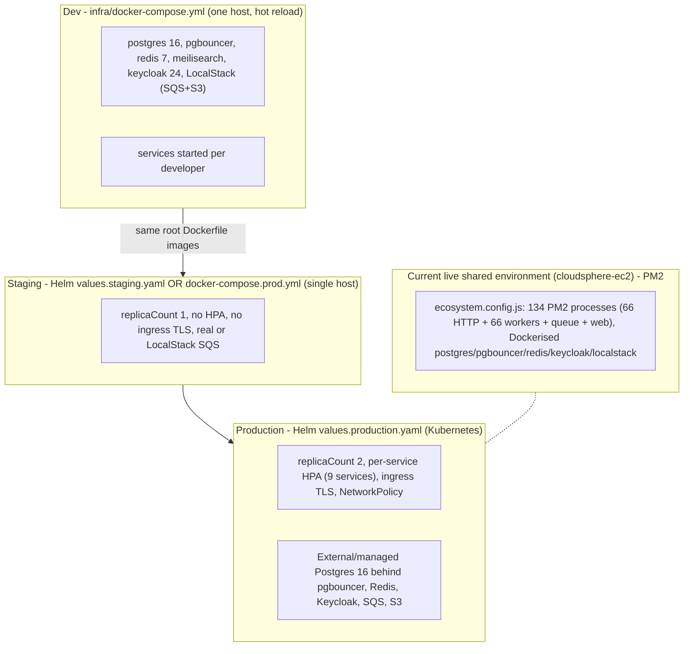
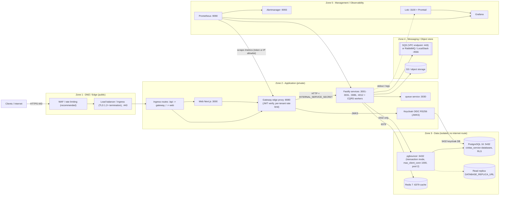
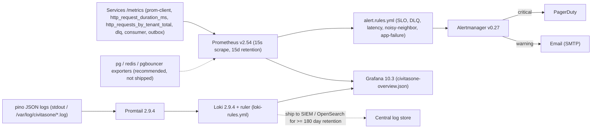

# CivitasOne Suite - Infrastructure and Network Architecture

| | |
|---|---|
| **Document** | Infrastructure and Network Architecture (formal design document) |
| **System** | CivitasOne Suite |
| **Baseline** | `civitasone-suite` @ commit `0a5843762` (UAT build 2026-11-19/20) |
| **Companion** | `CLOUD-ARCH.md` (AWS / cloud architecture) |
| **Status** | Draft for review |

## Evidence legend
| Tag | Meaning |
|---|---|
| **[SHIPPED]** | Runnable code/config exists in the repo (path cited). |
| **[DOCUMENTED]** | Stated in a repo document; no matching artifact, or the artifact differs. |
| **[PATTERN]** | Recommended design in this document; not implemented in the repo. |

Sources: `docs/DEPLOYMENT.md`, `docs/SELF-HOSTING.md`, `docs/SCALE-TO-1-LAKH-ANALYSIS.md`, `docs/architecture/CONNECTION-BUDGET.md`, `docs/operations/SLO-SLI-RUNBOOKS.md`, `docs/COMPLIANCE.md`, `infra/**`, `ecosystem.config.js`, `.github/workflows/**`, `scripts/ops/**`.

---

## 1. Introduction

### 1.1 Purpose and scope
This document specifies how CivitasOne is deployed and connected on infrastructure the operator controls: dev/staging/production topologies, network zones and firewall rules, connection pooling, hardware sizing, TLS/PKI and DNS, load balancing, observability, backup and log retention, upgrade procedures, and a comparison of on-premises and cloud deployments. It is aimed at State Data Centre / NIC / PSU IT teams and platform engineers.

### 1.2 Platform footprint
| Component | Detail |
|---|---|
| Services | Fastify microservices; documents state 33 (ports 3001-3031, 3086, 4012), plus `gateway :8080`, `web :3000` (Next.js 15.5). The live `ecosystem.config.js` defines 67 services (66 DB-backed + queue-service) / 134 PM2 processes (66 HTTP + 66 workers + queue + web) over ~66 databases. |
| Data | PostgreSQL 16 (one DB per service, `civitas_<service>`), PgBouncer 1.21 `:6432`, Redis 7, Meilisearch / OpenSearch |
| Identity | Keycloak (24 in dev, 25.0 in `docker-compose.prod.yml`), RS256 JWTs, JWKS verification |
| Messaging | `@civitasone/queue` library (SQS, RabbitMQ or memory), `queue` service `:3030` |
| Object storage | S3 / S3-compatible (LocalStack in dev) |
| Runtime | Docker images from one root `Dockerfile`; Helm chart; compose; PM2 on the shared EC2 host |

### 1.3 Honest status
Shipped: Dockerfile, compose (dev, prod single-host, e2e, observability), Helm chart, PgBouncer config, Postgres tuning, Prometheus/Alertmanager/Loki/Promtail/Grafana config, backup and restore-drill scripts, CI/CD workflows. **Not shipped:** Ansible playbooks (`DEPLOYMENT.md` §5 says so explicitly), any VLAN/firewall/hardware-level configuration (the network design below is a pattern derived from `SELF-HOSTING.md` §2), cert-manager/PKI automation, a Keycloak or Postgres/Redis Helm template, and exporters for Postgres/Redis/PgBouncer. Terraform covers only SQS, SNS alerts and an RDS replica.

---

## 2. Deployment Topology

| Aspect | Dev | Staging | Production | Live shared env (today) |
|---|---|---|---|---|
| Artifact | `infra/docker-compose.yml` [SHIPPED] | `values.staging.yaml` or `infra/docker-compose.prod.yml` [SHIPPED] | `values.production.yaml` Helm on Kubernetes [SHIPPED] | `ecosystem.config.js` PM2 + Docker infra [SHIPPED] |
| Replicas | 1 | `replicaCount: 1`, HPA off, PDB off | `replicaCount: 2`, per-service HPA (9 services) | 1 per process |
| Postgres | `postgres:16-alpine` container | Managed or hardened single node via pgbouncer | Primary + replicas (managed/RDS or DC-hosted), pgbouncer | Docker `civitasone-postgres` (host port 5435), pgbouncer 6432 |
| Queue | LocalStack SQS (`AWS_ENDPOINT_URL=http://localstack:4566`) | Real SQS (leave `AWS_ENDPOINT_URL` unset) | SQS, or RabbitMQ on-prem | LocalStack |
| TLS | none | `ingress.tls.enabled: false` | `ingress.tls.enabled: true`, secret `civitasone-tls` | none (internal) |
| Secrets | `.env` | `infra/.env` (git-ignored) / K8s Secret | K8s Secret `civitasone-secrets` | env in ecosystem |
| Search | Meilisearch v1.11.3 | same | Meilisearch/OpenSearch (flag only in chart) | - |

### 2.1 Kubernetes release contents [SHIPPED, verified with `helm template`]
Production overlay renders 68 Deployments (33 service entries incl. queue + 32 workers + gateway + web + pgbouncer; queue and gateway have no worker), 36 Services, 9 HPAs, 1 NetworkPolicy, 1 ConfigMap, 1 ServiceAccount, 0 PDBs and **0 Ingress by default** (`ingress.enabled` defaults false; production values set only host+tls; `--set ingress.enabled=true` yields 1). No PodDisruptionBudget renders (template/value key mismatch - see `CLOUD-ARCH.md` §3.2).

### 2.2 Startup order (compose / bring-up) [SHIPPED]
1. postgres, redis, LocalStack/SQS, pgbouncer, keycloak (health-gated by `depends_on: service_healthy`).
2. `pnpm run db:bootstrap` (creates `civitas_<service>` DBs, roles, RLS prerequisites; SQL under `infra/db/bootstrap/`, Kubernetes: run as a Job/initContainer).
3. `pnpm -r run db:migrate` (Drizzle, expand phase).
4. services and workers, then gateway, then web.

### 2.3 Fleet-count caveat
Documents and chart: 33 services. `CONNECTION-BUDGET.md` (2026-09-08/22): 132 PM2 processes, 65 services (code now: 134 / 67), but only 60 databases / 58 roles bootstrapped at 2026-09-22 (8 services without a DB, 3 with credential mismatches). All sizing in §4 and the pooling in §3.4 should be re-derived from `scripts/ops/lib/fleet-topology.mjs` before final procurement.

---

## 3. Network Architecture

### 3.1 Security zones

| Zone | Contents | Reachable from | Egress |
|---|---|---|---|
| 1. DMZ / Edge | Load balancer, TLS termination, optional WAF | Client networks on 443 only | to Zone 2 (ingress/gateway) |
| 2. Application (private) | Ingress controller, gateway `:8080`, web `:3000`, services `:3001-3031/:3086/:4012`, workers, queue `:3030`, Keycloak | Zone 1 (gateway/web only) | Zones 3 and 4; Keycloak JWKS |
| 3. Data (isolated) | pgbouncer `:6432`, PostgreSQL `:5432`, read replica, Redis `:6379` | Zone 2 only | **none to internet**; WAL/backup target in Zone 4 |
| 4. Messaging / object store | SQS (VPC endpoint) or RabbitMQ / S3-compatible store | Zone 2 | SQS/S3 endpoints only |
| 5. Management / observability | Prometheus, Alertmanager, Grafana, Loki/Promtail, bastion | Admin VPN / jump host | scrape Zone 2 `/metrics` |

Principles from `SELF-HOSTING.md` §2: only the gateway (and web via ingress) is reachable from client networks; east-west calls are authenticated with `INTERNAL_SERVICE_SECRET`; data-zone hosts have no route to the internet except the SQS endpoint (none at all in air-gapped sites using RabbitMQ).

### 3.2 Minimum firewall matrix [DOCUMENTED, SELF-HOSTING §2]
| From | To | Port | Purpose |
|---|---|---|---|
| Clients | Load balancer | 443 | only public ingress |
| LB | Gateway / web | 8080 / 3000 | edge proxy, web |
| Gateway | Services | 3001-3031, 3086, 4012 | east-west, secret-authenticated |
| Services | pgbouncer | 6432 | **no direct Postgres from app zone** |
| pgbouncer | PostgreSQL | 5432 | pooled backend connections |
| Services | Redis | 6379 | cache |
| Services | SQS / broker | 443 / 4566 / 5672 | AWS endpoint, LocalStack, RabbitMQ |
| Gateway, services | Keycloak | 8443 (8080 in-cluster) | OIDC discovery + JWKS |
| Prometheus | all `/metrics` | service ports (+ `/api/metrics` on web) | token or internal-IP allowlist |
| Promtail | Loki | 3100 | log push |
| Admin VPN | Grafana, Prometheus, Alertmanager | 3001*, 9090, 9093 | *Grafana published on host 3001 in the observability compose; collides with identity `:3001` if co-located |

### 3.3 In-cluster policy [SHIPPED, coarse]
`templates/networkpolicy.yaml` (one policy per release): pod selector = release selector labels; ingress from pods with the same labels and from namespace `ingress-nginx`; egress to same-label pods, DNS 53/TCP+UDP, and to `0.0.0.0/0` excluding `169.254.0.0/16`, `172.16.0.0/12`, `10.0.0.0/8`. Consequences: (1) it does **not** implement the per-service "only its DB/Redis/SQS" policy that `DEPLOYMENT.md` §3 describes; (2) external Postgres/Redis in RFC1918 space is blocked unless an additional egress rule is added; (3) enable a CNI that enforces NetworkPolicy (Calico/Cilium). `infra/onprem/k8s/base/` contains only an HPA manifest.

### 3.4 Connection pooling (PgBouncer) [SHIPPED]
Per `docs/architecture/CONNECTION-BUDGET.md` (PERF-001):

| Item | Value |
|---|---|
| Position | all services -> `pgbouncer:6432` (`DB_HOST`, `DB_VIA_PGBOUNCER=true`) -> Postgres `:5432` |
| Pool mode | **transaction** (session mode would not reduce connections) |
| Routing | wildcard `* = host=... port=5432` (single-database entries break per-service DBs) |
| Auth | `auth_type=scram-sha-256`, `auth_user=civitas_admin`, `auth_query = SELECT rolname, rolpassword FROM pg_authid WHERE rolname=$1`; one bootstrap credential in `userlist.txt` (not in git); client and server side authenticate as the same real role (`auth_type=trust` fails against `pg_hba scram-sha-256`) |
| Reset | `server_reset_query = DISCARD ALL`, `server_reset_query_always = 1` (without it, session state leaks across clients in transaction mode) |
| Sizing | `max_client_conn=1000`, `default_pool_size=2`, `min_pool_size=1`, `reserve_pool_size=1` |
| Client pool | `DB_POOL_MAX=5` per process; `prepare:false` |
| Budget math | 130 DB processes + <= 19 scanner pools, x5 = 745 <= 1000; 84 pools x 2 = 168 <= `max_connections 200` (32 headroom) |
| Postgres | `max_connections=200`, `shared_buffers 256MB`, `effective_cache_size 768MB`, `random_page_cost 1.1`, `effective_io_concurrency 200`, `log_min_duration_statement 200`, `pg_stat_statements` preloaded (`infra/postgres/postgresql.conf`; these are dev-box values, scale per §4) |
| Tenant safety | RLS GUC set with `set_config('app.tenant_id', $1, true)` as the first statement in a transaction; advisory locks are `pg_advisory_xact_lock` only; no LISTEN/NOTIFY or temp tables |
| Verification | `tests/security/connection-budget.test.ts`, `tests/integration/perf-001-pgbouncer-pooling.test.ts`, `scripts/ops/verify-pgbouncer-routing.mjs`, `scripts/ops/redeploy-pgbouncer.sh` |

**Known drift and risks:**
- `SELF-HOSTING.md` §1 and `docker-compose.prod.yml` still say `max_client_conn=500`, `default_pool_size=20` (and prod compose `AUTH_TYPE: md5`); the authoritative values are 1000 / 2 / scram. At pool size 20 the backend budget (84 x 20 = 1,680) would blow `max_connections=200`. Align before any deployment from the prod compose file.
- As of 2026-09-22 the shared `civitasone-pgbouncer` container was still on the pre-fix config (`trust`, single-DB) - fix merged but not redeployed; processes were connecting directly to Postgres (`CONNECTION-BUDGET.md` §9).
- 8 of 19 scanner (BYPASSRLS) DSNs are not distinct; reserve pool could briefly exceed `max_connections`; alert on `pg_stat_activity` near 180.
- pgbouncer is a single replica in the Helm chart and a single container in compose (SPOF) [PATTERN: run 2+ behind a Service].
- The Helm chart uses one shared `civitasone` DB role; the compose/PM2 path uses per-service roles (different auth model).

### 3.5 Egress
Services need outbound access to: SQS/S3 endpoints (or RabbitMQ), SMTP/SMS providers (notification), PFMS and other government integrations (payroll), eSign, Razorpay (billing), and Keycloak. Use an egress proxy / allow-list; data zone has none. Kubernetes NetworkPolicy blocks private ranges but allows any public egress - tighten to an allow-list in production [PATTERN].

---

## 4. Hardware Sizing (`SELF-HOSTING.md` §1) [DOCUMENTED]

Targets: ~1,000 TPS at the Large tier; p95 < 500 ms (GET) / 1000 ms (POST); PostgreSQL always behind pgbouncer, Redis as read-through cache.

| Tier | Users | App nodes | Per app node | PostgreSQL | Redis | Queue | Shared storage |
|---|---|---|---|---|---|---|---|
| Small | <= 5,000 | 2 (HA pair) | 8 vCPU / 16 GB | 1 x 8 vCPU / 32 GB / 500 GB SSD | 1 x 4 GB | managed SQS or single-node broker | 500 GB - 1 TB |
| Medium | <= 50,000 | 4-6 | 8 vCPU / 32 GB | primary + 1 replica, 16 vCPU / 64 GB / 2 TB NVMe | 2 x 8 GB (HA) | managed SQS / DLQ | 2-4 TB |
| Large | <= 1,000,000 | 10+ autoscaled | 16 vCPU / 64 GB | primary + 2 replicas, 32 vCPU / 128 GB / 4 TB+ NVMe | cluster 3 x 16 GB | SQS + DLQ + redrive | 8 TB+ tiered |

Sizing rules: database is the bottleneck - fastest NVMe and most RAM to Postgres, add replicas before app nodes; Redis sized for the hot working set (TTL 1 s - 1 h); +20% headroom for month-end/payroll peaks; Postgres `max_connections` sized from pgbouncer pools, not pod count.

Additional nodes (not in the SELF-HOSTING table) [PATTERN]:
| Role | Suggested | Basis |
|---|---|---|
| Keycloak | 2 x 4 vCPU / 8 GB | HA, RS256 local verification means low runtime load |
| Observability | 1 x 4 vCPU / 16 GB / 500 GB | Prometheus 15 d TSDB, Loki, Grafana |
| Bastion / jump | 1 small | admin access |
| Backup target | >= 2x DB size + WAL retention | 7 days dumps + PITR window |
| Per-pod defaults | request 100m CPU / 192 Mi, limit 500m / 512 Mi (production overlay: 250m/256Mi to 1000m/1Gi) | `values*.yaml` |

Pod count driver: ~68 pods in the chart baseline (33 service entries incl. queue + 32 workers + gateway + web + pgbouncer = 68 Deployments) with default replicas 1-2 and HPA to 6-8 for 9 services; fits Small tier on 2 nodes only with the lower resource requests.

Note: the live fleet (67 services / 134 processes) needs roughly double the pod/connection budget; the shared EC2 host has previously hit memory exhaustion under concurrent load, so size RAM before disk.

---

## 5. TLS/PKI and DNS

### 5.1 TLS policy [DOCUMENTED]
- Terminate TLS at the edge (load balancer or ingress). Client to edge: TLS 1.2+, prefer 1.3.
- Public certificates from a government CA (e.g. NICCA); ACM on AWS.
- Keycloak served over HTTPS; OIDC discovery and JWKS URLs `https://`. Tokens are **RS256**; services fetch public keys from `JWKS_URI` and verify locally.
- Internal mTLS or service mesh **recommended** for Medium/Large in addition to `INTERNAL_SERVICE_SECRET`.
- Postgres/Redis/RabbitMQ in transit: enable TLS in the data zone [PATTERN].

### 5.2 What the repo provides
| Item | State |
|---|---|
| Ingress TLS secret reference (`ingress.tls.secretName`, production `civitasone-tls`) | [SHIPPED] |
| Certificate issuance/renewal (cert-manager, ACME is not available on `.gov.in` air-gapped; CSR via NICCA) | [PATTERN] |
| mTLS / mesh | [PATTERN] |
| Keycloak HTTPS config | prod compose runs `--http-enabled=true --hostname-strict=false`: **must be fronted by TLS proxy and hardened for production** |

### 5.3 Key and secret material
Rotate `PII_ENC_KEY`, `MFA_ENC_KEY`, `INTERNAL_SERVICE_SECRET`, `METRICS_TOKEN`, `DEVICE_TRUST_SECRET` on a fixed schedule; store in HSM-backed secrets manager / Ansible Vault; never in config. Prometheus token supplied through `credentials_file` (`/etc/prometheus/secrets/metrics_token`).

### 5.4 DNS [PATTERN, with shipped hostnames]
| Name | Target |
|---|---|
| `civitasone.<dept>.gov.in` | load balancer VIP (`ingress.host`; routes `/api` -> gateway, `/` -> web) |
| `civitasone-staging.<dept>.gov.in` | staging ingress |
| `keycloak.<dept>.gov.in` | Keycloak (issuer must match `KEYCLOAK_URL` / JWKS) |
| Internal | cluster DNS: `civitasone-gateway:8080`, `civitasone-pgbouncer:6432`, `civitasone-redis:6379`, `civitasone-keycloak:8080` |
Multi-region geo-DNS and residency routing are roadmap (`SCALE-TO-1-LAKH-ANALYSIS.md` gap 5).

---

## 6. Load Balancing and the API Gateway

### 6.1 Path [SHIPPED]
Client -> external LB (L4/L7, TLS) -> ingress (`nginx`, host `ingress.host`) -> `/api` -> **gateway Service `:8080`** (2..8 replicas, HPA 65%) and `/` -> **web `:3000`** (2 replicas). Gateway then proxies to `UPSTREAM_*` service URLs (ClusterIP Services).

### 6.2 Gateway responsibilities
- JWT verification (RS256, JWKS from Keycloak); API-key auth (`api-key-auth.ts`).
- Rate limiting via `@fastify/rate-limit`, with a per-tenant tier keyed only from a verified tenant (SEC-008).
- CORS (`CORS_ORIGIN`), request proxying with `INTERNAL_SERVICE_SECRET` on east-west hops, `/ready` reporting upstream readiness (identity, finance, queue).
- It is Tier 0: SLO 99.95%, proxy overhead p95 < 50 ms.

### 6.3 Balancing and health
| Layer | Mechanism |
|---|---|
| External | LB health check on `/health`; TLS offload; idle timeout above gateway keep-alive |
| Service discovery | Kubernetes Service (round-robin across ready endpoints) |
| Readiness gating | `/ready` 503 on DB/Redis/SQS failure removes the pod from Endpoints |
| Graceful drain | PM2 `graceful: true` workers (PERF-003); `terminationGracePeriodSeconds`/preStop not set in chart [PATTERN] |
| Autoscale | HPA on CPU (see `CLOUD-ARCH.md` §8) |
| pgbouncer | transaction multiplexing; add replicas behind a Service for HA [PATTERN] |

### 6.4 Gaps
No WAF, no L7 canary/blue-green routing, no sticky-session need (stateless), global load balancing absent.

---

## 7. Observability Stack

### 7.1 Metrics and dashboards [SHIPPED: `infra/observability/`]
| Component | Version / detail |
|---|---|
| Prometheus | v2.54.1, scrape 15 s, retention **15 d**; jobs: gateway, core (3001-3006), finance (3007-3009), estab (3010-3015), reporting, gov, admin, CRM/ops, intelligence, infra (queue 3030, analytics 3031, location 4012) and `civitasone-web` (`/api/metrics`, bearer token) |
| Targets limitation | static list of **33 service ports on `host.docker.internal`**; the 67-service fleet and K8s pods need service discovery (`kubernetes_sd_configs`) [PATTERN] |
| `/metrics` guard | `METRICS_TOKEN` bearer or internal-IP allowlist; centralised in `@civitasone/observability` `registerOpsRoutes` |
| Grafana | 10.3.1, provisioned datasources + `civitasone-overview.json`; sign-up disabled |
| Alertmanager | v0.27.0; critical -> PagerDuty (10 s group wait, repeat 30 m), warning -> email; inhibit rule suppresses error alerts when `ServiceDown` fires; SMTP and recipient values are injected by env (receiver `to: ''` in file) |
| Missing | Postgres, Redis and PgBouncer exporters are recommended in `SELF-HOSTING.md` §5 but **not shipped**; `pg_stat_activity` > 180 alert therefore has no source yet |

### 7.2 Logs
- **pino** structured JSON on every service (`LOG_LEVEL`, default info); correlation and tenant id in each line; PII redacted.
- Shipping: Promtail (`/var/log/civitasone/*.log`, matching PM2 log files) -> Loki 2.9.4 (single binary, filesystem storage, ruler with `loki-rules.yml`). In Kubernetes use a node agent (Promtail/Fluent Bit) on container stdout. Loki config has `alertmanager_url` commented out - LogQL alerts do not reach Alertmanager until enabled.
- SIEM: Elasticsearch/OpenSearch or the department SIEM as the long-term, rollover-protected store.

### 7.3 SLO/SLI framework (`SLO-SLI-RUNBOOKS.md`)
| Indicator | Target |
|---|---|
| Core availability | 99.9% (99.95% for gateway, identity, queue = Tier 0) |
| p95 interactive read | < 300-500 ms; auth/session validation < 150 ms; list/search < 2 s |
| Write path | CQRS `202 Accepted`; SLI = command commit < 5 s, queue lag < 60 s, DLQ = 0 |
| RPO / RTO | <= 15 min / <= 4 h |
| Error budget | 30-day rolling; page at burn > 2% of budget in 1 h |

Alert rules (`alert.rules.yml`) include: DlqAnyMessage / DlqDepthHigh / DlqDepthCritical, QueueConsumerStalled / QueueConsumerCritical, HttpP95LatencyHigh, AuthP95LatencyHigh (critical), TenantRequestRateHigh / Critical (noisy neighbour), CapturedErrorsAppearing, ConsumerErrorsHigh, OutboxRelayFailing, AuditPublishNoSubscribers (critical), PublishNoSubscribers. AWS side: CloudWatch alarms on SQS DLQ non-empty and oldest-message age > 15 min -> SNS (`infra/aws/modules`).

Customer-impact levels: Degraded, Partial outage, Full outage, Tenant-specific, Backlog incident (SLO doc §4). Service runbooks live in `docs/runbooks/<service>.md`.

### 7.4 Observability gaps
Tracing (OTel collector/Tempo) not shipped despite OTel mention; per-service dashboards beyond the overview; burn-rate alerts are described in the SLO doc but only latency/DLQ/error rules are in the rules file; Prometheus single instance (no HA), 15-day retention only.

---

## 8. Backup/Restore and Log Retention

### 8.1 Backup [DOCUMENTED + SHIPPED scripts]
| Item | Procedure | Frequency / retention |
|---|---|---|
| Logical DB dumps | `scripts/ops/backup-databases.sh [DIR]` - `pg_dump -Fc` per DB in a **hard-coded array of 33 DBs (of 66; keycloak excluded)**; gateway/queue classified `skipped` (note: the gateway has its own `civitas_gateway`); fails the run only when a Tier-0/Tier-1 DB fails | nightly; `BACKUP_RETENTION_DAYS` default **7** |
| PITR **[DOCUMENTED, not shipped]** | Documented (SELF-HOSTING §4): `wal_level=replica`, `archive_mode=on`, `archive_command` to `/wal_archive`, `archive_timeout=300`; periodic `pg_basebackup`. **No shipped config enables it** (`infra/postgres/postgresql.conf` has none; prod compose sets only pg_stat_statements) | RPO <= 15 min is a **target**, not an evidenced capability |
| Redis | AOF (`appendonly yes` in prod compose) for warm start only | not a DR asset |
| Queue | DLQ + redrive; outbox in Postgres is the durable record | - |
| Keycloak | **Not** in the shipped dump set (the `keycloak` DB is absent from the 33-DB array); realm config in `civitasone-realm.json` | gap: IdP DB un-backed-up |
| Audit chain | back up as any DB; never restore to an earlier state | - |
| Object store | versioning + replication; `dr-drills/` prefix holds drill reports | - |

Backups must be stored off the primary failure domain (separate array/site; S3 cross-region). Encrypt backups and restrict access.

### 8.2 Restore and drills [SHIPPED]
`scripts/ops/restore-drill.sh --all-tier01` (or `--service NAME`, `--report-json`) restores into a scratch container and verifies table counts and a sample row per Tier-0/1 service. `.github/workflows/dr-drill.yml` runs it weekly (Sunday 03:00 UTC) and on demand; reports to GitHub artifacts (400 d) and object storage; failures alert via `notify-alert-channel.mjs`. Limitation: the CI job drills an ephemeral Postgres, so it does not prove the production WAL/PITR chain or restore time; schedule a quarterly full DR rehearsal against production-like data to prove RTO <= 4 h.

**Restore runbook (RTO <= 4 h):** provision data zone -> restore base backup + replay WAL -> start pgbouncer/Redis -> Helm install at pinned tag -> verify `/ready`, gateway JWKS, SQS draining -> smoke test -> restore traffic. Open items before restoring any pre-contract-phase data: take `pg_dump` before contract migrations (`DEPLOYMENT.md` §9.3).

### 8.3 Log retention [DOCUMENTED]
| Log class | Retention | Store |
|---|---|---|
| Security-relevant application logs | **>= 180 days** (CERT-In), rollover-protected | central SIEM / OpenSearch |
| Application operational logs | per policy; Loki shipped config has no retention limits set | Loki (filesystem) |
| Metrics | Prometheus 15 d (shipped); longer via remote write | Prometheus |
| Audit chain | permanent, append-only SHA-256 hash chain, IT Act s.65B | `audit` DB |
| Backup/drill reports | GitHub artifacts 400 d; `dr-drills/` object prefix | S3 / object store |
Never log PII in plaintext; correlate app logs with the audit chain in investigations. **Gap:** shipped Loki is single-binary filesystem storage with no explicit retention or immutability, so 180-day WORM retention requires the SIEM/object-lock layer to be added.

---

## 9. Upgrade and Rollout Procedures

### 9.1 Standard upgrade (`SELF-HOSTING.md` §7, `DEPLOYMENT.md` §7, §9)
1. Read release notes (breaking migrations, env changes). Pin the image tag.
2. **Back up first**: fresh dump + confirm WAL archiving healthy (only if you have configured it: it is not configured in shipped config).
3. **Apply migrations** (expand, backward compatible) *before* pods: `pnpm -r run db:migrate` (or per service `pnpm --filter @civitasone/<svc> run db:migrate`). Kubernetes: run as a pre-upgrade Job [PATTERN; not in chart].
4. **Roll out by tier**: core platform (identity, tenant, policy, audit, queue, gateway) -> business services -> web, using `helm upgrade --install civitasone infra/onprem/helm/civitasone -n civitasone --set image.tag=<tag> -f values.production.yaml`. Readiness probes gate each pod.
5. **Verify**: `/ready` 200 everywhere, gateway JWKS, SQS draining and DLQ stable, SLOs (error rate < 1%).
6. **Contract phase** (drop deprecated columns) only after stability and when rollback is no longer needed; take a dump first.

### 9.2 Rollback
- Kubernetes: `helm history civitasone -n civitasone`, `helm rollback civitasone <rev> -n civitasone --wait`. Safe without reversing schema as long as migrations are expand-only; if a contract migration already dropped needed columns, run the prepared down-migration first (`scripts/ops/migrate-rollback.sh`, `scripts/ops/MIGRATION-ROLLBACK.md`).
- Compose: re-pin previous `IMAGE_TAG`, `pull`, `up -d`.
- Audit chain: never roll back; correct forward with compensating entries.
- Post-rollback checklist: `/ready`, gateway health + JWKS, SQS consumers draining, error rate < 1% SLO.

### 9.3 Infrastructure-component upgrades [PATTERN]
| Component | Approach |
|---|---|
| PostgreSQL minor | rolling on replicas, switchover; major (16 -> 17): logical replication or `pg_upgrade` in a window with a verified restore |
| pgbouncer | rolling with 2+ replicas; `edoburu/pgbouncer` regenerates config from env **only at container creation** - use `scripts/ops/redeploy-pgbouncer.sh` (dry-run default, `--apply` to recreate) |
| Keycloak | export realm, upgrade a standby, re-run realm scripts (`apply-user-profile.mjs`, `sync-keycloak-realm-roles.mjs`) |
| Redis | cache rebuildable; rolling with sentinel |
| Kubernetes | node-pool surge upgrade (requires working PDBs - currently not rendered) |

### 9.4 Progressive delivery (gap)
Canary, blue-green and tenant deployment rings (ring 0 canary, ring 1 early, ring 2 GA) are specified as roadmap in `SCALE-TO-1-LAKH-ANALYSIS.md` (gap 6) and not implemented. Schema-migration orchestration across shards/silos (gap 12) likewise absent. Interim: staging soak, then rolling production update.

---

## 10. On-Prem vs Cloud Deployment Matrix

| Dimension | On-prem Kubernetes (SDC / NIC / PSU) | On-prem VM (air-gapped) | AWS (ap-south-1) | Single host (UAT / Small) |
|---|---|---|---|---|
| Orchestration | Helm chart [SHIPPED] | systemd/Ansible [PATTERN, no playbook]; PM2 [SHIPPED] | EKS + Helm [PATTERN]; ECS [PATTERN] | docker-compose.prod.yml / PM2 [SHIPPED] |
| Provisioning IaC | none shipped (Ansible/Terraform-vSphere [PATTERN]) | Ansible [PATTERN] | Terraform: SQS, SNS, RDS replica only [SHIPPED]; rest [PATTERN] | compose |
| PostgreSQL | DC-hosted primary + replicas, Patroni/repmgr [PATTERN] | same | RDS Multi-AZ + replica | container |
| PgBouncer | Helm Deployment (1 replica) | host service `:6432` | Helm/ECS sidecar or service | container |
| Redis | in-cluster sentinel flag / DC Redis | host service | ElastiCache | container (AOF) |
| Queue | RabbitMQ (`QUEUE_DRIVER=rabbitmq`) or SQS-compatible | RabbitMQ | SQS + DLQ [SHIPPED TF] | LocalStack / SQS |
| Object store | MinIO / DC S3-compatible | MinIO / NAS | S3 | LocalStack S3 |
| Identity | Keycloak (HA) | Keycloak | Keycloak on EKS | Keycloak container |
| Edge / LB | hardware LB or NGINX Ingress, NICCA cert | HAProxy/NGINX on VIP | ALB + ACM | host port 8080 |
| Secrets | K8s Secret from Vault | Ansible Vault + EnvironmentFile | Secrets Manager / ESO | env file |
| Observability | `infra/observability` compose / in-cluster | same | same + CloudWatch alarms [SHIPPED TF] | same |
| Backup/DR | pg_dump + WAL to separate site; DR site in second DC | same | RDS PITR + snapshots, cross-region copy | pg_dump |
| Autoscaling | HPA (9 services) [SHIPPED]; node pool manual | none | HPA + Karpenter/Cluster Autoscaler | none |
| Network isolation | VLANs + firewall + NetworkPolicy | VLANs + firewall | VPC, SGs, NACLs, endpoints | Docker bridge `civitasone` |
| Data residency | In-country by construction | In-country | Mumbai region; DPDP | host-located |
| Internet dependency | Optional (registry mirror) | None (air-gapped; mirror images offline) | Required (AWS APIs) | Optional |
| Ops burden | High (own HW, patching, backups) | Highest | Lowest (managed services) | Low but SPOF |
| Cost model | CapEx/hosted by NIC | CapEx | OpEx, scale-linear | minimal |
| Maturity in repo | Helm path usable with gaps | pattern only | partial IaC | working (current UAT) |
| Recommended for | Large central/state tenants, Medium-Large tiers | Defence / classified | SaaS multi-tenant, Small-Medium | demos, UAT, Small tier |

### 10.1 Selection guidance
- Choose **AWS** for the multi-tenant SaaS offering and for speed to market; author the missing Terraform first (VPC, RDS primary, ElastiCache, S3, KMS, EKS).
- Choose **on-prem Kubernetes** when the tenant requires in-country DC hosting; reuse the Helm chart, replace SQS with RabbitMQ where outbound AWS is not allowed, and provide Postgres/Redis/Keycloak/MinIO yourself.
- Choose **VM/Ansible** only where Kubernetes is prohibited; the playbook must be authored (`DEPLOYMENT.md` §5 role layout).
- Do not use the single-host form for HA tenants; it carries single points of failure for Postgres, pgbouncer, Keycloak and the host.

---

## Appendix A - Gaps and recommended actions

| # | Gap | Evidence | Action |
|---|---|---|---|
| 1 | No Ansible playbook; no VLAN/firewall artefacts | `DEPLOYMENT.md` §5 honesty note | Author roles; publish firewall rule set as code |
| 2 | Helm: PDBs do not render; `hpa:` overlay inert; no Keycloak/Postgres/Redis templates; pgbouncer single replica | `helm template`, `templates/*.yaml` | Fix keys; add dependencies/Job for DB bootstrap |
| 3 | NetworkPolicy is coarse and blocks RFC1918 managed data stores | `templates/networkpolicy.yaml` | Per-service egress policies, explicit data-zone rules |
| 4 | PgBouncer parameter drift across docs/compose/chart; live container not redeployed | `CONNECTION-BUDGET.md` §9 | Standardise 1000/2/scram; redeploy |
| 5 | No Postgres/Redis/PgBouncer exporters; Prometheus targets static, 33 ports | `prometheus.yml` | Add exporters and service discovery |
| 6 | Loki lacks retention/immutability; LogQL alerts not routed | `loki-config.yml` | Add SIEM/object-lock; set `alertmanager_url` |
| 7 | Alertmanager receivers ship empty (`to: ''`, smarthost `''`) | `alertmanager.yml` | Inject at deploy; test on-call path |
| 8 | Backup retention 7 d in script vs. 180-d logs; DR drill not on production data (the drill is WEEKLY, not quarterly; the GIGW checklist 1 h / 30 min and "quarterly" wording is stale, canonical RPO <= 15 min / RTO <= 4 h) | `backup-databases.sh`, `dr-drill.yml` | Define backup retention policy; full rehearsal on production-like data |
| 9 | Migration Job and progressive delivery absent | workflows, chart | Add pre-upgrade Job; rings/canary |
| 10 | Fleet-size inconsistency (33 vs 67 services / 134 PM2; 60/65 DBs bootstrapped at 2026-09-22) | `CONNECTION-BUDGET.md` §2, §9 | Reconcile; recompute sizing |
| 11 | Keycloak (image 25.0) runs HTTP-enabled with `hostname-strict=false` in prod compose | `docker-compose.prod.yml:141` | Enforce HTTPS hostname and proxy headers |
| 12 | East-west auth relies solely on a shared secret | `SELF-HOSTING.md` §3 | mTLS / mesh |
| 13 | Shipped backup script covers 33 of 66 DBs and excludes keycloak | `scripts/ops/backup-databases.sh` | Regenerate list from `fleet-topology.mjs`; add keycloak |
| 14 | WAL archiving / PITR not configured in shipped config; RPO <= 15 min is a target | `infra/postgres/postgresql.conf`, `docker-compose.prod.yml` | Add archive config + basebackup; prove PITR restore |
| 15 | ZAP DAST runs against a mock gateway and is non-blocking | `security.yml`, `scripts/ci/start-mock-gateway.mjs` | Authenticated DAST of real services |
| 16 | TLS version not enforced in any shipped config (policy 1.2+, prefer 1.3) | ingress.yaml, helm, compose | Pin ssl-protocols / minTLS |
| 17 | Helm renders 0 Ingress by default | `values.yaml` `ingress.enabled: false` | Document `--set ingress.enabled=true` |
| 18 | Prod compose pgbouncer values (md5/500/20) are shipped but wrong versus authoritative `pgbouncer.ini` / Helm (1000/2/scram) | `docker-compose.prod.yml` | Align (see gap 4) |

*Gap count: the "14 gap items" figure quoted earlier did not match the 12 listed here and 12 in CLOUD-ARCH Appendix A. Both appendices now list the same 18 (12 original + 6 added), with the numbering of added items 13-18 differing slightly in wording.*
