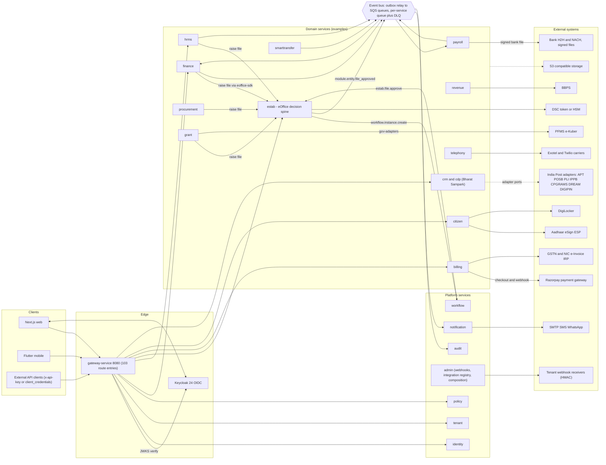
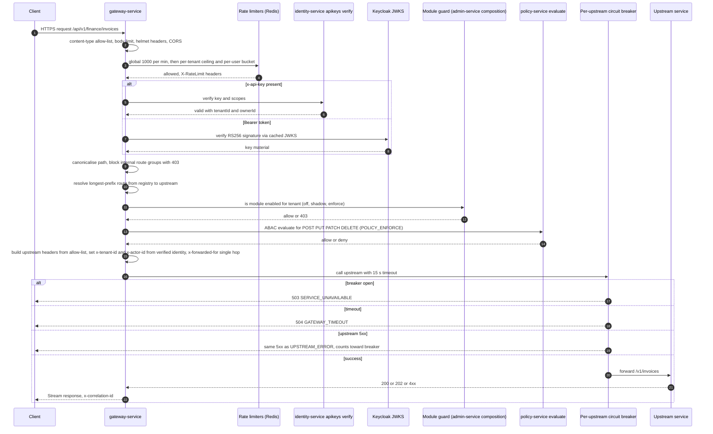
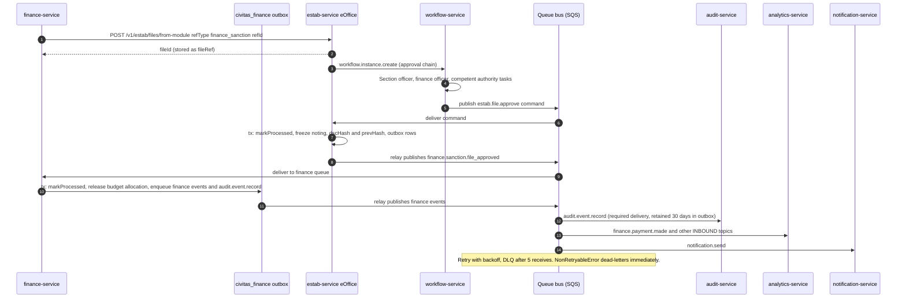

# CivitasOne Suite — Integration Architecture

| | |
|---|---|
| **Document** | Integration Architecture (formal design document) |
| **System** | CivitasOne Suite |
| **Baseline** | `civitasone-suite` @ `0a5843762` (main) |
| **Status** | Draft for review. Descriptive of the baseline code and docs. |
| **Companions** | `SECURITY-ARCH.md`, `DATA-ARCH.md` |
| **Evidence convention** | Docs cited by path; code verified by source path. Where doc and code disagree the code wins; see Appendix A. |

---

## 1. Introduction

### 1.1 Purpose and scope
This document describes how CivitasOne's parts talk to each other and to the outside world: the API gateway and REST contract, the asynchronous event bus, the eOffice decision backbone, and the external government and commercial systems the suite connects to. It also states the API standards and the resilience mechanisms.

### 1.2 Integration principles
| # | Principle |
|---|---|
| I1 | **One public door.** All client traffic enters through `gateway-service` (`:8080`); service ports are internal. |
| I2 | **Commands in, events out.** Writes are asynchronous commands (`202 Accepted`); state change is announced by past-tense events; services never share tables. |
| I3 | **Reliable by construction.** Transactional outbox on the producer, idempotent inbox on the consumer, DLQ on failure. |
| I4 | **Contracts over conventions.** Topic names, envelopes and (for new topics) zod contracts are versioned and tested. |
| I5 | **External systems sit behind ports.** Each provider is an adapter/connector with `mock` → `sandbox` → `production` modes that **fail closed** when unconfigured. |
| I6 | **Tenant identity is never negotiated.** It is derived from the verified token at the edge and carried in every envelope (`SECURITY-ARCH.md` §4). |
| I7 | **Every outbound call is bounded.** Timeout, retry policy, circuit breaker. |

### 1.3 Diagram — integration landscape

---

## 2. Internal integration

### 2.1 API gateway (`services/gateway-service`)

**Role.** The only public ingress: TLS-terminated upstream, authentication and tenant derivation, rate limiting, module and policy gates, routing, and upstream protection.

**Routing.** `src/registry.ts` holds ~103 route entries `{name, prefix, upstream, upstreamPath?}`; `upstream(name, port)` honours `GATEWAY_<NAME>_URL`. The external contract is `https://{host}/api/v1/{service}/{resource}`; the gateway strips `/api` and forwards `/v1/...` (or applies `upstreamPath` where a service's internal prefix differs, e.g. `/api/v1/project → /v1/projects`, `/api/notification → /notifications`). Resolution is **longest-prefix**, which lets one service owner carve a sub-tree out of another's prefix (e.g. `/api/v1/contract/documents` → legal-service). Unknown paths return `404 NOT_FOUND`.

**Request pipeline** (ordered, from `app.ts`):
1. Content-Type allow-list for body methods; body cap (`GATEWAY_BODY_LIMIT_BYTES`, default 1 MiB, hard ceiling 10 MiB; the careers resume route is the only exception).
2. `helmet` (CSP, HSTS, frame/sniff protections), strict `CORS_ORIGIN` list.
3. Rate limiting, Redis-backed so it is fleet-wide with an in-process fallback: **global** (default 1000/min), **per-tenant safety ceiling** (default 1000), **per-user bucket** (default 200); keys come only from verified identity or client IP; `X-RateLimit-*` headers; `429` with `Retry-After`. Per-tenant configurable **quota** plugin (Redis counters, shadow mode available).
4. `apiKeyPreHandler` (if `x-api-key`), then `jwtEdgeVerify` (`true | audit | off`, default verify).
5. In the proxy handler: canonicalise path (reject `..`, encoded separators, `;`, encoded prefix); resolve route; block service-internal route groups (`/api/[v1/]<svc>/internal/**` ⇒ 403); require Bearer or a verified API key unless the route is a public prefix/exact route; **module guard** then **ABAC policy check** (§2.1.3).
6. Build the upstream request from an **allow-list of forwardable headers** (`authorization, content-type, accept, x-correlation-id, x-device-id, x-device-trust-token, x-step-up-token, x-tenant-id, x-actor-id, x-idempotency-key`); strip bypass headers; set `x-forwarded-for` to the single observed client address; set `x-gateway-request: 1`; **re-derive `x-tenant-id`/`x-actor-id` from verified identity**.
7. Proxy through a **per-upstream circuit breaker with timeout**; stream the response (no buffering) preserving `content-type`, `content-disposition`, `content-length`.

**Gateway-owned endpoints.** (Note: the gateway strips inbound `x-service-secret`/`x-internal*` and does not forward a secret on proxied traffic; services re-verify the JWT. The global rate limit registers at the default onRequest stage, before auth; tenant and user tiers register at preHandler.) `/ops/breakers` (ops-auth), `/metrics/prom` and `/metrics/latency` (ops-only), `/internal/config` and module-cache invalidation (guarded by `x-internal-secret`), screen manifest and global search routes, the `catalogue` module (own DB), provider webhooks.

**Webhook pass-through.** `/api/v1/billing/webhooks` (Razorpay `x-razorpay-signature`) and `/api/v1/telephony/webhooks` (`x-twilio-signature`, `x-exotel-token`) are bearer-exempt; the **raw body bytes** are forwarded unmodified (a scoped content-type parser keeps them as a string) because the provider signature is computed over exact bytes; client identity headers are dropped.

**Auth for non-browser callers.** `x-api-key` (resolved against identity-service with scope check) or `client_credentials` JWT from `civitasone-services`.

#### 2.1.1 Module guard (entitlement)
Reads the admin-service composition projection per tenant. Modes `off` (legacy fail-open), `shadow` (log `would_deny`, allow), `enforce` (fail closed on disabled module, unmapped route, missing tenant, admin outage). HRMS routes are split into per-prefix module keys (`hrms-leave`, `hrms-recruitment`, `workforce_core`, …) via `hrms-subroute-map.ts`.

#### 2.1.2 ABAC policy check
`POLICY_ENFORCE=off|audit|true` (default **off**). Applies to POST/PUT/PATCH/DELETE except platform routes; calls policy-service `/v1/policy/evaluate` with the internal secret.

#### 2.1.3 Diagram — gateway request path

### 2.2 Asynchronous event bus

#### 2.2.1 Components
| Component | Location | Responsibility |
|---|---|---|
| Queue facade | `packages/queue` | The only import domain services use (`createQueue`, `Queue`, `NonRetryableError`, …); never import SQS SDKs directly |
| Bus | `services/queue-service/src/bus.ts` | `MemoryQueue` (dev/test), `SqsQueue` (AWS SQS / LocalStack / ElasticMQ); adapters for RabbitMQ and Kafka exist under `src/adapters`. Driver selected by `QUEUE_DRIVER` |
| Outbox/inbox | `packages/outbox` | `enqueue`, `relayOnce`/`startRelay`, `markProcessed`, `recordCommandOutcome`, `purgeOutbox` |
| Envelope | `packages/events/src/envelope.ts` | Runtime zod guard for the wire contract |
| Contracts | `packages/events/src/contracts` | `defineContract` DSL |
| Worker | each service's `src/worker.ts` | Subscribes consumers, runs the relay (31+ worker entrypoints) |

#### 2.2.2 Topic and message model
- **Commands** `{service}.{aggregate}.{action}` (write intent, one consumer = the owning service); **events** `{service}.{aggregate}.{pastTense}` (fact, 0..n subscribers). A topic is one or the other, never both.
- **Envelope** (`eventEnvelopeSchema`): `messageId (uuid), type, tenantId, actorId, correlationId, causationId?, timestamp, schemaVersion, traceparent? (W3C), payload`. An invalid envelope is dead-lettered **before any handler runs**.
- **Fan-out**: the SQS implementation gives each *subscribing service* its own queue per topic (SNS-style fan-out without SNS); subscriber discovery caches 15 s (`SQS_SUBSCRIBER_CACHE_TTL_MS`), so a newly deployed service may miss messages for up to 15 s. Queue name = topic with `.`→`-` truncated to **45 characters** (`TOPIC_BASE_MAX`), plus `.fifo` for order-sensitive topics (suffix `.fifo` on the topic name selects FIFO with dedup on `messageId`).
- **Publish options**: `requireSubscribers` makes publish throw a retryable `NoSubscribersError` if no subscriber queue exists — used for audit topics.

#### 2.2.3 Event contract policy (ADR-0019, decision D-ST-19, accepted 2026-10-09)
1. Every `smarttransfer.*` and `hrms.posting.*` topic ships a `defineContract` in **`mode: "enforce"`** (the DSL default `off` is not acceptable); a violating payload throws `ContractViolationError` at the consumer gate.
2. Topic names ≤ 45 characters after dot-to-dash (max observed 34).
3. Money on the wire is a **string** ending `Minor` with required `currency` (schema v2); no C0 topic carries money.
4. Every contract declares its `pii: []` list; sensitive attributes (category, disability, medical, spouse) never appear in payloads.
5. Exactly one owner and one kind per topic. Tolerant reader: adding a consumer later does not change the contract.
6. Contract tests run under `pnpm test:contract` / `tests/contract` with the cross-service-events ratchet.
Contracts exist today for SmartTransfer (`contracts/smarttransfer`), `ap-intake` and `tenant-lifecycle`; every other topic still follows the untyped naming convention (ADR-0019 records this as the baseline being corrected). `schemaVersion` per topic is resolved from `schema-versions.ts` at **enqueue** time.

#### 2.2.4 Delivery, idempotency and ordering
- **Producer**: the outbox row is written in the same transaction as the business change; `relayOnce` publishes with bounded concurrency (default 20) and marks only successes `published_at`; failures are isolated per row (`outbox_relay_failures_total`).
- **Consumer idempotency**: every consumer calls `markProcessed(tx, messageId)` as the first statement inside its transaction; a duplicate returns false and the handler exits. A stale (undated 2025) audit reported ~126-132 consumer files all calling `markProcessed`; this was not re-verified at the baseline. Secondary natural-key idempotency exists where useful (`fact_events (tenant_id, dedupe_key)`, `posting_history (tenant_id, event_id)`).
- **API-level idempotency**: `x-idempotency-key` is carried through to `RequestContext.idempotencyKey`; `idempotentId()` derives a deterministic UUID from `sha256(tenantId:key)`; `withIdempotency` (`packages/cache/src/idempotency.ts`) replays the first answer for same key + same body (hrms leave application).
- **Ordering**: none across topics; FIFO only on `.fifo` topics; consumers must be order-tolerant.
- **Outcome visibility**: `_inbox.command_results` + `getCommandOutcome(tenantId, commandId)` let a caller resolve a 202 to `succeeded | rejected | failed`.

#### 2.2.5 Diagram — end-to-end event flow (eOffice-driven sanction)

---

## 3. Event catalog overview

### 3.1 Scale (queue audit, `docs/audits/QUEUE-EVENT-AUDIT.md`)
At the time of the audit: **616** unique topics (389 commands, 208 events), **37** cross-service subscription declarations, **132** consumer files, **31** worker entrypoints. Counts have grown since (service count has doubled; the audit source is stale and flagged in A6); they have not been recomputed here. Roughly 190 events had no cross-service subscriber by design ("emit everything, subscribe selectively" — every consumer also emits `audit.event.record`).

### 3.2 Catalog by domain (publisher → consumers)
Derived from the audit's confirmed-active subscriptions, `DATABASE-SCHEMA.md`, `event-list.md` and the eOffice design.

| Domain | Topic (representative) | Publisher | Consumers |
|---|---|---|---|
| **Tenancy** | `tenant.tenant.created` | tenant | hrms, workflow (provisioning) |
| | `tenant.tenant.isolation_changed` | tenant | install (silo provisioning) |
| **Audit (all domains)** | `audit.event.record` / `audit.event.ingest` | every service | audit (required delivery) |
| **Notification** | `notification.send` | any | notification |
| **eOffice decision spine** | `workflow.instance.create` (cmd) | estab (via DISPATCH) | workflow |
| | `estab.file.approve` / `reject` (cmd) | workflow | estab |
| | `{module}.{entity}.file_approved` / `*.file_decided` | estab | the originating module (finance, hrms, procurement, grant, asset, legal, contract) |
| **Finance / procurement** | `procurement.grn.accepted` | procurement | finance, stock, inventory, asset |
| | `procurement.tender.awarded` | procurement | contract |
| | `procurement.po.approved` | procurement | analytics |
| | `finance.payment.made` | finance | grant, payroll, analytics |
| | `finance.bank_statement.reconciled` | finance | revenue |
| | `legal.contract_review.cleared` | legal | procurement |
| **HR / payroll** | `hrms.leave.approved` | hrms | payroll (loss of pay), finance |
| | `hrms.posting.applied/changed/hold_placed/hold_released` | hrms | audit; smarttransfer; payroll (flag-gated); estab, notification (per event list) |
| | `hrms.posting.apply` (cmd) | smarttransfer | hrms |
| | `contractRenewalDecided` (decision) | workflow | hrms (`hrms.contract.*` events are published by hrms; their subscribers are not catalogued here) |
| **SmartTransfer** | 22 `smarttransfer.*` topics (cycle, request, preference, scenario, exception, run, assignment, solve, order, relieving, joining, appeal, evidence) | smarttransfer / allocation-solver | audit, notification, smarttransfer coordinator |
| **Citizen / grievance** | `citizen.rti.filed` | citizen | estab |
| | `estab.rti.responded` | estab | citizen |
| **CRM / helpdesk** | `crm.case.opened`, `telephony.call.missed` | crm, telephony | helpdesk |
| **Billing** | `billing.checkout.verify` (cmd) / `billing.checkout.verified` | billing | billing (consumer of its own command); other subscribers not verified |
| | `catalogue.rate.*` | catalogue | billing (rate validation) |
| **Assets** | `asset.disposal.decided` (emitted after `asset.disposal.file_decided`) | asset | not verified (audit sink at minimum) |
| **Analytics** | INBOUND set: finance payment made, grant disbursement completed, PO approved, meeting attendance/vote/completed, court case registered/status changed/hearing scheduled, visitor checked-in/overstay | respective services | analytics |
| **Marketing / CDP** | `journey.*`, `loyalty.*`, `recommendation.nba.*`, `catalogue.*` | journey, loyalty, recommendation, catalogue | not catalogued; recommendation declares no inbound events; catalogue is consumed by billing |

The frozen SmartTransfer topic surface and payload outlines are in `docs/smarttransfer/event-list.md`.

### 3.3 Known catalog defects (audit findings; status checked against current source)
| Finding | Status at baseline |
|---|---|
| Analytics subscribed to never-emitted `finance.payment.released`, `grants.release.processed` | **Fixed** — `INBOUND` now uses `finance.payment.made`, `grant.disbursement.completed`; no references remain |
| admin and billing publish `notification.alert.send`; notification subscribes to `notification.send` | **Still open** — publishers remain in `admin-service/support/consumer.ts` and `billing-service/invoices/consumer.ts`; no matching subscriber in notification-service |
| 4 eOffice callback ref types without consumers (`hr_leave_special`, `hr_recruitment`, `grant_scheme`, `procurement_award`) | Mitigated by fail-closed SDK allow-list; consumer coverage not re-verified |
| `identity.user.deactivated` / `identity.session.revoked_all` have no cross-service subscriber | Partly mitigated by the `sid` denylist for explicit revokes; user deactivation not verified |
| `billing.dunning.exhausted`, `billing.subscription.expired`, `inventory.stock.low` have no consumer | Not re-verified |
| Missing integration tests for tenant provisioning, `*.file_decided` chain, billing chains | Not re-verified |
| 21 services without application-level DLQ visibility | Not re-verified (infrastructure DLQ exists everywhere) |

---

## 4. External integrations

### 4.1 Common integration model
- **Ports and adapters.** `packages/connector-framework` defines a `Connector` contract (`configure`, `isConfigured`, `healthCheck`, `invoke(operation, input)`) with modes `mock | sandbox | production`; `BaseConnector.isConfigured()` is fail-closed (every `requiredSecrets` entry must be non-empty outside mock). Typed ports exist for `esign`, `dsc`, `bank_api`, `pfms`, `ocr`. `createAdapter(category, ctx)` returns the mock in `sandbox` and a **`Real…Stub` in production**; `REAL_ADAPTER_PROVIDERS` is **empty**, so no port-based production provider is live at the baseline.
- **Direct gov adapters.** `packages/gov-adapters` (`pfms.ts`, `gstn.ts`, `nach.ts`, `traces.ts`) are env-gated (`*_MODE` = `mock` default | `sandbox` | `production`), throw when production env is incomplete, and use `fetchWithTimeout` (default 30 s, `*_TIMEOUT_MS`).
- **Per-tenant configuration.** `admin-service` holds an `integration_settings` registry (secrets sealed AES-256-GCM with `CONFIG_ENC_KEY`); `@civitasone/integration-config` resolves it with env fallback and returns null on any registry failure so a registry outage never takes down a send path.
- **Never trust callbacks.** Provider webhooks are authenticated by signature over raw bytes and carry no tenant identity from the caller.

### 4.2 Integration matrix
| System | Purpose | Direction | Protocol | Auth | Implementation state |
|---|---|---|---|---|---|
| **eOffice (estab-service)** — internal decision spine | System of record for decisions: any module raises an eFile, approval chain runs in workflow, decision returns as an event | Internal bidirectional | REST (`POST /v1/estab/files/from-module`) out, events back; `@civitasone/eoffice-sdk` | Service Bearer/internal secret; clearance gate on classified files | **Built** (finance sanction proven end-to-end; 15 ref types, SDK fail-closed) |
| **NIC eFile (Ver 7.0)** | Comparison baseline for eOffice parity | None | None | — | **No integration exists.** CivitasOne eOffice is a parallel implementation, not a connector to NIC's product; `docs/architecture/EOFFICE-VS-NIC-INTEGRATED-DESIGN.md` is a BA parity analysis |
| **Keycloak 24 / SSO** | Identity provider; JWKS for token verification | Inbound to platform | OIDC Auth Code + PKCE (web/mobile), `client_credentials` (services); JWKS over HTTPS | RS256 JWT; client secrets for confidential clients | **Built** (`infra/keycloak/civitasone-realm.json`) |
| **PFMS (e-Kuber)** | Sanction-to-disbursement, status reconciliation for grants/payments | Outbound | HTTPS REST (`PFMS_API_URL`) | Bearer/API token (`PFMS_AUTH_TOKEN`), agency code | Adapter built (`gov-adapters/pfms.ts`, `PfmsConnector`); default `mock`; grant-service `canRetryDisbursement`; production go-live gated on signing/DSC (VAPT-012) |
| **Payment gateways** | Online fee/checkout collection | Outbound API + inbound webhook | HTTPS REST; webhook POST | API credentials per gateway; **HMAC signature** (`x-razorpay-signature`) over raw body | Adapters for Razorpay, CCAvenue, PayU and UPI autopay in billing-service; 3 attempts, 1/2/4 s back-off on 5xx/timeout, none on 4xx; citizen fee payments report honest `pending` when unconfigured |
| **BBPS** | Bill payments for municipal revenue | Outbound/inbound | Biller config + transaction tables in revenue-service | Per biller config | Modelled in revenue-service (`bbps` schema); provider connectivity not verified |
| **GSTN (GSP) / NIC e-Invoice IRP** | GSTR-1/3B filing; e-invoice IRN generation | Outbound | HTTPS REST via GSP; NIC IRP OAuth2 `client_credentials` | OAuth client id/secret (`GSTN_*`); IRP creds (`EINVOICE_MODE`) | Adapters built, **mock by default**; GST return runs in finance/billing |
| **Banks (NACH/APBS, H2H)** | Bulk salary/pension and vendor payment files | Outbound | Fixed-width NPCI files over SFTP/API; signed files | Detached PGP / XML-DSig / PKCS#7 signature; optional encrypt-to-bank | File generation built (`nach.ts`, payroll bank-file signing); production keystore stub ⇒ fails closed |
| **TRACES / NSDL** | TDS returns 24Q/26Q | Outbound (file) | FVU-ready text files | — | Generator built, mock default |
| **DSC / eSign** | Cryptographic signature on documents/notings | Outbound | DSC: PKCS#7 detached in-process (`@civitasone/render`); eSign: provider redirect + verify (hash-only) | PKCS#12 keystore; Aadhaar OTP at ESP | Software DSC built; **ESP and HSM/NIC middleware not wired** (stub in production) |
| **DigiLocker / UIDAI KYC** | Document fetch and KYC gating | Outbound | HTTPS OAuth | Provider credentials | citizen/visitor adapters; env-gated, `provider_unconfigured` rather than fake success |
| **Telephony carriers (Exotel, Twilio)** | Click-to-call, IVR, call events | Outbound + inbound webhook | REST; webhook POST | `x-twilio-signature` / `x-exotel-token`, fail-closed | Webhook verification built |
| **Notification channels** | Email (SMTP), SMS, WhatsApp, push | Outbound | SMTP / provider REST | Provider credentials via registry or env | notification-service channels, templates, bulk; providers configured per tenant |
| **Video conferencing** | Meeting sessions and recordings | Outbound | Vendor-neutral `VC_Adapter`; provider priority per tenant | Provider credentials | Fallback chain with circuit breaker (meeting-service) |
| **Object storage** | Documents, scans, exports | Outbound | S3 API (`@civitasone/storage`) | Access credentials / IAM | S3-compatible (MinIO/S3) |
| **Tenant webhooks** | Push events to tenant systems | Outbound | HTTPS POST | **HMAC-SHA256** (`sha256=…`) with per-webhook secret, maker-checker secret rotation | Built (admin-service); 3 retries with exponential backoff, delivery replay |
| **Bharat Sampark / India Post** (customer programme, BRD v2.8) | CRM, CDP, helpdesk and engagement suite for India Post | Platform serves it; adapters bridge to its systems | REST adapters publishing into the event bus | Keycloak JWT via `@civitasone/auth`; per-tenant credentials | RTM: 214 of 294 itemised requirements DONE. Adapter services under `services/adapters/india-post`: **APT scaffolded; POSB, PLI, IPPB, CPGRAMS, DREAM, DIGIPIN, Dak Karmayogi placeholders** |

### 4.3 eOffice as the decision spine (detail)
**Contract.** Every eFile carries `refType` + `refId` pointing at the source entity. A module raises a file through the SDK (`EOfficeClient.raiseFile`) with subject, department, classification, priority, `initiatedBy`, approval chain and context. The file is created with an initial yellow noting; the submission starts a workflow instance; when the chain approves, workflow issues `estab.file.approve`; estab freezes the noting (green, `dscHash` over notingId+body+officerId+timestamp, `prevHash` of the previous noting) and emits `{module}.{entity}.file_approved` carrying `fileId, refType, refId, decision, approvedBy, notingId, dscHash, approvedAt`. **The source module executes the decision only after this event.**

**Registered ref types (15 in `DECISION_CONSUMED_REF_TYPES`):** `finance_sanction, finance_payment, finance_reappropriation, procurement_po, procurement_award, hr_promotion, hr_transfer, hr_disciplinary, hr_leave_special, hr_recruitment, grant_disbursement, grant_scheme, asset_disposal, legal_opinion, contract_award`. SmartTransfer types (`hr_transfer_order`, `hr_posting_cycle`) are enabled per deployment via `EXTRA_DECISION_CONSUMED_REF_TYPES` so main stays fail-closed.

**Properties.** HR hierarchy snapshot frozen on the noting; approval chain chosen by amount matrix (`estab_approval_rule`); notings immutable (consumer rule + DB trigger + hash chain); classification clearance gate; every action audited; **no cross-service SQL**; the estab database can be relocated to a government-controlled data centre by changing `GATEWAY_ESTAB_URL` and `ESTAB_DATABASE_URL`, with the event bus bridging environments.

### 4.4 Keycloak and SSO
Keycloak is both an integration and a dependency of every request path: the web BFF performs the code+PKCE exchange, the gateway and every service fetch JWKS and verify tokens, and `scripts/ops/sync-keycloak-realm-roles.mjs` and `infra/keycloak/scripts` keep realm roles and the tenant attribute aligned (`backfill-tenant-attribute.mjs`). SAML/OIDC federation to a department SSO is a Keycloak configuration concern (`SECURITY.md` §3).

### 4.5 Signatures and non-repudiation integrations
See `SECURITY-ARCH.md` §6.4. Integration-level summary: `esign` and `dsc` ports transmit only a SHA-256 of the document and an opaque signer reference; no Aadhaar number or key material crosses the port.

---

## 5. API design standards

### 5.1 Contract (from `STANDARDS.md` §2 and `API-GUIDE.md`)
| Topic | Standard | Notes |
|---|---|---|
| **Style** | REST + CQRS. `GET` = query (200, from cache), `POST/PUT/PATCH/DELETE` = command (202). A `GET` must never mutate. | |
| **Versioning** | `/v1/{resource}` in the path; breaking change ⇒ new version; `/v1`→`/v2` with a **90-day deprecation** window (GIGW checklist cites the tech steering rule) | No `/v2` endpoints exist at the baseline |
| **External shape** | `https://{host}/api/v1/{service}/{resource}` via the gateway | Never call service ports |
| **Auth** | `Authorization: Bearer <RS256 JWT>`; `x-api-key` for key-based integrators; OIDC `client_credentials` for machine clients | Public routes are an explicit allow-list |
| **Correlation** | `x-correlation-id` accepted or generated, echoed, threaded to every log line, envelope and `traceparent` | |
| **Validation** | zod at every boundary; no raw `req.body`; server revalidates regardless of UI | |
| **Success shapes** | Command: `202 {commandId/id, status:"accepted", correlationId}`. Query: `200 {data, …}` | |
| **Error envelope** | `{ code, message, detail?, correlationId, retryable, fieldErrors?[{field,message}] }` | Canonical codes: `UNAUTHENTICATED 401`, `FORBIDDEN 403`, `NOT_FOUND 404`, `VALIDATION_FAILED 400/422`, `CONFLICT 409`, `PAYLOAD_TOO_LARGE 413`, `RATE_LIMITED 429`, `INTERNAL 500 (retryable)`. Gateway adds `SERVICE_UNAVAILABLE 503`, `GATEWAY_TIMEOUT 504`, `BAD_GATEWAY 502`, `UPSTREAM_ERROR`, `TOKEN_INVALID 401` |
| **Pagination** | Standard: cursor-based `{ data, pagination:{ cursor, hasMore, total?, pageSize } }`. `API-GUIDE.md` documents `limit`/`offset` with `{limit, offset, total}`; services clamp oversized limits (`clamp-limit.ts`) | Two shapes coexist — see Appendix A |
| **Idempotency** | `x-idempotency-key` header on commands; default is the new resource id; duplicates de-duplicated by consumer (`idempotentId`) and, for creates that opt in, replayed by `withIdempotency` | Not described in `openapi.yaml` |
| **Rate limits** | 3-tier at gateway; `X-RateLimit-Limit/Remaining/Reset`, `Retry-After` on 429 | |
| **Money** | Integer minor units; strings on the wire for values ≥ 2^53 | |
| **Documentation** | OpenAPI 3.1 at `docs/api/openapi.yaml` (v0.2.0, ~266 paths, `bearerAuth` plus `scimBearerToken`); per-service `/openapi.json` generated; CI fails on drift | Committed spec server URL is `https://api.civitasone.app` |
| **Webhooks (outbound)** | HTTPS POST of signed event payloads; `sha256=<hex HMAC>` of the raw body; receiver verifies in constant time and dedupes by event id | |
| **SCIM** | `scimBearerToken` scheme declared for provisioning | Implementation scope not verified |
| **Path hygiene** | No traversal, `;`, encoded separators; `internal` route groups unreachable externally | |

### 5.2 Conventions for event APIs
Past-tense event names; payload carries only the minimum fields; ids rather than embedded entities; money as `…Minor` strings with `currency`; PII declared in the contract and sensitive attributes excluded; additive evolution only (tolerant reader) with `schemaVersion` bumps for breaking change.

---

## 6. Resilience

### 6.1 Mechanisms
| Concern | Mechanism | Defaults / evidence |
|---|---|---|
| **Gateway → service failure isolation** | Per-upstream circuit breaker (`@civitasone/circuit-breaker`: closed → open after N **consecutive** failures → half-open after `recoveryMs`) | `GATEWAY_CB_FAILURE_THRESHOLD=5`, `GATEWAY_CB_RECOVERY_MS=15000`; 5xx counts as failure, 4xx does not; open ⇒ `503 SERVICE_UNAVAILABLE` |
| **Timeouts** | Upstream `GATEWAY_UPSTREAM_TIMEOUT_MS` | 15 s ⇒ `504 GATEWAY_TIMEOUT`; network error ⇒ `502`; runtime-tunable via `/internal/config` |
| **Service → service** | Breaker + hard timeout on internal clients | e.g. hrms→payroll 5 s / 5 failures / 30 s; meeting VC adapters 10 s; India Post adapters 10 s, 3 retries exp. back-off |
| **Outbound providers** | Per-adapter timeout; bounded retries on transient errors only | Gov adapters 30 s; payment gateways 3 attempts at 1/2/4 s on 5xx/timeout, none on 4xx |
| **Queue retry** | SQS visibility-timeout redelivery with exponential back-off (base 1 s, ×2, cap 60 s; `SQS_BACKOFF_*`); `MemoryQueue` back-off `2^attempt × 10 ms`, 5 attempts | `SQS_VISIBILITY_TIMEOUT=60` |
| **Dead-letter** | Every per-service queue gets a `-dlq` companion with native RedrivePolicy `maxReceiveCount` 5 (`SQS_MAX_RECEIVE_COUNT`) plus an application safety net; `NonRetryableError` and invalid envelopes dead-letter immediately; `incrementDlqMessage()` metric | Alert: warn at DLQ depth ≥1 (Tier 0/1), page on stale consumer heartbeat |
| **Application DLQ & replay** | workflow-service `subscribeWithDlq` (per-message attempt counter in Postgres, admin list/requeue API, `WORKFLOW_DLQ_MAX_ATTEMPTS=5`); webhook delivery replay in admin-service | Other services rely on infrastructure DLQ only (audit finding) |
| **Producer reliability** | Transactional outbox; per-row relay isolation; audit topics `requireSubscribers` + extended retention | |
| **Consumer reliability** | `markProcessed` idempotency; envelope validation; command outcome ledger | |
| **Edge protection** | Rate limits (Redis, fleet-wide), tenant quotas, body cap, content-type guard | |
| **Config safety** | Boot-time assertions: HS256 forbidden in production, `INTERNAL_SERVICE_SECRET` required, audience required, dev-login and memory-queue refused in production | |
| **Graceful degradation** | Module guard `off`/`shadow` fail-open vs `enforce` fail-closed; denylist fail-open on Redis error; rate-limit falls back to in-process store if Redis is down at boot; integration registry returns null (env fallback); policy outage ⇒ 503 deny for permission checks | Documented, deliberate trade-offs |
| **Operations** | `/health`, `/ready` (sheds traffic on dependency failure); Prometheus metrics (DLQ, outbox failures, consumer heartbeat); Alertmanager; `/ops/breakers` | `infra/observability` |

### 6.2 Failure modes and expected behaviour
| Failure | Behaviour |
|---|---|
| Upstream service down | Breaker opens after 5 consecutive 5xx/timeouts; clients get 503 fast; breaker half-opens after 15 s |
| Queue broker unavailable at publish | Route fails (command not accepted) or relay retries on next cycle (events already safe in the outbox) |
| Consumer crashes mid-transaction | Transaction rolls back; message redelivered; effect applied once |
| Poison message | Retries with back-off, DLQ at 5 receives; or immediate DLQ on `NonRetryableError` (recorded as `rejected`) |
| Duplicate delivery / replay | `markProcessed` returns false; no second effect |
| Provider outage | Adapter timeout → bounded retry → typed error; honest `pending`/`provider_unconfigured` rather than fake success |
| Redis outage | Rate limit uses in-process store; denylist fails open (logged); cache read-through falls back to database |
| Keycloak/JWKS unreachable | Cached JWKS continues to verify; new key rotation not picked up until reachable |

### 6.3 Gaps
- **No circuit breaker on queue consumers** (audit): a dependency outage exhausts retries and dead-letters instead of pausing consumption. `@civitasone/circuit-breaker` is used for HTTP, not for poll loops.
- Application-level DLQ admin/requeue exists only in workflow-service (others: infrastructure DLQ, ops must inspect SQS).
- Fan-out discovery cache (15 s) affects canary deploys.
- `notification.alert.send` mismatch silently drops admin and billing notifications.
- Production adapters for eSign, DSC/HSM, bank API and the India Post systems are stubs or placeholders.

---

## Appendix A — Documented drift and gaps (verify before relying)

| # | Topic | Observation |
|---|---|---|
| A1 | "eOffice/NIC" | The sources describe an internal eOffice module with NIC eFile parity; no NIC API connector exists. Confirm this matches the intended meaning of "eOffice/NIC integration". |
| A2 | Service counts | Docs say 33 services; repo has 68 service directories (66 DB-backed + queue-service + `adapters/` container), 134 PM2 processes and ~103 gateway route entries. PFMS/GSTN direct adapters contain real production code paths gated by `*_MODE` (default mock); only port-based providers (esign/dsc/bank) are stubs. Evidence tags: this document cites paths inline and does not use the CLOUD/INFRA tag scheme. Event totals (616 topics) are from the older audit. |
| A3 | Pagination | Cursor (STANDARDS) versus limit/offset (API-GUIDE). Per-service behaviour not surveyed. |
| A4 | Idempotency in OpenAPI | `x-idempotency-key` and cursor parameters are not documented in `openapi.yaml`. |
| A5 | Tenant claim | `API-GUIDE.md` says `tenant_id`; platform uses `tid`. |
| A6 | Queue audit date | `QUEUE-EVENT-AUDIT.md` is dated "2025-01-XX"; findings re-checked above only for analytics INBOUND and `notification.alert.send`. |
| A7 | Event contracts | Only SmartTransfer, `ap-intake` and `tenant-lifecycle` have `defineContract`; ADR-0019 asserts "zero production contracts" prior to SmartTransfer. |
| A8 | Queue drivers | `QUEUE_DRIVER` documents memory and sqs; RabbitMQ and Kafka adapters exist in source — whether either is used in any deployment is not stated. |
| A9 | Gateway ABAC/module guard | Default-off runtime switches; production values not verifiable from source. |
| A10 | SCIM, BBPS, payment-gateway connectivity | Declared or modelled; end-to-end provider connectivity not verified in this review. |
| A11 | India Post adapters | Only `apt-adapter` has source scaffold; the rest are placeholders per the README. |
| A12 | Webhook retry count | Consumer comment says "3x with exponential backoff"; `delivery.ts` holds the schedule and `maxAttempts` per delivery row — exact schedule not transcribed. |
