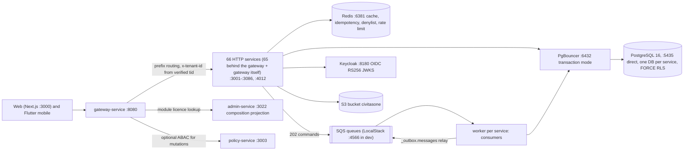
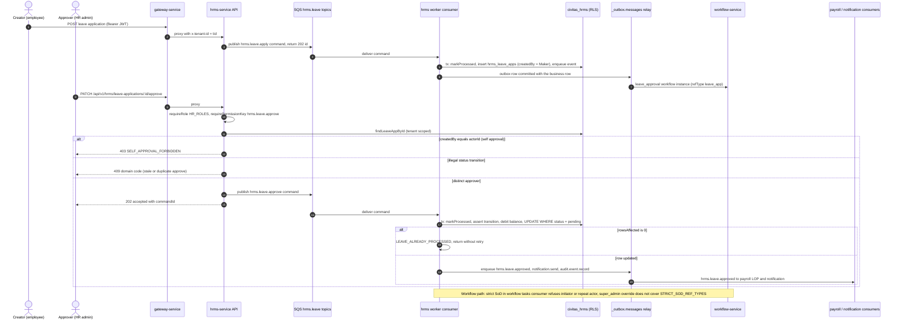
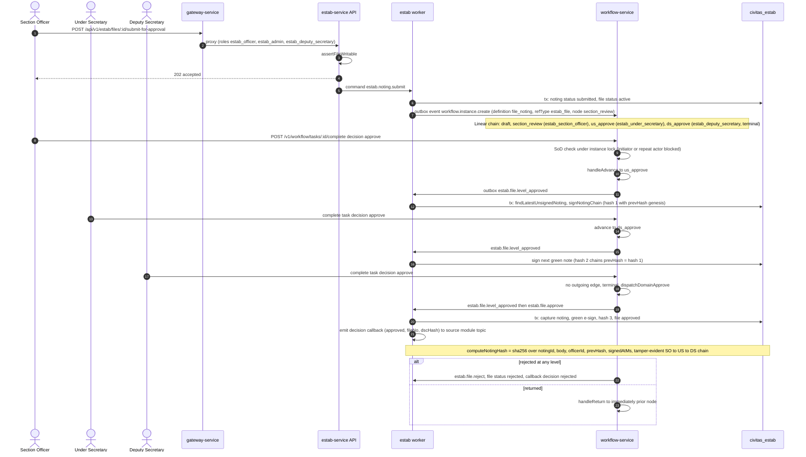
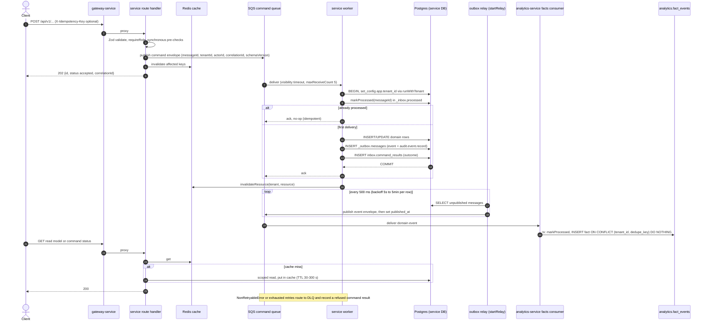
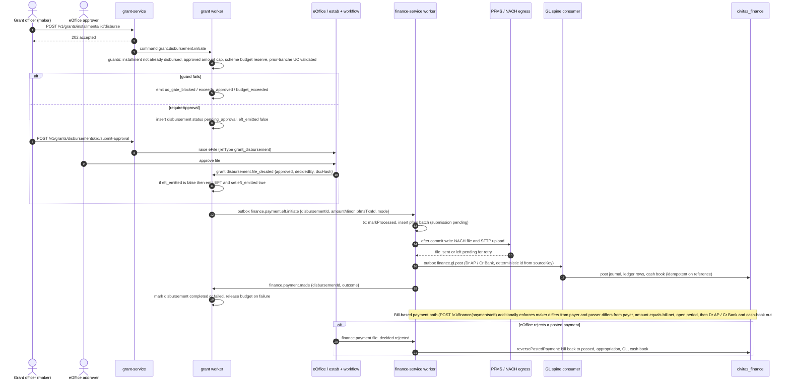
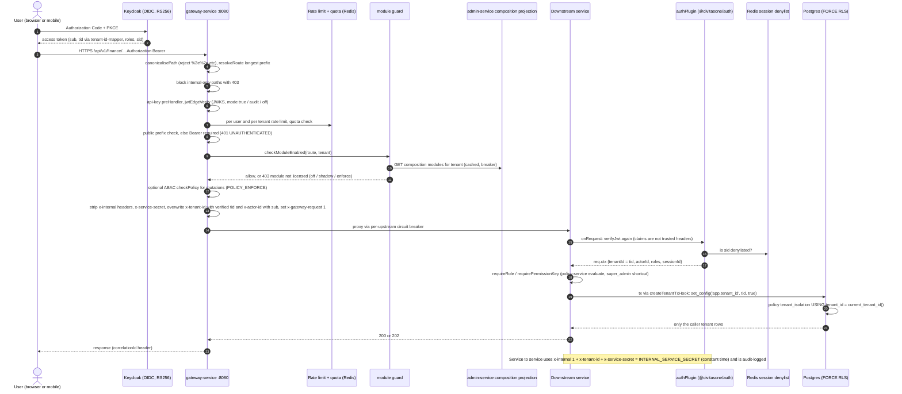
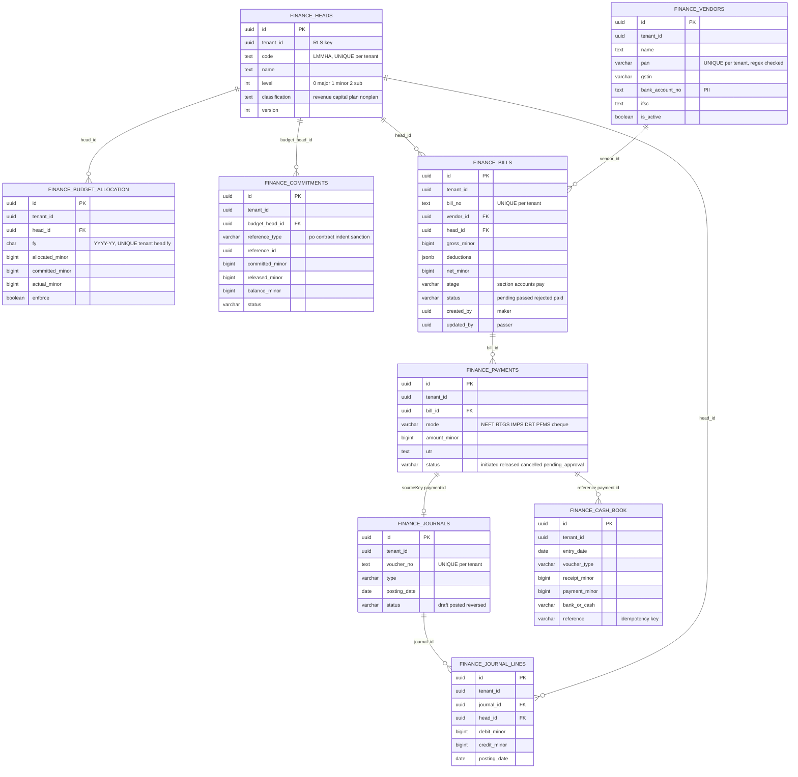
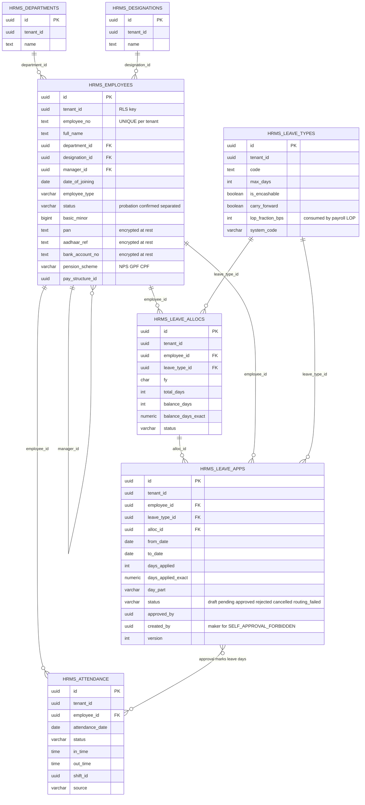
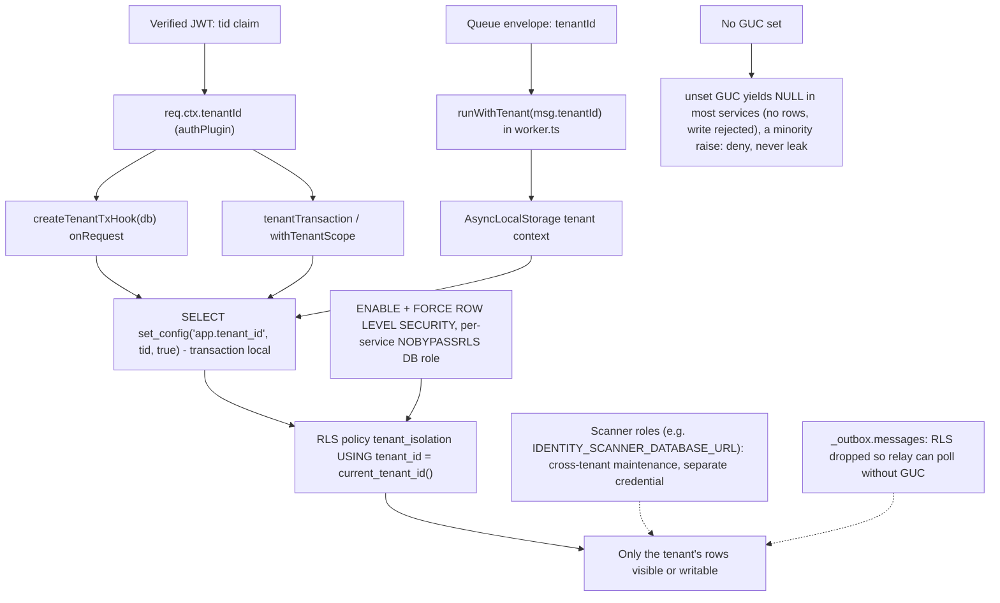

# CivitasOne Suite - Low-Level Design (LLD)

| Field | Value |
| --- | --- |
| Product | CivitasOne - multi-tenant government ERP (CQRS / event-driven microservices) |
| Document | Low-Level Design |
| Baseline | Repository `civitasone-suite`, build `0a5843762` (UAT freeze 2026-11-19/20) |
| Evidence base | `docs/PLATFORM-ARCHITECTURE.md`, `docs/DATABASE-SCHEMA.md`, `docs/api/openapi.yaml`, `services/*` (routes, modules, consumers, migrations, `topics.ts`), `packages/*`, `ecosystem.config.js` |
| Method | Read-only code and doc inspection. Every statement is grounded in a file under the repo; where code and docs disagree the code wins and the disagreement is listed in Appendix B. |
| Status | Draft for review |

---

## 1. Introduction

### 1.1 Purpose
This document specifies the internal design of the CivitasOne platform at the level a developer, reviewer or auditor needs to reason about behaviour: shared libraries and their contracts, the internal structure of each service, the data each service owns, the APIs and events it exposes, the business rules it enforces, the critical runtime sequences, and the cross-cutting patterns for errors, idempotency, consistency and configuration.

### 1.2 Scope
In scope: the Node.js/TypeScript backend (`services/*`, 66 DB-backed service directories plus `queue-service` and `adapters`), the shared packages (`packages/*`, 33 packages), the data layer (PostgreSQL 16 database-per-service, Redis, SQS/S3), and the API gateway. The Next.js web app (`apps/web`) and Flutter mobile app are referenced only where they constrain backend contracts (OIDC PKCE, feature flags, BFF header handling).

Out of scope: infrastructure provisioning (`infra/`), CI pipeline internals, ML model internals, and UI design (see the UX documents under `docs/`).

### 1.3 Relation to other documents
| Document | Relation to this LLD |
| --- | --- |
| HLD / SAD | Defines the system context, quality attributes and the architectural decisions (database per service, CQRS everywhere, outbox, gateway as the auth and routing point). This LLD refines each of those decisions into modules, tables, topics and sequences. Where the SAD states a decision, Section 3 and Section 4 show how the code realises it. |
| `docs/PLATFORM-ARCHITECTURE.md` | Source for the topology and security tables. It is partly stale (see Appendix B), so port and package counts here come from `ecosystem.config.js` and `packages/`. |
| `docs/DATABASE-SCHEMA.md` | Source for the database inventory; table lists here come from the per-service `migrations/` and Drizzle `schema.ts` files. |
| `docs/api/openapi.yaml` | Unified API description (OpenAPI 3.1, about 266 path entries). The per-service route inventory here is taken from the Fastify route registrations, which are the authoritative and larger set. |

### 1.4 Conventions
- Money is stored as integer minor units (paise) in `bigint` columns named `*_minor`; transported as decimal strings in JSON/events.
- All tenant data rows carry `tenant_id uuid NOT NULL`; standard audit columns are `created_at`, `updated_at`, `created_by`, `updated_by` and an optimistic-lock `version`.
- Topic names are dotted `service.resource.action`. Commands are imperative (`hrms.leave.approve`), events are past tense (`hrms.leave.approved`).
- "Command" means a message on a queue that a service's own worker consumes; "event" means a fact published via the transactional outbox for other services.

---

## 2. Component model

### 2.1 Runtime topology

Each domain service is two OS processes started by PM2 from `ecosystem.config.js` through the `svc("<name>")` helper (HTTP API, Fastify 4, `app.ts`/`index.ts`) and the `worker("<name>")` helper (queue consumers, outbox relay and schedulers, `worker.ts`). Database-backed processes connect through PgBouncer (`localhost:6432`, transaction mode) with `DB_VIA_PGBOUNCER=true` (disables prepared statements) and `DB_POOL_MAX=5`; PgBouncer proxies to Postgres, which is exposed on the host as `:5435`.

### 2.2 Service skeleton (identical across services)
Every service follows the same layout, which is what makes the per-service subsections in Section 3 comparable.

| Path | Role |
| --- | --- |
| `src/app.ts` | `buildApp()`: Fastify with `bodyLimit` 1 MiB, `trustProxy` limited to loopback/private ranges, CORS, `authPlugin`, rate limit, `createTenantTxHook(db)`, ops routes (`/health`, `/ready`, `/metrics`), module route plugins, `registerSchemaErrorHandler`. |
| `src/index.ts` | HTTP bootstrap. |
| `src/worker.ts` | Worker bootstrap: wraps `queue.subscribe` so every handler runs inside `runWithTenant(msg.tenantId)`, registers consumers, starts `startRelay(db, queue)` (outbox) and `startOutboxPurge`, starts domain schedulers. |
| `src/topics.ts` | `COMMANDS`, `EVENTS`, `CONSUMED_EVENTS` constants (the topic contract of the service). |
| `src/modules/<module>/` | Vertical slice: `routes.ts` (HTTP), `commands.ts` (publish command, return 202), `consumer.ts` (worker: transaction, domain write, outbox), `repo.ts` (Drizzle), `queries.ts` (read side), `schema.ts` (Drizzle tables), `validators.ts` (Zod), `domain.ts` (pure rules, state machines). |
| `src/shared/` | `db.ts`, `infra.ts` (cache and queue singletons), `outbox.ts` (re-export of `@civitasone/outbox`), `context.ts` (`HttpError`, `resolveContext`, `requireRole`, `requirePermissionKey`). |
| `migrations/NNNN_*.sql` | Idempotent plain SQL (`IF NOT EXISTS`), including RLS policies; per-service `_outbox` and `_inbox` schemas. |

### 2.3 Shared packages

```mermaid
flowchart TB
  subgraph SVC["Domain / platform service (Fastify 4 process + worker process)"]
    direction TB
    APP["app.ts: routes + authPlugin + tenant hook"]
    WRK["worker.ts: consumers + outbox relay + schedulers"]
  end

  subgraph SEC["Identity, tenancy and security"]
    AUTH["@civitasone/auth: verifyJwt, authPlugin, RBAC helpers, session denylist"]
    TYPES["@civitasone/types: RequestContext, gateway public routes"]
    KMS["@civitasone/kms: envelope encryption, DSC certificates"]
    SECH["@civitasone/security-headers, rate-limit"]
    TPROF["@civitasone/tenant-profile, module-licence, feature-flags"]
  end

  subgraph DATA["Data access and consistency"]
    DB["@civitasone/db: pool, tenant GUC, TenantRouter, quota-check"]
    OUTBOX["@civitasone/outbox: enqueue, relay, markProcessed, command results"]
    CACHE["@civitasone/cache: Redis read-through, idempotency, invalidation"]
    NUM["@civitasone/numbering: gap-free document numbers"]
    GOV["@civitasone/data-governance: masking, consent, retention"]
  end

  subgraph MSG["Messaging"]
    QUEUE["@civitasone/queue: facade over queue-service bus (SQS, memory, RabbitMQ)"]
    EVENTS["@civitasone/events: envelope, schema registry, topic contracts"]
    EOSDK["@civitasone/eoffice-sdk: raise file, decision callback contract"]
    SCANLINK["@civitasone/scan-link: bulk-scan filing wire contract"]
  end

  subgraph CONTRACT["Contracts and presentation"]
    SCHEMAS["@civitasone/schemas: Zod validators, sendAccepted, error handler"]
    OBS["@civitasone/observability: health, ready, metrics, redaction, tracing"]
    CB["@civitasone/circuit-breaker"]
    UIKIT["@civitasone/ui-kit, client-core: web and mobile"]
  end

  subgraph INTEG["Integration and document capabilities"]
    CONN["connector-framework, integration-config, gov-adapters (PFMS, GSTN, NACH, TRACES)"]
    STORE["storage (S3 SigV4), scanner (ClamAV), ocr, render (PDF, DSC), search"]
    PLUG["plugin-sdk"]
    RECON["reconciliation, gst"]
  end

  APP --> AUTH
  APP --> SCHEMAS
  APP --> DB
  APP --> CACHE
  APP --> OBS
  APP --> SECH
  APP --> QUEUE
  WRK --> QUEUE
  WRK --> OUTBOX
  WRK --> DB
  OUTBOX --> DB
  OUTBOX --> QUEUE
  QUEUE --> EVENTS
  AUTH --> TYPES
  AUTH --> CACHE
  DB --> TYPES
  EOSDK --> EVENTS
  CONN --> CB
  APP --> TPROF
  APP --> CONN
  APP --> STORE
  APP --> NUM
```

| Package | Role and key contract |
| --- | --- |
| `@civitasone/auth` | `verifyJwt` (RS256 against Keycloak JWKS; HS256 only in dev/test shared-secret mode), `toRequestContext` (tenant taken from the signed `tid` claim, never from a header in production), `authPlugin` (Fastify `onRequest`; public paths `/health`, `/ready`, `/metrics`; `x-internal` service path guarded by `INTERNAL_SERVICE_SECRET` with constant-time comparison; session denylist lookup by `sid`), `assertGatewayRequest`, `hasAnyRole`/`requireRole`, `checkPermission`/`requirePermission` (calls policy-service `POST /v1/policy/evaluate`, `super_admin` shortcut, 5 s timeout, `503 POLICY_UNAVAILABLE` on failure). JWT claims: `sub`, `tid`, `roles`, `sid`, plus optional district claims (`office_id`, `position_id`, `dept_code`, `hierarchy_domain`, `jurisdiction_unit_ids`, `clearance_level`). |
| `@civitasone/types` | `RequestContext` (tenantId, actorId, actorType, roles, correlationId, sessionId, optional org claims, idempotencyKey), gateway public-route lists (`PUBLIC_PREFIXES`, `PUBLIC_ROUTES`, device routes) shared with the web BFF, standard error envelope types. |
| `@civitasone/db` | `createSqlClient` (postgres.js pool, PgBouncer aware), Drizzle helpers, tenant GUC family: `withTenantScope`, `setTenantGuc`, `tenantTransaction`, `createTenantTxHook`, `runWithTenant`/`tenantStorage` (AsyncLocalStorage), `withTenantConsumer`, `wrapWithTenantGuc`, `withRawTenantGuc`; `TenantRouter`/`createTenantDb` (silo and shard routing, read-replica router), `quotaCheckPlugin` (per-tenant quotas). |
| `@civitasone/outbox` | `outbox.messages` and `inbox.processed` tables, `enqueue`/`enqueueMany`, `relayOnce`/`startRelay` (default 500 ms, per-row failure isolation, exponential backoff 5 s to 5 min, "stuck" after 10 attempts, bounded concurrency 20), `markProcessed`, `purgeOutbox`, command-result tracking (`recordCommandResult`, `getCommandResult`, `CommandRefusal`, `subscribeCommand`), per-topic schema versions, `SYSTEM_ACTOR_ID`, `stableUuid`. |
| `@civitasone/queue` | Facade over `queue-service/bus.ts`: `createQueue`, `Queue` with `publish`/`subscribe`, drivers `memory`, `sqs`, `rabbitmq` (`QUEUE_DRIVER`), `NonRetryableError`, `.fifo` topic suffix for ordered topics, SQS wait time 20 s, retry backoff 1 s to 60 s, `SQS_MAX_RECEIVE_COUNT` default 5, `SQS_VISIBILITY_TIMEOUT` default 60 s. |
| `@civitasone/events` | Canonical envelope (messageId, type, tenantId, actorId, correlationId, causationId, timestamp, schemaVersion, traceparent), contracts, schema registry, notification and municipal cross-service event types. |
| `@civitasone/cache` | `Cache` over Redis (`RedisCache`) or `MemoryCache`; read-through, tenant-scoped keys (`cache.makeKey`), `invalidate`, `invalidateResource`, TTL clamp 1 s to 3600 s (default 60 s), 256 KiB value cap, singleflight; `withIdempotency` (claim TTL 90 s, errors for key reuse with different body and for in-progress). |
| `@civitasone/schemas` | Zod validators (common, per domain, web response), `sendAccepted` (standard 202 body `{id, status, correlationId}`), `registerSchemaErrorHandler`/`createFastifyErrorHandler` (error envelope), money helpers, module catalogue and manifest, plan modules and pricing, budget heads. |
| `@civitasone/observability` | `registerOpsRoutes` (health, ready with db/cache/queue probes, metrics), structured logging with redaction, tracing, graceful shutdown (`registerGracefulShutdown`, `signalReady`). |
| `@civitasone/circuit-breaker` | Zero-dependency breaker (closed, open, half-open) used per upstream in the gateway and in outbound integrations. |
| `@civitasone/rate-limit`, `@civitasone/security-headers` | Fastify rate-limit registration (key by actor, tenant plus IP), HTTP security headers. |
| `@civitasone/feature-flags`, `@civitasone/tenant-profile`, `@civitasone/module-licence` | Deterministic flag evaluation (tenant, user, rollout hash); tenant-type profile catalogue (definitions in code, assignment in `tenant.tenants.profile_code`); service-to-service and consumer licence check driven by `MODULE_LICENCE_CHECK=on` and the composition projection mode (off, shadow, enforce). |
| `@civitasone/eoffice-sdk` | Contract between modules and the eOffice file system: `SOURCE_REF_TYPES` (finance_sanction, finance_payment, procurement_award, grant_disbursement, hr_promotion, and more), `MODULE_CALLBACK_TOPICS` (for example `finance.payment.file_decided`, `grant.disbursement.file_decided`), `raiseFileInput`, `decisionCallbackPayload` (fileId, fileNo, refType, refId, decision approved/rejected/returned, notingId, dscHash, decidedBy), `parseDecisionCallback`, `EOfficeClient`. |
| `@civitasone/numbering` | Document number allocation and formatting. |
| `@civitasone/data-governance` | Consent, masking and retention helpers. |
| `@civitasone/kms` | KMS provider selection (`KMS_PROVIDER=aws` or local envelope encryption) and DSC certificate handling. |
| `@civitasone/connector-framework`, `@civitasone/integration-config`, `@civitasone/gov-adapters` | Connector contract and registry; client that resolves external integration config and secrets from admin-service `integration_settings`; PFMS, GSTN, NACH, TRACES adapters with shared timeouts. |
| `@civitasone/storage`, `scanner`, `ocr`, `render`, `search`, `scan-link` | S3 SigV4 presign; ClamAV client (fail-open on scanner outage); provider-agnostic OCR chain; PDF render, DSC signing and verification; Meilisearch/OpenSearch adapter and global search indexing; wire contract between bulk-scan filing and link targets (hrms, finance, others). |
| `@civitasone/plugin-sdk`, `reconciliation`, `gst`, `client-core`, `ui-kit` | Plugin manifest/lifecycle/permissions; generic two-dataset reconciliation engine; GST split validation; OIDC PKCE and offline sync for clients; design tokens and primitives. |

---

## 3. Service-by-service low-level design

Service population (from `ecosystem.config.js` and `services/`): the platform has about 66 HTTP services. Sections 3.1 to 3.15 describe the core services in full; Section 3.16 summarises the remainder in a table. Route counts are the number of `app.get/post/put/patch/delete("...")` registrations in `src/` excluding tests (approximate). "Tables" is the count of `CREATE TABLE` statements across the service's migrations, including `_outbox`/`_inbox` and partitions (approximate).

Common to every service unless stated: HTTP writes validate with Zod, authorise with `requireRole` (and often `requirePermissionKey`), publish a command and return `202 {id, status:"accepted", correlationId}` via `sendAccepted`; the worker consumes the command inside one transaction that performs `markProcessed` (inbox dedupe), the domain write, `enqueue` of events including `audit.event.record`, and then invalidates cache keys. RLS (`tenant_isolation` policy on `tenant_id`) is enabled and forced on tenant tables.

### 3.1 gateway-service (port 8080)
**Responsibilities.** Single public entry point. Longest-prefix routing from `/api/...` to upstream services, edge JWT verification, API-key authentication, rate limiting and quotas, module-licence guard (403 for modules a tenant has not bought), optional ABAC policy check on mutations, identity header normalisation, per-upstream circuit breaker and timeout, runtime-config and API catalogue.

**Key modules/components.** `app.ts` (hooks, `proxyHandler`), `registry.ts` (`SERVICE_ROUTES`, env override `GATEWAY_<NAME>_URL`), `path-guard.ts` (`canonicalisePath`, rejects encoded traversal such as `%2e%2e`), `jwt-edge.ts` (`GATEWAY_JWT_EDGE_VERIFY` true/audit/off), `api-key-auth.ts` (validates `x-api-key` against identity-service and overwrites `x-tenant-id`/`x-actor-id`), `module-guard.ts` (composition projection from admin-service; modes off/shadow/enforce; legacy coarse allow-list when `COMPOSITION_ENFORCEMENT!=on`), `policy-check.ts` (`POLICY_ENFORCE` off/audit/true; skips identity, policy, audit, install, admin), `upstream-proxy.ts` (per-service `CircuitBreaker`), `quota-store.ts`, `public-prefixes.ts` (re-exports `@civitasone/types`), `internal-path.ts` (blocks internal-only paths with 403), `runtime-config.ts`, `modules/catalogue` (API catalogue registry), `worker.ts` (per `topics.ts` and `module-cache-invalidation.ts`, consumes `admin.composition.enforcement_mode_changed` to invalidate the module cache).

**Database.** Stateless proxy for requests; a small DB for the API catalogue (migrations: 3). Principal tables: `catalogue.api_entry`, `catalogue.api_changelog`.

**API surface (14 own routes).** Catch-all proxy for prefixes (`/api/identity`, `/api/v1/finance`, `/api/v1/hrms`, `/api/v1/payroll`, `/api/v1/grants`, ...), `GET /ops/breakers`, `GET /internal/config`, `POST /internal/module-cache/invalidate`, catalogue routes, webhook scope for billing and telephony callbacks. Notable legacy/alias routes: `/api/v1/hr` rewrites to `/v1/hrms`, `/api/v1/project(s)` to `/v1/projects`, `/api/notification` to `/notifications`, `/api/v1/contract/documents` is sent to legal-service.

**Events.** Publishes `gateway.catalogue.lifecycle_changed`, `gateway.catalogue.registered`, `gateway.catalogue.seeded`. Consumes `admin.composition.enforcement_mode_changed`.

**Business rules.** Public bypass only for exact public routes and `PUBLIC_PREFIXES` (`/api/identity`, `/api/v1/careers`, `/api/v1/crm/public`, billing and telephony webhooks, QR verification routes). The gateway strips `x-internal`, `x-internal-secret`, `x-internal-caller`, `x-service-secret`, `x-gateway-request` from inbound requests, overwrites `x-tenant-id`/`x-actor-id` from the verified token (or deletes them if unauthenticated so FORCE RLS denies downstream), then sets `x-gateway-request: 1`. Downstream services re-verify the JWT (verified claims are not forwarded as trusted headers). Rate limits run at `preHandler` stage after identity is known (per user, per tenant, per API key).

### 3.2 identity-service (3001) - identity, authentication, RBAC
**Responsibilities.** Users and sessions, service accounts, API keys, device registration and trust, MFA (TOTP), WebAuthn passkeys, SAML, SCIM provisioning, break-glass access, operator (eOffice) enrolment with maker-checker, tenant-onboarding of admin users, gov integrations (Aadhaar OTP, GSTN), offline sync (push/pull mailbox). Keycloak is the OIDC IdP; identity-service holds the platform-side user, role and session records and the `tid` mapping.

**Modules.** `users` (26 routes), `rbac` (10), `scim` (10), `gov-integrations` (11), `operators` (7), `apikeys` (6), `webauthn` (6), `sessions` (5), `saml` (4), `breakglass` (4), `mfa` (3), `devices` (2), `sync` (2), `security-summary`, `tenant-onboard`.

**Database (`civitas_identity`, 28 CREATE TABLE across 35 migrations).** Schemas `users` (`users`, `service_accounts`, `password_setup_tokens`, `operator_change_requests`, `tenant_onboarding_settings`, `api_key_rotations`), `rbac` (`roles`, `permissions`, `role_permissions`, `role_assignments`, `role_assignment_history`), `sessions.sessions`, `mfa.configs`, `devices.registered_devices`, `webauthn.credentials`, `saml.tenant_config`, `scim.scim_tokens`, `apikeys` (`api_keys`, `api_key_audit`), `breakglass.grants`, `sync` (`entity_changelog`, `mailbox_cursors`, `processed_mutations`). A separate scanner DSN (`IDENTITY_SCANNER_DATABASE_URL`) exists for cross-tenant maintenance jobs.

**API (97 routes, key).** `POST /identity/sessions`, `DELETE /identity/sessions/:id`, `POST /identity/rbac/roles`, `GET /identity/rbac/roles`, `POST /identity/api-keys`, `POST /identity/mfa/setup`, `POST /identity/mfa/verify`, `POST /v1/devices/register`, `POST /v1/devices/step-up`, `GET /v1/identity/webauthn/register/options`, `POST /v1/identity/saml/acs`, SCIM `/v1/identity/scim/Users`, `POST /identity/break-glass`, `GET /identity/operators`, `POST /v1/sync/push`, `POST /v1/sync/pull`, internal `GET /identity/internal/user-summaries`.

**Events.** Publishes `identity.user.created|deactivated`, `identity.rbac.role.created|assigned|revoked`, `identity.rbac.permission.created|granted|revoked`, `identity.session.created|revoked|revoked_all`, `identity.mfa.enabled`, `identity.apikey.*`, `identity.scim.user.*`. Session revocation also writes to the Redis denylist read by `@civitasone/auth`. Consumed by workflow (`identity.rbac.role.revoked`) and audit.

**Business rules.** Tenant claim `tid` is produced by the Keycloak `tenant-id-mapper` from the user attribute `tenantId`. Operator enrolment and break-glass grants are maker-checker (`identity.operator.request|decide|cancel`). PII (MFA secrets) encrypted at rest. SCIM bearer token via `SCIM_BEARER_TOKEN`.

### 3.3 finance-service (3007) - GL, budget, payables, treasury
**Responsibilities.** Government financial management: Head-of-Account master and budget formulation/allocation/re-appropriation, sanctions, commitments (appropriation control), bills (multi-stage pass), payments/EFT, general ledger with a posting "spine", cash book, bank reconciliation, treasury instruments, advances, utilisation certificates, GST/TDS, period close and year end, financial statements, PFMS integration, audit paras, revenue billing.

**Modules (36).** `budget` (58 routes), `masters` (28), `payments` (24), `financial-statements` (17), `gl` (15), `pfms` (14), `instruments` (10), `org-structure` (8), `approvals`, `bank-recon`, `cashbook`, `fixed-asset`, `gst`, `gst-returns`, `hoa`, `integrations`, `period-close`, `recon`, `recurring`, `reports`, `resolution-intake`, `revenue-billing`, `revenue-gl`, `sales`, `scan-link`, `simplified`, `subledger`, `tds`, `traces`, `treasury`, `voucher-print`, `year-end`, `anomaly`, `audit`, `dashboard`, `grants`.

**Database (`civitas_finance`, 101 CREATE TABLE across 130 migrations).** Schemas: `budget` (`finance_heads`, `finance_major_heads`, `finance_budgets`, `finance_budget_allocation`, `finance_commitments`, `finance_sanctions`, `finance_demands`, `finance_reappropriations`, `finance_supplementary_demands`, ...), `gl` (`finance_journals`, `finance_journal_lines`, `finance_ledger`, `finance_cash_book`, `finance_ap_ledger`, `finance_ar_ledger`, `finance_period_close`, `finance_fiscal_years`, `finance_gst_ledger`, ...), `payments` (`finance_bills`, `finance_payments`, `finance_vendors`, `finance_advances`, `finance_uc`, `finance_pfms`, `finance_ddo`, `finance_bank_accounts`), `treasury`, `recon`, `ar`, `org`, `simplified`, `audit` (`finance_audit_paras`). See ER diagram in Section 5.1.

**API (296 routes, key).** `POST /v1/finance/bills`, `PATCH /v1/finance/bills/:id/approve|reject`, `POST /v1/finance/payments/eft`, `POST /v1/finance/payments/:id/submit-approval`, `POST /v1/finance/advances`, `POST /v1/finance/utilization-certificates`, `POST /v1/finance/periods/:period/close|hard-close|reopen`, `GET /v1/finance/cash-book`, `GET /v1/finance/statements/trial-balance-check|balance-sheet|profit-and-loss`, `POST /v1/finance/pfms/payments`, `POST /v1/finance/bank-statements/:id/reconcile`, `POST /v1/finance/vendors/:id/approve|reject`.

**Events.** Publishes `finance.bill.passed|rejected|mismatch`, `finance.payment.made`, `finance.gl.posted`, `finance.budget.*` (proposal_approved, allocation_distributed, outcome_evaluated), `finance.sanction.approved`, `finance.audit_para.transition`. Internal commands include `finance.gl.post` (also published by payroll, procurement, inventory, billing). Consumes `finance.payment.eft.initiate` (grant, payroll), `payroll.run.approved`, `billing.invoice.issued|paid`, `citizen.receipt.issued`, `citizen.refund.approved`, `audit.para.pending_recovery`, and eOffice callbacks `finance.payment.file_decided`, `finance.sanction.file_decided`, `finance.reappropriation.file_decided`.

**Business rules.** Maker != checker on bills (`assertDistinctMakerChecker`) and payer != passer (`assertPayerNotPasser`); payment amount must equal the bill net (no part payment); payment and AP posting blocked in soft- or hard-closed periods (`assertPeriodOpenForApPosting`); budget provision check per head and fiscal year before bill/payment (warning headers via `attachBudgetWarnings`); commitment drained from `committed_minor` to `actual_minor` with a guarded atomic UPDATE; GL posting uses deterministic journal ids derived from `sourceKey` (for example `payment:<id>`) so redelivery cannot double-post; DDO code required for government tenants; one payment per `X-Idempotency-Key`; rate limit 10 per minute on bill create and EFT. RLS helper is `budget.current_tenant_id()` (`current_setting('app.tenant_id', false)::uuid`).

### 3.4 hrms-service (3012) - HR, recruitment, leave, attendance
**Responsibilities.** Workforce core (cadre, post, post occupancy, posting ledger), employee master and service book, leave (CCS rules engine, comp-off, encashment, year end), attendance (geo, face, shifts, regularisation), recruitment (requisition to offer, candidate portal), appraisal/APAR, disciplinary and ICC, deputation, GPF/CPF/NPS/pension, claims (LTC, CEA, medical, travel), training and LMS, assessment, grievances, RTI, contracts/outsourced/apprentice, seniority and reservation rosters, ID cards, AI fraud/ML advisory, self-service.

**Modules (about 60).** Largest service by routes (799) and tables (249 CREATE TABLE across 196 migrations). Highlights: `employee`, `leave`, `attendance`, `recruitment`, `appraisals`, `apar`, `lifecycle`, `gpf`, `nps`, `cpf`, `pension`, `claims`, `training`, `assessment`, `disciplinary`, `contracts`, `reservation`, `seniority`, `workforce-core`, `scheduler`, `self-service`, `social`.

**Database (`civitas_hrms`).** Schemas by module: `employee` (`hrms_employees`, `hrms_departments`, `hrms_designations`, `hrms_service_book`, `hrms_loans`, `hrms_salary_advances`, `hrms_fnf_settlements`, ...), `leave` (`hrms_leave_types`, `hrms_leave_allocs`, `hrms_leave_apps`, `hrms_comp_off`, `hrms_leave_encashments`, `hrms_leave_year_end_entries`, ...), `attendance` (`hrms_attendance`, `hrms_attendance_regularisations`, `hrms_shifts`, `hrms_attendance_locks`, ...), `recruitment`, `lifecycle`, `workforce_core`, `appraisal`, `disciplinary`, `training`, `assessment`, `candidate`, `gpf`, `nps`, `cpf`, `pension`. PAN, UAN, Aadhaar reference, mobile and bank details are `encryptedText` columns (AES-256-GCM, keyed by `PII_ENC_KEY`/`PII_ENC_KEYRING`, blind index for UAN). See ER in Section 5.2.

**API (799 routes, key).** `POST /v1/hrms/leave-requests/preview`, `PATCH /v1/hrms/leave-applications/:id/approve|reject` (alias `leave-requests`), `GET /v1/hrms/leave/applications`, attendance mark/regularise/lock routes, employee CRUD, recruitment pipeline routes, public `/api/v1/careers/*` (candidate portal, signed `cand_token` using `CANDIDATE_JWT_SECRET`).

**Events.** Publishes `hrms.employee.created|separated`, `hrms.leave.applied|approved|rejected`, `hrms.attendance.marked`, `hrms.attendance.period_locked`, `hrms.claim.approved`, `hrms.contract.*`, `hrms.apprentice_stipend.*`, `hrms.consultant_invoice.*`, `assessment.certificate.issued`. Consumes workflow dispatch commands (`hrms.leave.approve|reject`), `workflow.instance.rejected` (marks the application `routing_failed`), eOffice callbacks (`hrms.promotion|transfer|disciplinary|leave_special|recruitment|transfer_order|posting_cycle .file_decided`), and board-intake decisions.

**Business rules.** Maker-checker on leave: approve/reject by the applicant returns `403 SELF_APPROVAL_FORBIDDEN`; managers without HR roles get `403 WORKFLOW_REQUIRED` and must use the workflow queue; synchronous pre-check of the status transition (`409` with the domain code) avoids a false 202; the consumer's `UPDATE ... WHERE status='pending'` makes the approve race-safe (`LEAVE_ALREADY_PROCESSED` is swallowed as an idempotent duplicate). Attendance regularisation and leave type administration enforce the same self-approval rule. Module profile and licence gating (`HRMS_MODULES`, core vs non-core consumers) decide which consumers a tenant runs.

### 3.5 payroll-service (3013)
**Responsibilities.** Payroll runs, pay components and structures, DA rates, statutory (PF/ESI/PT/LWF, TDS, Form 16/12BA, gratuity, NPS/GPF), loans, arrears, bonus, off-cycle runs, F&F, bank file generation and signing (DSC), NACH mandates and returns, disbursement transfers, project costing, journal export, payslip PDF.

**Modules (36)** e.g. `payroll`, `pay-components` (flag-gated), `pay-profiles`, `tax`, `statutory`, `statutory-returns`, `fnf`, `loans`, `arrears-approval`, `bank-transfer`, `bank-file-signing`, `nach`, `nach-return`, `disbursement-transfers`, `dsc-config`, `ledger-export`, `payslip-pdf`, `form16-pdf`, `form16-verify`, `project-costing`.

**Database (`civitas_payroll`, 79 CREATE TABLE across 94 migrations).** `payroll` schema: `payroll_runs`, `payroll_register`, `payroll_components`, `payroll_arrears`, `payroll_bonus`, `payroll_salary_revisions`, `payroll_ddos`, `payroll_lop_ledger`, `fnf_settlements`, `disbursement_transfers`, `nach_return_files`, `dsc_config`, `pay_groups`, `off_cycle_runs`, `payroll_professional_tax`, `payroll_opening_ytd`, ...; `loans` (`payroll_loans`, `payroll_loan_repayments`); `statutory` (`payroll_pf`, `payroll_esi`, `payroll_tds`, `payroll_tds_challan`, `payroll_gratuity`, `payroll_nps`, `payroll_gpf`, `statutory_config`).

**API (212 routes, key).** `POST /v1/payroll/runs/:id/bank-file`, `GET /v1/payroll/disbursement/transfers`, `POST /v1/payroll/disbursement/transfers/:id/retry|reconcile`, `POST /v1/payroll/fnf/compute`, `POST /v1/payroll/loans`, `PATCH /v1/payroll/loans/:id/disburse`, `GET /v1/payroll/runs/:id/journal-export`, `POST /v1/payroll/tax/form16/bulk-generate`, `POST /v1/payroll/nach/mandates`, `PUT /v1/payroll/dsc-config`.

**Events.** Publishes `payroll.run.approved|disbursed`, `payroll.arrear.created|decided`, `payroll.correction.*`, `payroll.loan.disbursed`, `payroll.project_cost.posted`, `finance.gl.post` (payroll journals), `finance.payment.eft.initiate` (batch salary payout), `payroll.audit.record`. Consumes `hrms.employee.created|separated`, `hrms.attendance.marked`, `hrms.leave.approved` (LOP using `lop_fraction_bps` of the leave type), `hrms.claim.approved`, `finance.payment.made`, and workflow dispatch `payroll.run.approve`.

**Business rules.** Run approval is strict maker-checker (`payroll_run` is in `STRICT_SOD_REF_TYPES`; domain returns `SELF_APPROVAL_FORBIDDEN`); arrear approval policy; bank-file signing with DSC; feature flag `S8_PAY_COMPONENTS_ENABLED` (default off) gates the pay-component master API; Section 8 change requests (`payroll_s8_change_requests`) are maker-checker as well.

### 3.6 grant-service (3019)
**Responsibilities.** Scheme definition, applications and scoring, beneficiaries (PII-protected), instalments and disbursement via PFMS/EFT, utilisation certificates with validation, compliance reporting.

**Modules (8).** `scheme`, `application`, `beneficiary`, `disbursement`, `utilisation`, `uc-validation`, `dashboard`, `integration`. 40 routes.

**Database (`civitas_grant`, 21 CREATE TABLE across 17 migrations).** `grant_schemes`, `grant_eligibility_criteria`, `grant_applications`, `grant_scores`, `grant_app_documents`, `grant_sanction_counters`, `grant_installments`, `grant_disbursements`, `grant_pfms_records`, `grant_beneficiaries`, `grant_bank_accounts`, `grant_aadhaar_links`, `grant_uc_statements`, `grant_uc_validations`, `grant_compliance_reports`, `grant_audit_paras`.

**API (key).** `POST /v1/grants/applications/:id/installments`, `POST /v1/grants/installments/:id/disburse`, `POST /v1/grants/disbursements/:id/submit-approval`, `POST /v1/grants/pfms/reconcile`, `GET /v1/grants/installments`, `GET /v1/grants/releases`.

**Events.** Publishes `grant.scheme.created|closed`, `grant.application.approved|rejected`, `grant.disbursement.completed|failed`, `grant.disbursement.exceeds_approved`, `grant.disbursement.uc_gate_blocked`, `grant.scheme.budget_exceeded`, `grant.uc.submitted|validated|rejected|sod_violation`, `finance.payment.eft.initiate`. Consumes `finance.payment.made`, `project.milestone.completed`, eOffice callbacks `grant.scheme.file_decided` and `grant.disbursement.file_decided`.

**Business rules.** Disbursement guards in the consumer: idempotent against an already disbursed instalment; amount cannot exceed approved; scheme budget is reserved; the prior tranche's UC must be submitted and validated (PFMS rule, `UC_GATE_BLOCKED`); optional approval gate holds the disbursement in `pending_approval` and emits the single EFT only after the eOffice decision (`eft_emitted` guarantees at-most-once payout). UC submitter/validator separation raises `grant.uc.sod_violation`. The web action to approve a release is hidden behind `NEXT_PUBLIC_GRANTS_RELEASE_APPROVE=1` until the backend endpoint ships.

### 3.7 crm-service (3024)
**Responsibilities.** Accounts, contacts, leads, pipelines and deals/tenders, products and price books, quotations with approval, activities capture, assignment rules and queues, communications and campaigns, appointments, onboarding cases, grievances, RTI, referrals, commissions, custom fields, documents, citizen sentiment.

**Modules (about 25).** `contacts` (35 routes), `deals` (32), `assignment` (27), `leads` (24), `activities` (22), `dashboard` (21), `accounts` (19), `communications` (13), `documents` (12), `grievances` (11), `rti` (10), `price-books` (9), and others. 302 routes.

**Database (`civitas_crm`, 78 CREATE TABLE across 123 migrations).** Single `crm` schema: `accounts`, `contacts`, `contact_roles`, `deals`, `pipelines`, `leads`, `lead_transitions`, `lead_score_rules`, `products`, `price_books`, `price_book_items`, `activities`, `captured_activities`, `assignment_rules`, `assignment_queues`, `commission_rules`, `commission_ledger`, `grievances`, `case_status_history`, `onboarding_cases`, `documents`, `custom_fields`, `approval_thresholds`, ...

**API (key).** `POST /v1/crm/leads/:id/convert`, `POST /v1/crm/accounts/merge`, `GET /v1/crm/tenders`, `POST /v1/crm/activities/capture`, `GET /v1/crm/price-books/resolve`, `POST /v1/crm/grievances`, `POST /v1/crm/rti`, public `/api/v1/crm/public/*`.

**Events.** Publishes `crm.<resource>.<action>` and past-tense variants (account, activity, address, assignment_rule, account_plan, ...), consumed by notification and analytics. A `consumers.ts` registers cross-service consumers (see file). Notification consent and CDP identity use CRM events.

**Business rules.** Quotation approval and commission approval enforce `403 SELF_APPROVAL_FORBIDDEN` (approver differs from requester/beneficiary); lead merge and dedupe rules; `CRM_PII_KEY` encrypts contact PII; consent timeout `CRM_CONSENT_TIMEOUT_MS`.

### 3.8 estab-service (3010) - eOffice, establishment
**Responsibilities.** eOffice file management (inward/DAK, file creation, noting and correspondence, movement, closure, record room, weeding), digital file approval with DSC, dispatch, committees and meetings, quarters and licence fee, spaces and facilities, bookings, fleet, consumables, citizen leases, court cases and RTI tracking, approval rules, operator/classification gates.

**Modules (23).** `files`, `approval-rules`, `correspondence`, `dfa`, `esign`, `records`, `referencing`, `register`, `operators`, `committee`, `quarters`, `spaces`, `facilities`, `booking`, `fleet`, `consumables`, `citizen-lease`, `legal`, `scan-link`, `migration`, and others. 210 routes.

**Database (`civitas_estab`, 73 CREATE TABLE across 60 migrations).** `files` schema (`estab_files`, `estab_notings`, `estab_file_movements`, `estab_file_attachments`, `estab_inward`, `estab_dispatch`, `estab_dfa`, `estab_signature`, `estab_sign_config`, `estab_approval_rule`, `estab_file_operator`, `estab_file_puc`, `estab_archival`, `estab_weedout`, `module_decision_log`, ...), `spaces`, `facilities`, `booking`, `fleet`, `quarters`, `committee`, `legal`, `citizen_lease`, `consumables`, `assets`.

**API (key).** `POST /v1/estab/files`, `POST /v1/estab/files/:id/notings`, `POST /v1/estab/files/:id/submit-for-approval`, `POST /v1/estab/files/:id/notings/:notingId/sign`, `PATCH /v1/estab/files/:id/move|close|recall|reopen`, `POST /v1/estab/inward`, `POST /v1/estab/dispatch`, `GET /v1/estab/files/mine`, `GET /v1/estab/files/search`.

**Events.** Publishes `estab.file.created|moved`, `estab.file.from_module` (a module raises a file through the eoffice-sdk), `estab.booking.*`, `estab.consumable.reorder_required`, `workflow.instance.create` requests, and decision callbacks on each module's `*.file_decided` topic. Consumes workflow dispatch `estab.file.approve`, `estab.file.level_approved`, `estab.file.reject`, and `citizen.rti.filed`.

**Business rules.** File moves go only to an active enrolled operator (`422 NOT_AN_OPERATOR`) and only to an officer whose clearance covers the file classification (`422 INSUFFICIENT_CLEARANCE`; classifications top_secret, secret, confidential, public); closed/read-only files reject writes (`assertFileWritable`); every green note is hash-chained (`computeNotingHash`) so the SO to US to DS chain is tamper-evident; Section 4.2 gives the full flow.

### 3.9 works-service (3036)
**Responsibilities.** Public-works lifecycle: work proposals, administrative approval (AA) and technical sanction (TS), BOQ with schedule-of-rates, pre-tender and tender, quotations and award (DO/DAO finalisation), contractors and ratings, measurement books, running/final bills with recoveries, physical/financial targets, execution progress and issues, closure and asset handover, account compilation.

**Modules (9).** `proposal`, `approval`, `boq`, `tender`, `contractor`, `billing`, `execution`, `masters`, `reporting`. 77 routes.

**Database (`civitas_works`, 53 CREATE TABLE across 32 migrations).** `works` schema: `work_proposals`, `administrative_approvals`, `technical_sanctions`, `boq_items`, `recapitulation`, `schedule_a_items`, `sr_items`, `pre_tenders`, `tenders`, `quotations`, `awards`, `contractors`, `contractor_ratings`, `measurement_books`, `measurements`, `bills`, `bill_items`, `bill_recoveries`, `deduction_rates`, `work_issues`, `work_closures`, `account_compilations`, `assets`, and master tables.

**Events.** Publishes `works.aa.created|finalized`, `works.award.created|finalized`, `works.mb.issued|finalized`, `works.bill.created|finalized`, `works.measurement.recorded`, `works.physical.completed`, `works.asset.handover`, and `finance.bill.create` (posts the contractor bill into finance). Consumes `finance.bill.rejected`. Config: `WORKS_FINANCE_BILL_HEAD_CODE`, `WORKS_CONTRACTOR_RATING_COOLDOWN_DAYS`.

**Business rules.** Authority chain AA then TS then tender then award; MB finalisation precedes bill finalisation; contractor rating has a cooldown; recoveries use configured deduction rates. PII key required at worker boot (`assertPiiKeyConfigured`).

### 3.10 procurement-service (3008)
**Responsibilities.** Procurement planning, indents, RFQ, tenders (documents, corrigenda, pre-bid, EMD/PBG security), e-auction, GeM/GePNIC/CPPP integrations, vendors (empanelment, scorecards, blacklist, central debarment), purchase orders and amendments, GRN and inspection, three-way match, advances and debit notes, GFR compliance.

**Modules (21).** `indent`, `planning`, `rfq`, `tender`, `auction`, `po`, `po-approval`, `po-print`, `grn`, `three-way-match`, `vendor`, `vendor-blacklist`, `security`, `gem`, `gepnic`, `cppp`, `gfr`, `payments`, `approvals`, `clearance`, `gap`. 143 routes.

**Database (`civitas_procurement`, 45 CREATE TABLE across 56 migrations).** `procurement_indents`, `procurement_indent_items`, `procurement_plans`, `procurement_rfqs`, `procurement_tenders`, `procurement_tender_bids`, `procurement_pos`, `procurement_po_items`, `procurement_po_amendments`, `po_approval_matrix`, `procurement_grns`, `three_way_match`, `procurement_vendors`, `procurement_vendor_scorecards`, `vendor_blacklist`, `procurement_emd`, `procurement_pbg`, `procurement_auctions`, `gem_integration_refs`, `procurement_advances`, `procurement_debit_notes`.

**Events.** Publishes `procurement.indent.approved|rejected`, `procurement.plan.approved`, `procurement.po.approved`, `procurement.grn.accepted|rejected`, `procurement.emd.collected|refunded|forfeited`, `procurement.pbg.*`, `procurement.auction.closed`, `finance.gl.post` (GRN clearing journals). Consumes workflow dispatch (`procurement.indent|plan|po|po_amendment .approve|reject`), `contract.contract.terminated`, `legal.contract_review.cleared`, `meeting.decision.procurement`, eOffice `procurement.award.file_decided`, `procurement.po.file_decided`.

**Business rules.** Indent/PO/plan/PO-amendment approvals are STRICT SoD ref types (domain `assertDistinctMakerChecker`); GRN to bill match uses `FINANCE_GRN_BILL_HEAD_CODE`; PO approval matrix by value; blacklisted vendors blocked.

### 3.11 document-service (3049) and bulk-scan
**Responsibilities.** Document repository (folders, files, versions, shares), DAK and document noting workflow, and the bulk-scan pipeline (batches of scanned files, OCR/extraction, review, filing into link targets, retention).

**Modules (5).** `files`, `folders`, `sharing`, `workflow`, `bulk-scan`. 28 routes.

**Database (`civitas_document`, 16 CREATE TABLE across 9 migrations).** `document` (`files`, `file_versions`, `folders`, `file_shares`, `daks`, `notings`, `approvals`), `bulk_scan` (`batches`, `batch_files`, `file_events`, `links`, `profiles`, `settings`, `settings_change_requests`). Separate scanner DSN `DOCUMENT_SCANNER_DATABASE_URL`.

**API (key).** `POST /v1/documents/files`, `POST /v1/documents/folders`, `POST /v1/documents/shares`, `POST /v1/documents/daks`, `GET /v1/documents/inbox`, bulk-scan batch, review and link routes.

**Events.** Publishes `document.bulkscan.batch.created|completed|cancelled`, `document.bulkscan.file.extracted|filed|failed|quarantined|retention_deleted`, `document.bulkscan.link.requested|linked|unlinked`, `document.bulkscan.settings.changed`, `document.approval.*`. Link targets (hrms personnel file, finance, estab) consume these through the `@civitasone/scan-link` contract.

**Business rules.** Bulk-scan settings and profile changes are maker-checker (`settings_change_requests`, `profile.change.propose`, `review.approve|reject`); link approve/reject by a second person; malware scan (ClamAV client, fail-open if scanner down) and quarantine; lookup timeouts guarded by a circuit breaker (`BULK_SCAN_LOOKUP_BREAKER_FAILURES`).

### 3.12 workflow-service (3029) - maker-checker and BPM engine
**Responsibilities.** Definitions (standard seeded chains and designer/BPMN/DMN), instances and tasks, role-based and assignment-matrix routing, delegation and substitution, SLA and calendars, authority limits, forwarding and workbaskets, case registry and links, deviations, checklists, external tasks, compensation, DLQ, simulation.

**Modules (30).** `tasks`, `instances`, `definitions`, `bpmn`, `dmn`, `designer`, `assignment`, `authority`, `delegations`, `sla`, `workbaskets`, `case-registry`, `case-links`, `checklists`, `closure`, `comments`, `compensation`, `decisions`, `deviations`, `dlq`, `external-tasks`, `finalization`, `forwarding`, `history`, `inbox`, `messages`, `nurture`, `provisioning`, `quorum`, `simulation`, `timeline`. 143 routes.

**Database (`civitas_workflow`, 39 CREATE TABLE across 51 migrations).** `workflow` schema: `definitions`, `definition_nodes`, `definition_edges`, `instances`, `tasks`, `transition_history`, `task_forwards`, `task_sla_pauses`, `workflow_delegations`, `substitution_rules`, `responsibility_matrix`, `authority_limits`, `role_members`, `working_calendars`, `decision_tables`, `dmn_tables`, `cases`, `case_links`, `case_deviations`, `checklist_templates`, `checklist_instances`, `committee_decisions`, `committee_votes`, `dead_letters`, `consumer_attempts`, `message_subscriptions`, `signal_subscriptions`, `instance_finalizations`.

**API (key).** `GET /v1/workflow/tasks`, `POST /v1/workflow/tasks/:id/complete|claim|assign`, `POST /v1/workflow/tasks/bulk-complete`, `POST /v1/workflow/decisions`, `POST /v1/workflow/decisions/:code/evaluate`, `POST /v1/workflow/internal/open-task-refs` (service accounts only).

**Events.** Publishes `workflow.instance.rejected`, `workflow.task.completed`, and domain dispatch topics: `hrms.leave.approve|reject`, `payroll.run.approve`, `procurement.indent|plan|po|po_amendment .approve|reject`, `estab.file.approve|level_approved|reject`, `asset.dispose.approve`. Consumes `tenant.tenant.created` (seeds standard definitions), `identity.rbac.role.revoked`, and the create-instance commands from services (for example the estab `workflow create` event with `definitionCode`, `refType`, `refId`).

**Standard definitions seeded per tenant (provisioning/catalog.ts).** `file_noting`, `leave_approval`, `finance_approval`, `procurement_approval`, `procurement_indent_approval`, `procurement_po_approval`, `procurement_plan_approval`, `procurement_po_amendment_approval`, `meeting_financial_countersignature`, `grant_disbursement`; non-core clusters are seeded only if the tenant profile includes them.

**Business rules.** Durable SoD under the instance lock: initiator or a repeat actor cannot complete another step (`sod_violation` history row, no advance); `STRICT_SOD_REF_TYPES` (procurement_indent/po/plan/po_amendment, payroll_run, meeting_decision) cannot be overridden even by `super_admin`; a Return goes to the immediately prior node; terminal node triggers `dispatchDomainApprove`.

### 3.13 analytics-service (3031)
**Responsibilities.** Cross-domain read model. Ingests domain events into `analytics.fact_events` (never reads another service's DB), then serves dashboards, KPIs, saved metrics, ad hoc queries, scheduled queries and exports, activation funnel.

**Modules (10).** `facts`, `kpi`, `dashboards`, `queries`, `analytics-query`, `metrics`, `exports`, `activation`, `stream`, `registry`. 28 routes.

**Database (`civitas_analytics`, 15 CREATE TABLE across 22 migrations).** `dashboards`, `dashboard_widgets`, `dashboard_shares`, `saved_metrics`, `fact_events` (range-partitioned, plus default partition), `query_runs`, `scheduled_queries`, `scheduled_exports`, `export_jobs`; `_outbox.messages` partitioned.

**API (key).** `POST /v1/analytics/query`, `GET /v1/analytics/kpis`, `GET /v1/analytics/dashboards`, `POST /v1/analytics/dashboards/:id/widgets`, `GET /v1/analytics/dashboards/:id/embed`, `POST /v1/analytics/exports`, `GET /v1/analytics/stream`, `POST /v1/analytics/activation/events`.

**Events.** Consumes `INBOUND` topics: `audit.event.record`, `finance.payment.made`, `grant.disbursement.completed`, `procurement.po.approved`, `court.case.registered|status_changed`, `court.hearing.scheduled`, `meeting.meeting.completed`, `meeting.vote.concluded`, `meeting.attendance.marked`, `visitor.checked_in`, `visitor.overstay.alerted`. Publishes `analytics.dashboard.*`, `analytics.query.run.*`, `analytics.export.created`.

**Business rules.** Double idempotency: inbox `markProcessed` plus unique `(tenant_id, dedupe_key)` with `ON CONFLICT DO NOTHING`. Scheduler gated by `ANALYTICS_SCHEDULER_ENABLED`. Embed links signed with `ANALYTICS_EMBED_DEV_SECRET` in dev.

### 3.14 notification-service (3006)
**Responsibilities.** Multi-channel delivery (email, SMS with DLT templates, WhatsApp, push, in-app), templates with locales and a maker-checker publish lifecycle, campaigns and segments, scheduling, digest and DND, frequency caps, bounce/complaint suppression, conversation inbox, A/B experiments, tracking pixels, alert rules, webhooks.

**Modules (24).** `deliveries`, `templates`, `approval`, `i18n`, `bulk`, `segments`, `channels`, `scheduling`, `digest`, `dnd`, `frequency-cap`, `bounces`, `email`, `push`, `inbox` (22 routes), `conversations`, `experiments`, `analytics`, `alerts`, `webhook`, `dlt`, `domain-events`, `ml-predictions`, `stream`. 130 routes.

**Database (`civitas_notification`, 51 CREATE TABLE across 54 migrations).** Schemas `notification` (conversations, messages, frequency, keyword rules, inbox correlations), `templates`, `deliveries`, `channels`, `bulk` (`campaigns`, `campaign_recipients`), `bounces` (`suppression_list`), `push`, `email` (`sending_domains`), `dlt`, `dnd`, `digest`, `experiments`, `segments`, `analytics`, `alerts`, `webhook`, `stream`, `i18n`.

**API (key).** `POST /notifications/send`, `GET /notifications/deliveries`, `POST /notifications/campaigns`, `PATCH /notifications/campaigns/:id/send`, `POST /v1/templates/:id/submit|approve|reject|publish`, `POST /v1/segments`, `GET /notifications/stream`, tracking `GET /t/pixel/:deliveryId.png`, `GET /t/click/:deliveryId`.

**Events.** Consumes the generic `notification.send` command from every service plus domain events (`finance.bill.passed`, `finance.payment.made`, `finance.sanction.approved`, `hrms.leave.applied|approved`, `helpdesk.ticket.created|escalated`, `audit.para.issued`, `contract.expiry.alert`, `citizen.request.created`, `ml.prediction.*`). Publishes `notification.channel.*`, `notification.campaign.*`, `notification.bounce.recorded`, `notification.consent.blocked|opted_out`.

**Business rules.** Template publication is maker-checker (submit, approve, reject, publish; command status endpoint `/v1/templates/commands/:commandId/status`); consent and DND checked before send; PII (recipient) encrypted with `NOTIFICATION_PII_KEY`; per-channel drivers selected by `NOTIFICATION_<CHANNEL>_DRIVER`; attachments scanned before storage.

### 3.15 audit-service (3004)
**Responsibilities.** Immutable platform audit trail (every service emits `audit.event.record` through its outbox), plus the audit-function domain: audit plans and teams, observations and replies, CAG-style audit paras with department response and settlement, compliance checklists, risk register with controls and incidents, vigilance cases, investigations, exports.

**Modules (11).** `events`, `exports`, `admin`, `plan`, `observation`, `para`, `compliance`, `risk`, `risk-register`, `vigilance`, `investigation`, `dashboard`. 72 routes.

**Database (`civitas_audit`, 35 CREATE TABLE across 40 migrations).** `events` (`events` partitioned, `events_default`), `exports` (`exports`, `download_redemptions`), `plan` (`audit_plans`, `audit_plan_items`, `audit_teams`), `observation`, `para` (`audit_paras`, `audit_dept_responses`, `audit_cag_paras`, `audit_para_status_history`), `compliance`, `risk` (`audit_risks`, `risk_controls`, `risk_incidents`, `risk_acceptances`), `vigilance` (`vigilance_cases`, `vigilance_actions`, `vigilance_evidence`), `investigation.investigations`.

**API (key).** `GET /v1/audit/events/count`, `GET /audit/events/export`, `POST /v1/audit/exports`, `POST /v1/audit/plans`, `POST /v1/audit/observations/:id/reply|review`, `POST /v1/audit/paras/:id/issue|response`, `PATCH /v1/audit/paras/:id/settle`, `GET /v1/audit/risks`, `GET /v1/audit/vigilance`, `POST /v1/audit/vigilance/:id/reveal` (PII reveal is itself audited).

**Events.** Consumes `audit.event.record` and `audit.event.ingest` (these two topics are in `REQUIRED_DELIVERY_TOPICS`, so the outbox retention policy keeps them until delivered; retention `AUDIT_OUTBOX_RETENTION_DAYS`). Publishes `audit.para.issued`, `audit.para.pending_recovery` (finance consumes it for recovery), `audit.export.requested`.

**Business rules.** Risk acceptance and vigilance actions are maker-checker (`risk_acceptance.propose/decide`, `vigilance.propose_action/decide_action`); audit events partitioned by time for retention; exports redeemed via one-time download records.

### 3.16 Remaining services (summary)
Platform and cross-cutting:

| Service (port) | Responsibility | Modules (sample) | Approx. tables |
| --- | --- | --- | --- |
| tenant (3002) | Tenant lifecycle, onboarding, plans, quotas, org hierarchy, positions, code lists, consent exchange, data migration | `plans`, `quotas`, `settings`, `org-hierarchy`, `positions`, `code-lists` | 28 |
| policy (3003) | ABAC/RBAC policy store and `POST /v1/policy/evaluate`, role features, tenant provisioning | `abac`, `bindings`, `evaluate`, `policies`, `roles` | 13 |
| install (3005) | Tenant provisioning orchestrator and domain packs | `orchestrator`, `provisioning`, `stages` | 10 |
| admin (3022) | Platform admin: composition (module licence projection and enforcement mode), central config, integration settings registry, API monitoring, backups, scheduled jobs | `composition`, `central-config`, `api-keys`, `api-monitoring`, `backup`, `config` | 81 |
| billing (3023) | Subscriptions, invoices, e-invoice, GSTN, payment gateways (Razorpay and others), dunning, churn | `invoices`, `payments`, `plans`, `einvoice`, `gateways`, `gstn` | 25 |
| queue-service (3030) | Queue bus library and HTTP adapter (SQS, memory, RabbitMQ), DLQ management | `bus.ts`, `adapters` | none |
| report (3016) | Scheduled reports, MIS, KPIs, rendering | `jobs`, `kpis`, `mis`, `render`, `scheduled`, `templates` | 9 |
| plugin (3017) | Extension marketplace, registry, sandbox runtime | `marketplace`, `registry`, `runtime`, `sandbox`, `hooks` | 12 |
| theme (3018) | Tenant branding tokens and templates | `branding`, `tokens`, `templates` | 10 |
| metadata (3039) | Configurable entities, fields, forms, layouts, lookups, formula | `entities`, `fields`, `forms`, `layouts`, `formula` | 18 |
| location (4012) | Office/branch hierarchy, LGD codes, geocoding, geofence, land records | `hierarchy`, `jurisdiction`, `geocoding`, `cadastral` | 25 |
| catalogue (3044) | Product/price catalogue, bundles, eligibility | `products`, `price-books`, `bundles`, `rates` | 16 |

Domain and citizen services:

| Service (port) | Responsibility | Modules (sample) | Approx. tables |
| --- | --- | --- | --- |
| contract (3009) | Rate and service contracts, clauses, e-sign, expiry alerts, renewals | `contracts`, `clauses`, `esign`, `obligations`, `renewals` | 20 |
| stock (3011) / inventory (3025) | SKU ledger and movements, valuation, e-way bill; warehouse items, batches, costing, cycle count | `ledger`, `receipt`, `valuation`; `items`, `batches`, `costing` | 15 / 27 |
| project (3014) | DPR, milestones, WBS, fund releases, delay forecast, geo evidence | `project`, `progress`, `escalation`, `delay-forecast` | 33 |
| asset (3015) | Fixed assets, depreciation, insurance, condemnation, fleet | `lifecycle`, `depreciation`, `insurance`, `condemnation`, `fleet` | 49 |
| citizen (3020) | Citizen portal, RTI, grievances, certificates, applications, payments, AI assistant (flag-gated) | `application`, `appeal`, `cpio`, `catalogue`, `ai` | 54 |
| legal (3021) / court (3034) | Cases, hearings, opinions, advocates, contract review; court case lifecycle, cause list, certified copy | `cases`, `counsel`, `documents`; `case-lifecycle`, `cause-list` | 34 / 24 |
| meeting (3033) / visitor (3035) | Committees, agenda, decisions and attendance; visitor check-in, passes, blacklist, badge | `agenda`, `decision`, `committee`; `check-in`, `digital-pass` | 28 / 30 |
| helpdesk (3027) / telephony (3026) / knowledge (3028) | Internal tickets with SLA and CMDB; call logs and IVR; knowledge base and AI assistant | `automation`, `cmdb`; `calls`, `ivr`, `queues`; `documents`, `search` | 37 / 14 / 15 |
| ml (3032) / ai-agent (3041) / recommendation (3040) / cdp (3047) / journey (3045) / loyalty (3048) / field (3046) | Advisory ML inference and registry; AI agents with guardrails; next-best-action; customer data platform; journeys; loyalty; field tasks | `inference`, `model-registry`; `agents`, `guardrails`; `nba`; `profiles`, `segments`, `dsar` | 7 / 15 / 12 / 17 / 7 / 8 / 6 |
| revenue (3038) / refund (3077) / inspection (3037) | Property tax and billing, BBPS, arrears; refund processing and reconciliation; inspections, CAPA, encroachment | `assessment`, `billing`, `collection`; `requests`; `checklist`, `enforcement` | 28 / 5 / 52 |
| Municipal licensing: advertisement (3073), animal (3082), building (3071), crematorium (3083), drainage (3080), event (3076), fire (3072), market (3085), parking (3084), parks (3081), roadcut (3075), sewerage (3078), shop (3060), swm (3079), trade (3070), vendor (3074) | Permit/licence lifecycles with application, approval, inspection, QR verification (some anonymous verify routes are public) | `applications`, `approvals`, `permits`, `lifecycle` | 5 to 9 each |
| smarttransfer (3086) | SmartTransfer OS: transfer orders and posting cycles; approvals via eOffice (`hr_transfer_order`, `hr_posting_cycle`) | `movement` | 15 |

---

## 4. Key sequence flows

All five flows share the same primitives: `202 Accepted` command, queue, worker transaction with `markProcessed`, transactional outbox, and RLS via the tenant GUC. They differ in who the actors are and which guards fire.

### 4.1 Maker-checker approval (creator, approver, executor; 403 self-approval guard)
Reference implementation: hrms leave (`services/hrms-service/src/modules/leave/routes.ts`, `commands.ts`, `consumer.ts`); the workflow engine enforces the same rule durably for queue-based approvals (`services/workflow-service/src/modules/tasks/consumer.ts`, `sod.ts`).

Design notes:
1. **Three roles, three layers.** The creator (maker) is stamped in `created_by` by the worker. The approver (checker) is authorised twice: `requireRole(HR_ROLES)` and `requirePermissionKey("hrms.leave.approve")` (policy-service evaluate). The executor is the worker consumer, which applies the state change.
2. **Guard 1 - synchronous, at the edge of the service.** `createdBy === ctx.actorId` returns `403 SELF_APPROVAL_FORBIDDEN` before anything is queued, so the user gets an immediate answer rather than a silent failed command. The same check is duplicated inside `commands.approveLeave` so any other caller (alias route, workflow dispatch) is covered.
3. **Guard 2 - state machine.** `assertLeaveAppStatusTransition(current, "approved")` throws a `DomainError`, mapped to `409`; this prevents a false 202 for a stale or repeated approve.
4. **Guard 3 - race-safe execution.** The worker runs `UPDATE ... WHERE id = $1 AND status = 'pending'`. Zero rows affected raises `LEAVE_ALREADY_PROCESSED`, which the consumer treats as an idempotent duplicate (no retry, no DLQ).
5. **Guard 4 - durable SoD in workflow.** For workflow-routed approvals the tasks consumer re-checks under the instance lock: `instance.createdBy === msg.actorId` (self approval) or the actor already completed another task of the instance (repeat actor) writes a `sod_violation` history row and does not advance. `super_admin` may pass `sodOverride`, except for `STRICT_SOD_REF_TYPES` (procurement indent/PO/plan/PO amendment, payroll run, meeting decision) where the domain would refuse anyway.
6. **Same pattern elsewhere.** Finance (`assertDistinctMakerChecker`, `assertPayerNotPasser`, 409), payroll run approve, asset insurance and verification (`403 SELF_APPROVAL_FORBIDDEN`), CRM quotation and commission approval, hrms attendance regularisation, grant UC (`grant.uc.sod_violation`), audit risk acceptance and vigilance actions, bulk-scan settings and links, notification templates.

### 4.2 eOffice file-noting chain (Section Officer, Under Secretary, Deputy Secretary)
Implementation: `services/estab-service/src/modules/files/*`, `services/workflow-service/src/modules/tasks/consumer.ts`, `provisioning/catalog.ts`, seed migrations `0003` and `0038` in workflow-service.

Design notes:
1. **Definition.** `file_noting` is a linear chain seeded for every tenant: `draft` -> `section_review` (`estab_section_officer`) -> `us_approve` (`estab_under_secretary`) -> `ds_approve` (`estab_deputy_secretary`, terminal). Nodes and edges are both seeded (migration 0003 originally seeded nodes only; the catalog now seeds both, idempotently).
2. **Per-level green note.** On every approve of an `estab_file` task workflow emits `estab.file.level_approved`; the estab consumer signs the latest unsigned noting through `signNotingChain`, so the file accumulates one signed (green) note per level rather than a single note at the end.
3. **Tamper evidence.** `computeNotingHash = sha256(notingId:body:officerId:prevHash:signedAtMs)`; each note stores `prev_hash` and `chain_seq`. Rewriting any earlier note breaks every subsequent hash.
4. **Terminal step.** With no outgoing edge the engine calls `dispatchDomainApprove` (topic map: `estab_file` -> `estab.file.approve`). The estab consumer signs the final note, records the DSC hash and sends the decision callback (`approved`, `fileNo`, `dscHash`, `decidedBy`) on the source module's topic so the originating module can execute (release budget, pay, etc.).
5. **Reject and return.** Reject emits `estab.file.reject` and a `rejected` callback; Return moves the task back to the immediately prior node (a returner may decide again at that node after resubmission; a return at another node still counts as prior action).
6. **Gates around the chain.** Moves require an active enrolled operator and sufficient clearance; closed or read-only files refuse notings (`noting_submit_rejected_read_only_file` audit event); roles for the file routes are `estab_officer`, `estab_admin`, `estab_deputy_secretary`, `super_admin`.
7. **Modules raising files.** The SDK `raiseFile` (`@civitasone/eoffice-sdk`, `raiseFileInput`, `SOURCE_REF_TYPES`) calls `POST /v1/estab/files/from-module` (202 Accepted, rate limit 30/min); estab accepts it asynchronously and the raise is also expressible as the `estab.file.from_module` command/topic consumed by estab `linkage/consumer.ts`. The decision comes back on the topic from `MODULE_CALLBACK_TOPICS`.

### 4.3 Async command, outbox, event, projection (CQRS)
Implementation: `packages/outbox`, `packages/queue` + `services/queue-service/src/bus.ts`, `services/analytics-service/src/modules/facts/consumer.ts`.

Design notes:
1. **Write side.** The route validates and returns `202` with the command id, which equals the message id; the client can poll `GET .../commands/:commandId/status` where adopted (`getCommandResult`, inbox `command_results`) or subscribe to the event.
2. **Atomicity.** `markProcessed`, the domain write, the outbox rows and the command result are in one DB transaction ("DB committed implies event will be delivered"; no dual-write hole). The relay publishes later and sets `published_at`; per-row failures are isolated, backed off from 5 s to 5 min, and counted (`outbox_relay_failures_total`); after 10 attempts a row is reported as stuck.
3. **At-least-once and idempotent.** SQS may redeliver; the inbox primary key on `message_id` makes the second delivery a no-op. Projections add a natural-key unique index.
4. **Failure routing.** `NonRetryableError` (deterministic business rejection, for example `UNKNOWN_VENDOR`) skips retries and goes straight to the DLQ, and the `onOutcome` hook records a refused command result so the caller can see it. Retryable errors back off (1 s to 60 s) until `SQS_MAX_RECEIVE_COUNT` (default 5) then DLQ.
5. **Read side.** Redis read-through cache (`cache.makeKey(tenantId, resource, id)`), invalidated by commands (optimistic) and by workers after commit; cache TTL is clamped to at most 1 hour. Cache poisoning is avoided by priming with the full row after commit.
6. **Tenant context in workers.** `worker.ts` wraps `queue.subscribe` with `runWithTenant(msg.tenantId, ...)` so the GUC is set for every consumer transaction.
7. **Ordering.** Topics ending in `.fifo` use FIFO queues; everything else is standard (unordered), so consumers are written to be commutative or state-machine guarded.

### 4.4 Payment and disbursement
Implementation: grant `disbursement/consumer.ts` and `eoffice-consumer.ts`; finance `integrations/consumer.ts` (EFT batch), `payments/consumer.ts` (bill payment), `gl/spine.ts` (journal), `payments/eoffice-consumer.ts` and `payment-reversal.ts`.

Design notes:
1. **Two payment entry points.** (a) Bill payment: `POST /v1/finance/payments/eft` (finance roles, rate limited 10 per minute, `X-Idempotency-Key`). (b) Programme payout: grant or payroll emit `finance.payment.eft.initiate` and finance builds a PFMS/NACH batch.
2. **Bill payment invariants** (all in one worker transaction): bill must be `passed`; payer differs from bill creator and from the officer who passed it; amount equals bill net; period open; budget committed amount moves to actual atomically; payment row inserted; bill set `paid`; `finance.payment.made` enqueued; GL journal `Dr Accounts Payable / Cr Bank` enqueued with a deterministic id from `payment:<id>`; cash-book row idempotent on reference.
3. **Egress after commit.** NACH file write and SFTP upload happen after the DB transaction has committed (TX-007) so a slow PFMS gateway cannot hold locks or exhaust the pool. A failed upload leaves the batch `pending` for scheduled or manual retry; audit and event records are never lost.
4. **Approval before payment (R14).** When approval is required, grant holds the disbursement in `pending_approval` with `eft_emitted = false`; only the eOffice decision (`approved`) emits the EFT, guarded by `eft_emitted` for at-most-once. Rejection releases the reserved scheme budget and cancels.
5. **Compensation.** If eOffice rejects a payment that finance already posted, `reversePostedPayment` returns the bill to `passed`, reverses the appropriation move, the GL journal and the cash-book entry.
6. **Close of loop.** `finance.payment.made` flips grant disbursement to `completed` or `failed` and feeds notification and analytics.

### 4.5 Authentication and authorisation through the gateway (JWT tid, tenant routing, RLS)
Implementation: `services/gateway-service/src/app.ts` (`proxyHandler`), `jwt-edge.ts`, `module-guard.ts`, `packages/auth/src/plugin.ts`, `packages/db/src/tenant-tx.ts`.

Design notes:
1. **Defence in depth.** The gateway verifies the token (edge verify, default on) but does not make downstream trust it: each service's `authPlugin` verifies the JWT again and rebuilds `req.ctx`. The tenant comes only from the signed `tid` claim; in production an RS256 token with no `tid` has no tenant (the header is honoured only for HS256 dev/test tokens).
2. **Header hygiene.** Inbound `x-internal*`, `x-service-secret` and `x-gateway-request` are stripped; `x-tenant-id` and `x-actor-id` are overwritten from the verified token, or removed if no verified identity exists so FORCE RLS denies instead of trusting a client value. Path canonicalisation prevents encoded dot-segment bypass of the public-prefix test.
3. **Module guard.** Per-tenant mode off, shadow (log would-deny, allow) or enforce (fail closed on disabled module, unmapped route, missing tenant or admin outage). `GATEWAY_TENANT_MODULE_MODE=on` selects per-tenant mode when the process-wide `COMPOSITION_ENFORCEMENT` is not `on`.
4. **Revocation.** `sid` is checked against a Redis denylist (fail-open on Redis error by design); token lifetime bounds exposure.
5. **Service-to-service.** `x-internal: 1` with `x-tenant-id` and `x-service-secret` equal to `INTERNAL_SERVICE_SECRET` (constant-time compare; service refuses to boot in non-dev without it). The call is elevated to a service-account context with the seven Keycloak realm roles and is logged as `internal_service_elevation`.
6. **Database.** `createTenantTxHook(db)` and `runWithTenant` set `app.tenant_id` transaction-locally (`set_config(..., true)`), so the `tenant_isolation` policy applies even if a query omits `WHERE tenant_id`.

---

## 5. Data model details

### 5.1 Finance (representative ER)
Source: `services/finance-service/migrations` (schemas `budget`, `gl`, `payments`).

Notes: `finance_budget_allocation.committed_minor + actual_minor` against `allocated_minor` gives availability per head and fiscal year; `finance_bills.stage` moves section, accounts, pay with `status` pending, passed, rejected, paid; a payment row is created at initiation and the GL journal id is derived from `payment:<id>`, which is how redelivery stays idempotent. All tables carry `tenant_id` with `UNIQUE (tenant_id, <natural key>)` constraints, `version` for optimistic locking, and RLS forced by `budget.current_tenant_id()`.

### 5.2 HRMS (representative ER)
Source: `services/hrms-service/src/modules/{employee,leave,attendance}/schema.ts`.

Notes: `hrms_leave_apps.created_by` is the maker used for `SELF_APPROVAL_FORBIDDEN`; `days_applied` (integer, whole-day ceiling) coexists with `days_applied_exact` (numeric, 0.5 granularity) and payroll uses the exact value for LOP; PII columns are application-level encrypted (`encryptedText`) and UAN has a blind index column for lookup.

### 5.3 Multi-tenant isolation mechanics (RLS and `tid`)

1. **Tenant identity** originates in the Keycloak token claim `tid` (mapped from the user attribute `tenantId`). It becomes `req.ctx.tenantId` and the `tenantId` field of every queue envelope.
2. **GUC propagation.** HTTP: `createTenantTxHook` (onRequest) and `tenantTransaction`/`withTenantScope`. Workers: `runWithTenant` stores the tenant in AsyncLocalStorage and the wrapped db sets the GUC for every transaction. Raw SQL: `withRawTenantGuc`. The setter validates a UUID and uses `set_config('app.tenant_id', $1, true)` (transaction-local, no bleed across pooled connections, which matters under PgBouncer transaction mode).
3. **Policy.** `ALTER TABLE ... ENABLE ROW LEVEL SECURITY; ... FORCE ROW LEVEL SECURITY;` and `CREATE POLICY tenant_isolation ON <table> USING (tenant_id = <schema>.current_tenant_id())`, where the helper (SECURITY DEFINER, STABLE) is `current_setting('app.tenant_id', ...)::uuid`. The migrations are mixed: 66 services define it with the missing-ok variant (`true`: an unset GUC yields NULL, so the predicate is false, rows are hidden and writes rejected) and 18 services still contain a migration with the raising variant (`false`: an unset GUC raises an error). Both fail closed, but a raised error is the minority behaviour.
4. **Roles.** Service DB roles are least-privilege and `NOBYPASSRLS`; maintenance jobs that must cross tenants use separate scanner credentials (`IDENTITY_SCANNER_DATABASE_URL`, `DOCUMENT_SCANNER_DATABASE_URL`) and must not fall back to the service DSN.
5. **Exceptions.** `_outbox.messages` has RLS dropped (the relay polls without a GUC); command-result tables are likewise un-RLS'd by design. Cross-checks: `scripts/ci/raw-session-guc-guard.mjs`, `tenant-index-guard.mjs`, `no-live-db-default-guard.mjs`.
6. **Deployment tiers.** `TenantRouter` supports silo and shard routing (`TENANT_SILO_IDS`, `TENANT_SILO_DSN_TEMPLATE`, `TENANT_SHARD_MAP`) and read replicas (`DATABASE_REPLICA_URL`).

---

## 6. Error handling, idempotency and consistency patterns

### 6.1 Error model
| Aspect | Design |
| --- | --- |
| Envelope | `{ code, message, correlationId, retryable, fieldErrors?, details? }`. Zod failures map to `VALIDATION_FAILED` (400), malformed JSON to `MALFORMED_BODY`, unknown failures to `INTERNAL` (500, `retryable:true`), rate limit surfaced via `statusCode` normalisation. Implemented once in `@civitasone/schemas` (`createFastifyErrorHandler`) and installed by `registerSchemaErrorHandler(app, HttpError)`. |
| Typed errors | Each service has `HttpError(status, code, message)`; domain code throws `DomainError` which routes translate (409 for state conflicts, 422 for rule violations, 404 for not found or cross-tenant, 403 for authorisation and SoD). |
| Auth errors | 401 `UNAUTHORIZED`/`UNAUTHENTICATED`; 403 `FORBIDDEN`, `WORKFLOW_REQUIRED`, `SELF_APPROVAL_FORBIDDEN`, `DIRECT_ACCESS_FORBIDDEN`; 503 `POLICY_UNAVAILABLE`. |
| Correlation | `x-correlation-id` accepted or generated at the edge, copied into `genReqId`, the command envelope and `audit.event.record`; W3C `traceparent` derived per envelope. |
| Resilience | Per-upstream circuit breaker and timeouts in the gateway; breakers on outbound integrations; policy evaluate 5 s timeout; PFMS/S3/OCR timeouts via env; ClamAV scanner fail-open by design; denylist lookups fail-open by design. |

### 6.2 Idempotency (layers)
1. **HTTP create:** `X-Idempotency-Key` handled by `withIdempotency` (`@civitasone/cache`): same key and same canonical body replays the first result; same key with a different body is rejected (`IdempotencyKeyReusedError`, 422); concurrent in-flight is rejected (`IdempotencyInProgressError`); claim TTL 90 s. Used on finance journal, vendor bill and payment creates. A natural-key duplicate *warning* (same maker, same payload, same minute) is separate and non-blocking.
2. **Message level:** inbox `markProcessed(messageId)` at the start of every consumer transaction.
3. **State level:** conditional updates (`WHERE status='pending'`), `eft_emitted` flags, `ON CONFLICT DO NOTHING` with natural keys (`fact_events (tenant_id, dedupe_key)`), deterministic ids from `sourceKey` for GL journals and cash book references.
4. **Command identity:** the 202 body's `id` is the message id (and the outbox/queue message id), so command status is queryable end to end.

### 6.3 Consistency
- **Within a service:** strong (single ACID transaction including outbox).
- **Across services:** eventual, via events; no distributed transactions. Compensation is explicit domain logic (payment reversal, budget release on rejected disbursement, bill back to `passed`).
- **Read-your-writes:** commands optimistically invalidate or prime the cache; clients that need the result poll the command status or the resource.
- **Optimistic concurrency:** `version` column on most tables; workflow task completion is optimistic-locked and serialised under the instance row lock.
- **Money:** `bigint` minor units end to end (`MONEY_MAX_MINOR` guard), decimal strings in events (`minorString`) to avoid JSON number precision loss.
- **Integrity of evidence:** hash-chained notings; audit events partitioned and retained with a "required delivery" policy; PDF/DSC signing and verification in `@civitasone/render`.
- **Schema evolution:** envelope `schemaVersion` captured at enqueue time from `schema-versions.ts`; tolerant readers (additive fields optional, `reasonCode` in decision callbacks).

---

## 7. Configuration and feature flags

Secrets are never hard-coded. `ecosystem.config.js` fails closed outside `NODE_ENV` of exactly `development` or `test` (allow-list, SEC-017): unset, `staging`, `uat`, `qa` or a typo require real secrets.

### 7.1 Core platform variables
| Variable | Purpose |
| --- | --- |
| `DATABASE_URL`, `DATABASE_URL_<SVC>` | Service DSN (per-service override such as `DATABASE_URL_HRMS`). PM2 default builds `postgres://<svc>_svc:...@localhost:6432/civitas_<svc>` through PgBouncer. |
| `DB_VIA_PGBOUNCER`, `DB_POOL_MAX` | Disable prepared statements for transaction-mode pooling; per-process pool size (5). |
| `DATABASE_REPLICA_URL`, `TENANT_SILO_IDS`, `TENANT_SILO_DSN_TEMPLATE`, `TENANT_SHARD_MAP` | Read replica and silo/shard routing for `TenantRouter`. |
| `*_SCANNER_DATABASE_URL` (identity, document, legal, smarttransfer), `PROVISIONING_RUNNER_DSN`, `INTEGRATION_REGISTRY_DB_URL` | Dedicated credentials for cross-tenant jobs and registries; must be set explicitly (no silent fallback). |
| `REDIS_URL` (`redis://localhost:6381`), `CACHE_DRIVER`, `CACHE_TTL` | Cache, idempotency, denylist, rate-limit store. |
| `QUEUE_DRIVER` (`sqs` in PM2; `memory`, `rabbitmq` supported), `QUEUE_ADAPTER`, `AWS_ENDPOINT_URL` (LocalStack `:4566`), `SQS_MAX_RECEIVE_COUNT` (5), `SQS_VISIBILITY_TIMEOUT` (60), `SQS_WAIT_TIME_SECONDS` (20), `SQS_BACKOFF_BASE_SECONDS`, `SQS_BACKOFF_MAX_SECONDS`, `RABBITMQ_URL` | Messaging. |
| `JWT_ALGORITHM` (default RS256), `JWT_SECRET`, `KEYCLOAK_URL`, `KEYCLOAK_REALM`, `KEYCLOAK_CLIENT_ID` | Token verification. `JWT_SECRET` only matters in HS256 dev/test mode. |
| `INTERNAL_SERVICE_SECRET` | Shared secret for service-to-service `x-internal` calls; required at boot outside dev/test (`assertInternalServiceSecret`). |
| `PII_ENC_KEY`, `PII_ENC_KEYRING`, `PII_KEY_ID`, `PII_ENC_SALT`, plus per-domain `CRM_PII_KEY`, `NOTIFICATION_PII_KEY`, `MEETING_PII_KEY`, `METADATA_PII_KEY`, `CITIZEN_PII_KEY`, `MFA_ENC_KEY`, `CONFIG_ENC_KEY` | Field-level encryption (AES-256-GCM); workers call `assertPiiKeyConfigured()` at boot. |
| `CANDIDATE_JWT_SECRET`, `ID_CARD_QR_SECRET`, `DEVICE_TRUST_SECRET`, `NOTIFICATION_TRACKING_SECRET`, `SCIM_BEARER_TOKEN`, `METRICS_TOKEN` | Purpose-specific signing/bearer secrets. |
| `PORT`, `BIND_HOST`, `CORS_ORIGIN`, `TRUSTED_PROXY_HOPS`, `LOG_LEVEL`, `SERVICE_NAME`, `TZ` | Process basics. |
| `<NAME>_SERVICE_URL` (HRMS, ESTAB, FINANCE, IDENTITY, PROCUREMENT, NOTIFICATION, TENANT, ML) | Peer service URLs for synchronous lookups. |
| `S3_BUCKET`/`AWS_S3_BUCKET`, `S3_REQUEST_TIMEOUT_MS`, `S3_CONNECT_TIMEOUT_MS`, `MAX_ATTACHMENT_SIZE_BYTES` | Object storage. |

### 7.2 Gateway
`GATEWAY_<SERVICE>_URL` (upstream override), `GATEWAY_JWT_EDGE_VERIFY` (`true` default, `audit`, `off`), `COMPOSITION_ENFORCEMENT` (`on` for process-wide module enforcement), `GATEWAY_TENANT_MODULE_MODE` (`on` for per-tenant modes), `POLICY_ENFORCE` (`off` default, `audit`, `true`) with `POLICY_SERVICE_URL`, `GATEWAY_RATE_LIMIT_MAX`, `GATEWAY_RATE_LIMIT_USER_MAX`, `GATEWAY_RATE_LIMIT_TENANT_MAX`, circuit breaker thresholds (`cbFailureThreshold`, `cbRecoveryMs` from runtime config), `API_METRICS_MAX_ENDPOINTS_PER_TENANT_DAY`, `MODULE_SOURCE`, `MODULE_LICENCE_CHECK` (consumer-side licence check in `@civitasone/module-licence`).

### 7.3 Feature flags and switches (examples)
| Flag | Scope | Effect (default) |
| --- | --- | --- |
| `S8_PAY_COMPONENTS_ENABLED` | payroll-service | Gates the Section 8 pay-component master API (`modules/pay-components`); off by default, routes inert when off. Related: `HRMS_S8_BULK_IMPORT_ENABLED`, `HRMS_S8_BULK_PAY_PROFILE_ENABLED`, `PLAN_APPLY_MAKER_CHECKER`. |
| `FEATURE_AI_ASSISTANT_ENABLED` | citizen-service | `"true"` activates the AI assistant adapter; any other value returns 404. Related: `FEATURE_ML_ENABLED`, `FEATURE_ML_TRAINING_ENABLED`, `FEATURE_PLUGIN_PREVIEW_ENABLED`, `FEATURE_OTP_VERIFICATION_ENABLED`, `TRANSCRIPTION_ENABLED`. |
| `NEXT_PUBLIC_GRANTS_RELEASE_APPROVE` | web (build-time) | `"1"` shows the Approve action in `grants/releases/ReleasesTable.tsx`; hidden until the backend endpoint is available. |
| `TENANT_PROFILES_ENABLED` | many services | Enables tenant-type profile behaviour (`@civitasone/tenant-profile`). |
| `HRMS_MODULES`, `HRMS_RECRUITMENT_SPLIT`, `WORKFORCE_CORE_LEDGER_ENABLED`, `HRMS_UAN_BLIND_INDEX_ENABLED` | hrms | Module profile (core vs non-core consumers), recruitment split, workforce ledger, UAN blind index. |
| `GLOBAL_SEARCH_TENANTS`, `SEARCH_ENGINE` | finance, hrms, estab, procurement | Which tenants are indexed for global search and which engine (Meilisearch default, OpenSearch). |
| `ANALYTICS_SCHEDULER_ENABLED`, `REPORT_SCHEDULER_ENABLED`, `ADMIN_SCHEDULED_JOB_TARGETS` | analytics, report, admin | Schedulers. |
| `PFMS_ENABLED`, `PFMS_BASE_URL`, `PFMS_API_KEY`, `PFMS_TREASURY_*`, `BBPS_ENABLED`, `GSTN_API_KEY`, `RAZORPAY_KEY_SECRET`, `ESIGN_AADHAAR_PROVIDER`, `OCR_PROVIDER`, `ALLOW_DEV_OTP_ECHO`, `CITIZEN_PAYMENTS_SANDBOX_ENABLED` | External integrations and sandbox switches. |
| `NOTIFICATION_{SMS,EMAIL,WHATSAPP,IN_APP}_DRIVER` | notification | Channel driver per environment. |
| Finance head codes: `FINANCE_GRN_BILL_HEAD_CODE`, `FINANCE_BANK_CODE`, `FINANCE_GRANT_CAP_RECEIPT_CODE`, `WORKS_FINANCE_BILL_HEAD_CODE`; `FINANCE_GST_RCM_CATEGORIES`, `FINANCE_GST_ITC_BLOCKED_CATEGORIES` | Chart-of-accounts bindings and GST category policy. |

`@civitasone/feature-flags` provides the runtime (non-env) flag evaluator: a `FeatureFlag` with rollout percentage, tenant and user targeting and a deterministic hash of `userId + flagKey` into [0, 100); state is passed in by the caller (no I/O).

### 7.4 The `:5435` DSN pattern
Postgres runs in the `civitasone-postgres` container and is published on host port **5435** (container 5432). Application processes must not connect there: PM2 points every DB-backed process at **PgBouncer on 6432** (`DB_HOST = "localhost:6432"`), which proxies to Postgres. Consequences and rules:
- On the shared dev/UAT host, 5435 is the *live* database. CI helper scripts (`tenant-index-guard.mjs` defaults `PGPORT=5435`; `no-live-db-default-guard.mjs` forbids tests from falling back to `localhost:5435`) exist because tests and bootstrap tools that default to 5435 have previously hit live data.
- Scripts that open their own DSNs (bootstrap, schema-drift, scanner, admin-service platform-config which defaults to `localhost:5435/civitas_admin`) can bypass PgBouncer and RLS-role posture; override every DSN variable explicitly when running them against anything other than a disposable database.
- Per-service DB users follow `<svc>_svc` (NOBYPASSRLS) and scanner users `<svc>_scanner` are separate credentials.

---

## Appendix A - Event catalogue (selected, by producer)
| Producer | Events | Principal consumers |
| --- | --- | --- |
| identity | `identity.user.created`, `identity.rbac.role.assigned|revoked`, `identity.session.revoked` | workflow, audit, gateway cache |
| hrms | `hrms.employee.created|separated`, `hrms.leave.approved`, `hrms.attendance.marked`, `hrms.claim.approved` | payroll, notification |
| payroll | `payroll.run.approved|disbursed`, `finance.gl.post`, `finance.payment.eft.initiate`, `payroll.project_cost.posted` | finance, project |
| finance | `finance.payment.made`, `finance.bill.passed`, `finance.gl.posted`, `finance.sanction.approved`, `finance.budget.*` | grant, notification, analytics, procurement |
| grant | `grant.disbursement.completed|failed`, `grant.uc.*`, `finance.payment.eft.initiate` | finance, analytics |
| procurement | `procurement.po.approved`, `procurement.grn.accepted`, `finance.gl.post` | finance, analytics, notification |
| works | `works.bill.finalized`, `finance.bill.create` | finance |
| estab | `estab.file.approved`, module `*.file_decided` callbacks, `workflow.instance.create` | workflow, originating modules |
| workflow | `workflow.task.completed`, `workflow.instance.rejected`, domain approve/reject dispatches | hrms, payroll, procurement, estab, asset |
| document | `document.bulkscan.*` | hrms, finance, estab (via scan-link) |
| audit | `audit.para.issued`, `audit.para.pending_recovery` | notification, finance |
| every service | `audit.event.record`, `notification.send` | audit, notification, analytics |

## Appendix B - Gaps, discrepancies and items not fully grounded
1. **Docs vs code (counts; canonical: 67 services = 66 DB-backed + queue-service, ~66 databases, 33 packages, 134 PM2 processes = 66 HTTP + 66 workers + queue + web).** `PLATFORM-ARCHITECTURE.md` states 33 services, 31 workers, 12 shared packages, 65 PM2 processes and "dead-letter after 3 retries". The repo has 66 service directories plus `queue-service` and `adapters`, 33 packages (App B previously said 34), ecosystem comments referring to 130+ DB-backed processes, and the code default is `SQS_MAX_RECEIVE_COUNT=5`. `DATABASE-SCHEMA.md` says 32 physical databases. The architecture doc's port table omits many services (for example works 3036, meeting 3033, document 3049, smarttransfer 3086); ports in Section 3 come from `ecosystem.config.js`.
2. **Docs vs code (connections).** The doc lists Postgres on `:5435` for services; the PM2 config routes through PgBouncer `:6432` (PERF-001).
3. **Queue broker.** Docs describe SQS only; code supports `memory`, `sqs`, `rabbitmq` drivers in `queue-service/bus.ts`; PM2 sets `QUEUE_DRIVER=sqs`.
4. **Per-service SQL helper name.** RLS helper function is schema-local (`budget.current_tenant_id()` in finance) rather than one global `current_tenant_id()`; other services may use a different schema prefix (not enumerated here).
5. **Table counts** are `CREATE TABLE` statement counts across migrations (includes `_outbox`, `_inbox`, partitions and re-creates) and are approximate; use `docs/DATABASE-SCHEMA.md` and live `\dt` for exact numbers.
6. **Route counts** are static counts of `app.<verb>("...")` registrations excluding tests; routes registered through helper loops or plugins may be undercounted. OpenAPI (`docs/api/openapi.yaml`, about 266 path entries) covers only a subset.
7. **Events for crm, citizen, asset, project and the municipal services** were summarised from module lists and `topics.ts` skims, not traced consumer by consumer; Section 3.7 and 3.16 do not claim full event matrices for them.
8. **Not verified in code in this pass:** the exact Keycloak realm configuration (taken from comments and `infra/keycloak/civitasone-realm.json` references), the policy-service ABAC rule model, `payroll-service` run state machine detail beyond route and topic names, the web BFF, and mobile sync internals.
9. **Operational drift risk evidenced in code:** several bootstrap, schema-drift and scanner tools carry `localhost:5435` fallback DSNs, which is why `scripts/ci/no-live-db-default-guard.mjs` exists.
