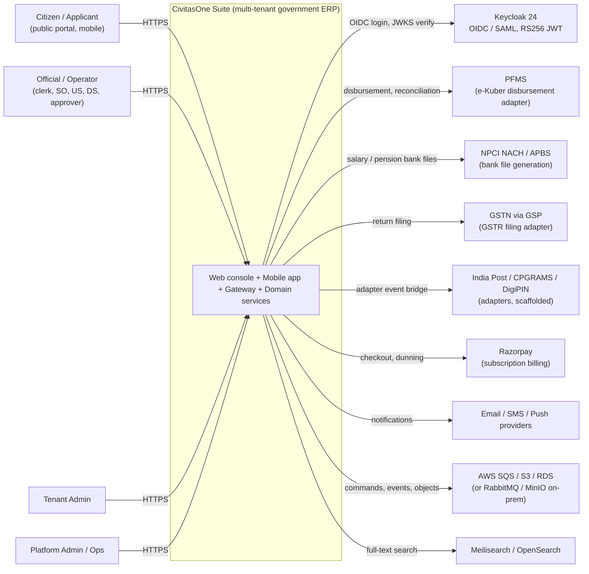
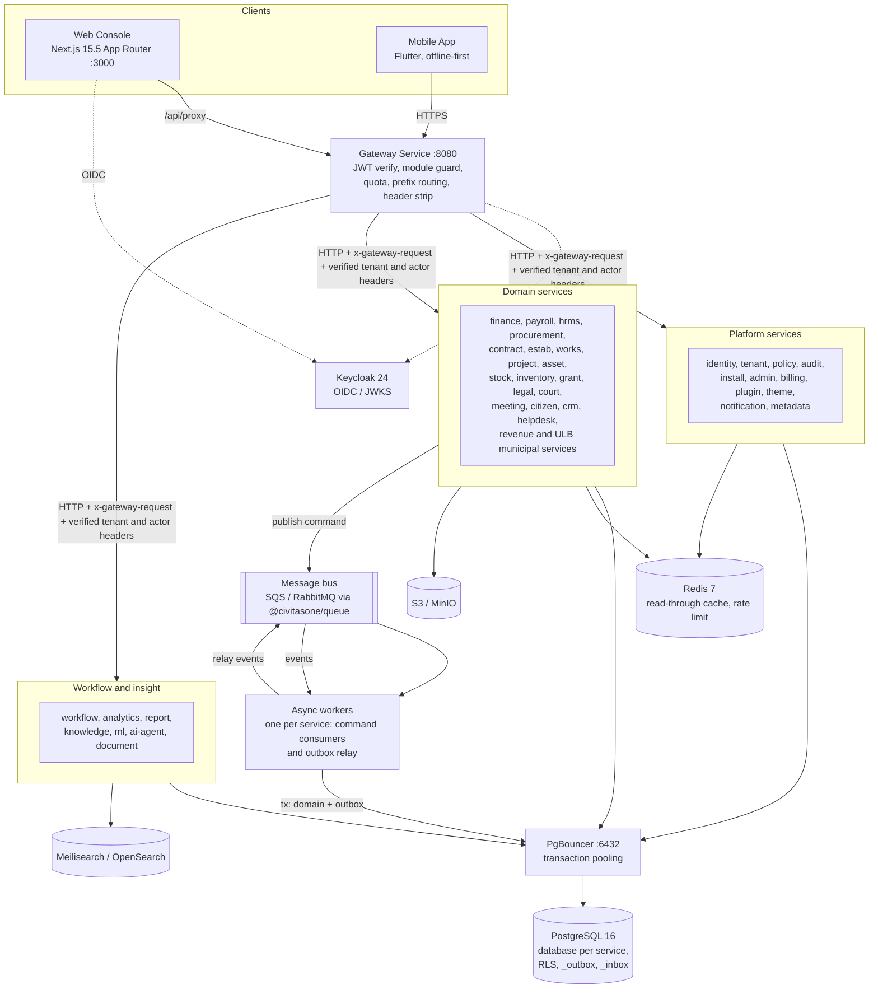
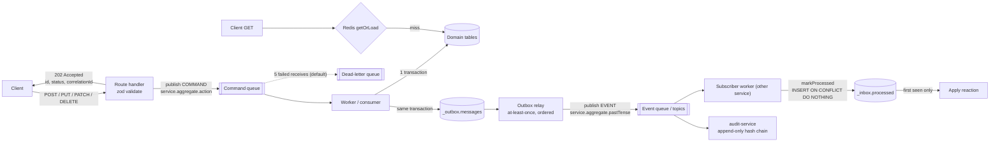
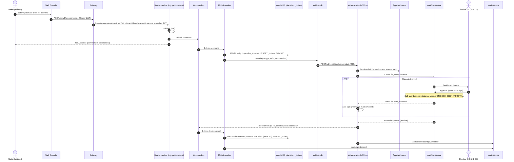
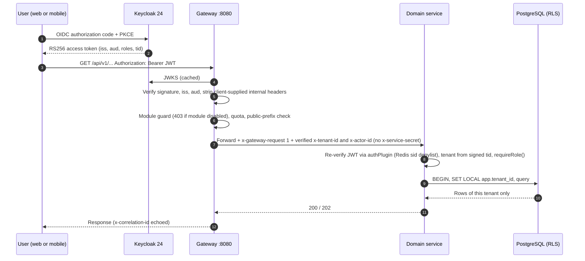
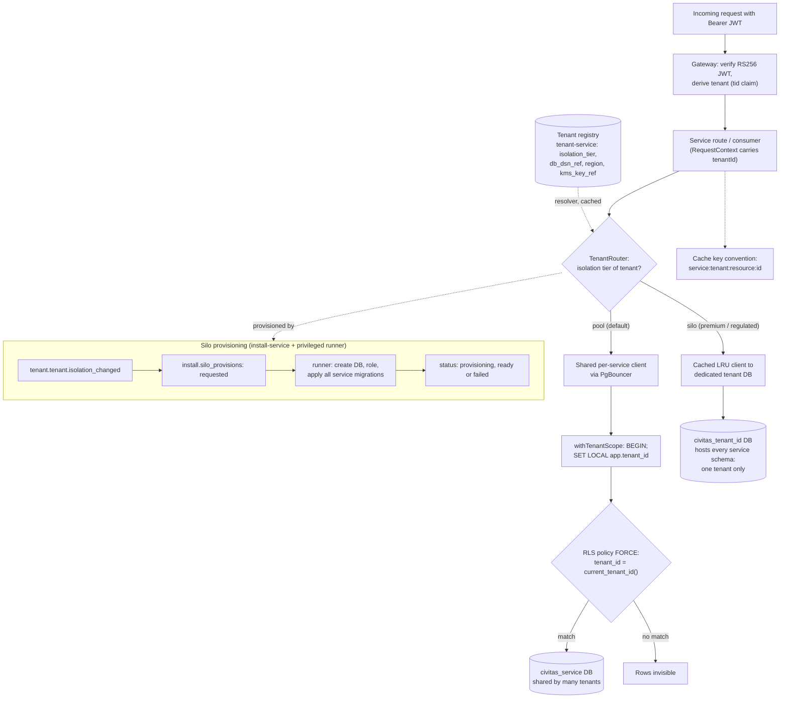
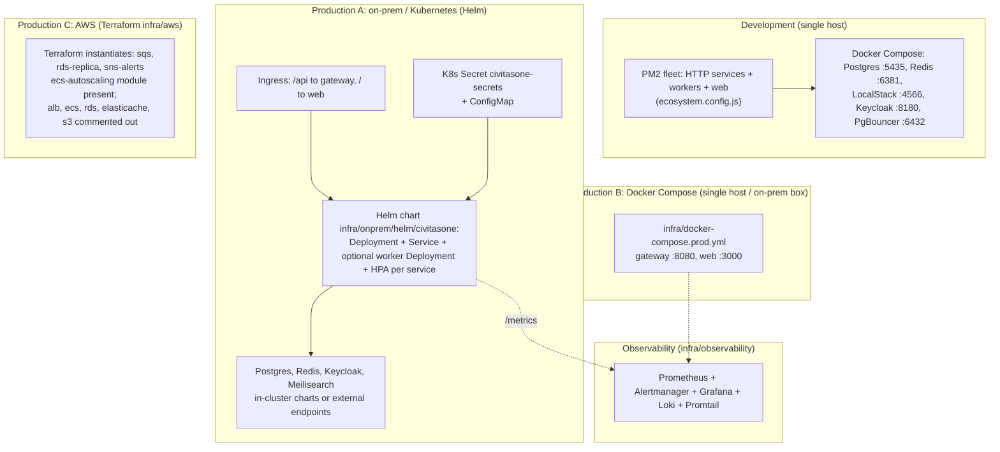

# CivitasOne Suite — Solution Architecture Document (SAD)

| Item | Value |
|---|---|
| Document | Solution Architecture Document |
| System | CivitasOne Suite — multi-tenant ERP for Indian Government, PSU and urban local bodies |
| Baseline build | `0a5843762` (2026-11-21) |
| Status | Submission draft, synthesised read-only from repository documents and code |
| Companion | `HLD.md` |

> **Evidence convention.** `[ARCH]` docs/ARCHITECTURE.md · `[ERP-HLA]` docs/architecture/ERP-HIGH-LEVEL-ARCHITECTURE.md · `[PLAT]` docs/PLATFORM-ARCHITECTURE.md · `[MT]` docs/architecture/MULTI-TENANCY.md · `[SVC]` docs/SERVICES.md · `[STD]` docs/STANDARDS.md · `[SEC]` docs/SECURITY.md · `[COMP]` docs/COMPLIANCE.md · `[PERF]` docs/PERFORMANCE.md · `[SELF]` docs/SELF-HOSTING.md · `[SCALE]` docs/SCALE-TO-1-LAKH-ANALYSIS.md · `[CONN]` docs/architecture/CONNECTION-BUDGET.md · `[DEP]` infra/DEPLOY.md · `[CLAUDE]` repository CLAUDE.md · `[CODE]` source inspected at the baseline build. Code wins over documents on conflict.

---

## 1. Overview

### 1.1 Purpose and scope
This SAD records the solution architecture of CivitasOne Suite: the architecture drivers, the structural views (context, containers, components), the data, integration and security architecture, the deployment views, quality-attribute scenarios and the key architecture decisions. It complements the HLD, which explains the business context and module decomposition.

### 1.2 System summary
CivitasOne is a pnpm/Turborepo monorepo of Fastify microservices — 68 service directories (66 DB-backed services incl. the gateway, plus `queue-service` which has no DB, plus the `adapters/` container directory for india-post) — behind a single gateway, with a Next.js web console and a Flutter mobile app. Integration is **HTTP for reads and message bus for writes**, using CQRS with a transactional outbox, a per-database inbox, a Redis read-through cache and universal audit. `workflow-service` is the approval router and `estab-service` (eOffice) is the cross-module decision backbone `[ERP-HLA §5][CONN][CODE]`.

### 1.3 Reading guide
Sections 2–3 set drivers and the top-level structure; 4–7 detail components, data, integration and security; 8 gives deployment; 9 maps quality attributes to mechanisms; 10 lists decisions. Section 11 records known gaps.

---

## 2. Architecture drivers

### 2.1 Key functional drivers
| ID | Driver | Source |
|---|---|---|
| F-1 | Cover government back-office domains (finance, HR/payroll, procurement, works, assets, legal, citizen, eOffice) and ULB citizen services in one suite | `[SVC][CODE]` |
| F-2 | Every consequential decision flows through a routed, auditable approval (eOffice + workflow) and executes automatically in the originating module | `[ERP-HLA §3]` |
| F-3 | Multiple organisations on one platform, with optional physical isolation | `[MT]` |
| F-4 | Packaging by edition (Small Office, PSU, Govt Dept) without code forks | `[CLAUDE §1]` |
| F-5 | Extensibility via plugins and tenant-level theming/branding | `[SVC][CODE: plugin, theme, plugin-sdk]` |

### 2.2 Constraints
| ID | Constraint | Source |
|---|---|---|
| K-1 | Database per service with separate login; no cross-database grants or cross-service SQL; cross-prefix joins banned and CI-checked | `[CLAUDE §3]` |
| K-2 | Writes asynchronous via command queue (202); reads via cache | `[STD §2]` |
| K-3 | Node 20 container runtime (engines/CI Node 22) / Fastify 4 / TypeScript strict / Drizzle; PostgreSQL 16 only (supertest/testcontainers are standard-only, not in the as-built stack) | `[CLAUDE §2]` |
| K-4 | Queue accessed only through `@civitasone/queue` adapter (SQS, RabbitMQ; Kafka named as adapter option in CLAUDE.md) | `[CLAUDE §2][ARCH §12]` |
| K-5 | Money as `bigint` paise; time as `timestamptz` UTC | `[STD §8]` |
| K-6 | Every endpoint authenticated unless declared public; every mutation emits an audit event; every input zod-validated | `[CLAUDE §3]` |
| K-7 | Indian regulatory context: DPDP Act 2023, CERT-In, GFR 2017, CSMOP, IT Act §65B, RBI/PFMS | `[COMP]` |

### 2.3 Quality attributes (priority order as evidenced)
1. **Security and tenant isolation** — RLS FORCE, Pool/Silo, edge JWT, fail-closed secrets.
2. **Auditability / integrity** — hash-chained append-only audit, hash-chained notings, maker-checker.
3. **Scalability** — 1,000 TPS goal; 100,000+ tenant design target (currently ~1,000 tenant readiness) `[PERF][SCALE]`.
4. **Reliability / consistency** — outbox, inbox, DLQ, DR targets RPO ≤ 15 min, RTO ≤ 4 h `[SELF]`.
5. **Operability** — health/ready/metrics, Prometheus alerting, correlation IDs.
6. **Maintainability / extractability** — uniform service anatomy; modules extractable to services.
7. **Compliance and accessibility** — GIGW 3.0 self-assessment, WCAG 2.2 AA.

---

## 3. Solution overview

### 3.1 C4 Level 1 — System context

*Figure: system-context (source: `diagrams/system-context.mmd`)*

The system serves four human roles (citizen, official, tenant admin, platform admin) and depends on Keycloak (identity), a message bus and object store (AWS or RabbitMQ/MinIO), search, notification providers, Razorpay, and Indian government rails reached through the `gov-adapters` package (PFMS, NACH/APBS, GSTN) `[CODE]`. Government rail adapters default to **mock** mode and are fail-closed when real credentials are absent.

### 3.2 C4 Level 2 — Containers

*Figure: container-diagram (source: `diagrams/container-diagram.mmd`)*

| Container | Technology | Responsibility |
|---|---|---|
| Web Console | Next.js 15.5 App Router (:3000); `/api/proxy` to the gateway | Operator and public UI; 61 route groups |
| Mobile App | Flutter, offline-first | Field and citizen UI |
| Gateway | Fastify (:8080) | JWT verification, module guard, API-key auth, quota, routing by longest prefix, header stripping |
| Domain / platform services | Fastify, one DB each | Bounded contexts (see section 4) |
| Workers | Same image, `dist/worker.js` | Command consumers and outbox relay, one per service that ships a worker |
| PgBouncer | transaction mode, :6432 | Connection multiplexing (`DB_VIA_PGBOUNCER`, pool max 5 per process) |
| PostgreSQL 16 | One cluster, database per service | System of record; RLS; `_outbox`, `_inbox` |
| Redis 7 | Read-through cache, rate limiting, sessions | Per-tenant keyed cache |
| Message bus | SQS (LocalStack in dev) or RabbitMQ | Commands and events |
| Object / search stores | S3 / MinIO; Meilisearch / OpenSearch | Documents; full-text search |
| Keycloak 24 | OIDC/SAML | Identity provider, realm `civitasone` |

Service ports: identity 3001 … estab 3010, hrms 3012, payroll 3013, workflow 3029, analytics 3031, then newer services in the 3032–3086 range and location 4012; the authoritative map is `ecosystem.config.js` `[CODE]`.

---

## 4. Component and service architecture

### 4.1 Database per service
Each DB-backed service owns exactly one database `civitas_<service>`, with its own least-privilege login. Services do not read or write other services' data `[CLAUDE §3.1][ARCH §5]`. Inside a database, modules own separate PostgreSQL schemas (e.g. `civitas_finance` → `gl`, `budget`, `treasury`, `payments`, `org`; `civitas_hrms` → `employee`, `leave`, `gpf`, `pension`, `claims`, `recruitment`). Every database also carries `_outbox` and `_inbox` schemas `[ARCH §5]`. A service can be lifted to its own cluster by changing a connection string `[CLAUDE §3.1]`. Maintenance loops (outbox relay, purge) use a separate BYPASSRLS "scanner" pool because FORCE RLS on `_outbox.messages` otherwise hides cross-tenant rows (11 wired today, 19 services could have one) `[CONN §1–2]`.

### 4.2 Gateway
The gateway holds a registry of ~100 prefix→upstream entries (`registry.ts`), resolved by longest prefix, with environment overrides `GATEWAY_<SERVICE>_URL`. It performs: JWT verification at the edge (`jwt-edge.ts`), `PUBLIC_PREFIXES` bypass, module guard returning 403 for disabled modules (`module-guard.ts`), API-key authentication that injects tenant and actor context (`api-key-auth.ts`), per-tenant quota (`quota-store.ts`), content-type and path guards, per-upstream circuit breaker (`upstream-proxy.ts`), and API/response metrics `[CODE: services/gateway-service/src]`. Services trust the gateway-provided context and do not re-verify the user's token `[PLAT: Key Design Decisions]`; calls between the gateway and services carry `x-service-secret`.

### 4.3 Service anatomy
Every service has `routes.ts`, `commands.ts`, `consumer.ts`, `repo.ts`, `schema.ts` and `shared/topics.ts` (single source of the messaging contract: `COMMANDS` and `EVENTS`) `[SVC §1]`. A service publishes only its own commands/events and subscribes to others' events; it never invokes another service's command topic `[SVC §6]`.

### 4.4 CQRS and outbox

*Figure: cqrs-outbox (source: `diagrams/cqrs-outbox.mmd`)*

Guarantees `[ARCH §11]`: ACID within a service; eventual consistency across services; at-least-once delivery with idempotent effect via `_inbox`; per-aggregate ordering by insertion-order draining; failed messages go to a DLQ after SQS_MAX_RECEIVE_COUNT receives (default 5) `[PLAT]`.

### 4.5 Service tiers
| Tier | Services (original catalogue) | Role |
|---|---|---|
| Core ERP | identity, tenant, finance, hrms, payroll | Identity, tenancy, financial/personnel backbone |
| Domain | procurement, contract, estab, stock, project, asset, grant, citizen, legal, crm, inventory, billing | Line-of-business |
| Supporting | policy, audit, notification, report, telephony, helpdesk, knowledge, workflow, analytics, location | Shared capabilities |
| Platform | install, plugin, theme, admin, queue (package + `queue-service` ops process, no DB), gateway | Bootstrap, extensibility, edge, transport |
| Added since the catalogue | meeting, court, visitor, works, revenue, inspection, metadata, ml, ai-agent, catalogue, journey, cdp, loyalty, document, recommendation, field, and ULB services (trade, shop, market, parking, parks, fire, building, advertisement, animal, swm, sewerage, drainage, roadcut, crematorium, event, refund, vendor, smarttransfer), plus `adapters/india-post` | Extended domains `[CODE: ecosystem.config.js, services/]` |

### 4.6 Workflow and eOffice
`workflow-service` provides definitions (nodes/edges per tenant), amount-condition routing, delegations, SLA, workbaskets, DMN/BPMN modules, DLQ, and domain dispatch on completion `[CODE: services/workflow-service/src/modules][ERP-HLA §4]`. `estab-service` provides eOffice files, DAK, DFA (draft→approve→sign→dispatch), e-sign, fleet, quarters, handover and paper-file migration modules `[CODE: services/estab-service/src/modules][ERP-HLA §3]`. The two-way contract is: **raise** via `eoffice-sdk` → `POST /v1/estab/files/from-module`; **decide-back** via event `{module}.{entity}.file_decided`.

*Figure: event-flow (source: `diagrams/event-flow.mmd`)*

---

## 5. Data architecture summary

| Aspect | Design | Source |
|---|---|---|
| Stores | PostgreSQL 16 per service; Redis 7; S3/MinIO; Meilisearch/OpenSearch | `[ARCH][CLAUDE]` |
| Identifiers | Standard entity columns: `id, tenantId, createdAt, updatedAt, createdBy, updatedBy, version`; tables prefixed `{service}_`; cross-domain references by opaque id string (e.g. `procurement_po:UUID`), never FKs | `[CLAUDE §3][STD §8]` |
| Money / time | `bigint` paise + ISO-4217; `timestamptz` UTC | `[STD §8]` |
| Migrations | Plain SQL, idempotent (`IF NOT EXISTS`), under `services/<svc>/migrations/`; Drizzle schema in `schema.ts` | `[PLAT]` |
| Tenant column + RLS | `tenant_id` on every tenant row; `ENABLE` + `FORCE ROW LEVEL SECURITY`; policy `tenant_id = current_tenant_id()` (GUC `app.tenant_id`) | `[ARCH §7]` |
| Cache | `getOrLoad(key, loader, ttl)`; key `{service}:{tenant}:{resource}:{id}`; TTL 1 s–1 h; invalidation by `delByPrefix` on write | `[ARCH §8]` |
| Pooling | PgBouncer transaction mode (`pgbouncer.ini`: `max_client_conn = 1000`); Postgres `max_connections = 200`; 76 distinct pools today, 84 forward-looking | `[CONN §2][CODE: infra/pgbouncer, infra/postgres]` |
| PII | AES-256-GCM field encryption (PAN, Aadhaar, bank, MFA TOTP); key `PII_ENC_KEY`; field-visibility policies per surface | `[PLAT][SEC §4.1]` |
| Consistency | Strong within a service; eventual across; exactly-once effect through inbox | `[ARCH §11]` |
| Backup / DR | Nightly logical backup + WAL archiving; RPO ≤ 15 min, RTO ≤ 4 h | `[SELF §4]` |
| Retention | Security logs ≥ 180 days; hash-chained audit retained as record of action while PII is erased on DPDP erasure | `[COMP §2–3]` |

---

## 6. Integration architecture summary

### 6.1 Internal integration rules
| Concern | Mechanism | Source |
|---|---|---|
| Cross-service read | HTTP API, `x-service-secret`, rare | `[ARCH §10]` |
| Cross-service write | Command/event on message bus only | `[ERP-HLA §2]` |
| Within-service write | Route → zod → command → 202; consumer → inbox check → tx(domain + outbox) → event → cache refresh | `[ERP-HLA §2]` |
| Audit | Every mutation emits `audit.event.record` | `[CLAUDE §3.8]` |
| Notification | `notification.send` / `notification.message.send` | `[ERP-HLA §4]` |
| Contracts | `@civitasone/types` and `@civitasone/events`; consumer-driven contract tests | `[STD §2, §5]` |
| Topics | Commands `{service}.{aggregate}.{action}`; events `{service}.{aggregate}.{pastTense}`; declared in `src/shared/topics.ts` | `[SVC §6]` |

### 6.2 Gateway and API conventions
Versioned `/v1/{service}/{resource}` routes reachable only via the gateway; cursor pagination; uniform error envelope (`code`, `message`, `correlationId`, `retryable`, `fieldErrors`); idempotency keys on commands; OpenAPI generated from route/zod schemas and served at `/openapi.json` `[STD §2]`. The legacy `/api/<service>` prefix and the `/api/v1/<service>` prefix coexist in the registry `[CODE: registry.ts]`.

### 6.3 External integration
| External | Mechanism | State |
|---|---|---|
| Keycloak | OIDC + JWKS | Built |
| PFMS | `gov-adapters/pfms.ts` (`PFMS_MODE` mock\|sandbox\|production; timeouts; fail-closed) | Adapter built; mock by default |
| NACH / APBS | `gov-adapters/nach.ts` bank-file generation | Adapter built |
| GSTN (GSP) | `gov-adapters/gstn.ts` GSTR-1 / 3B | Adapter built |
| India Post family, CPGRAMS, DigiPIN, DREAM, Dak Karmayogi | `services/adapters/india-post/*`, bridging to the event bus | `apt-adapter` scaffolded; rest placeholders |
| Razorpay | Billing checkout | Built `[PLAT]` |
| Outbound webhooks to integrators | Proposed (notification-service module) | **Not built** `[SCALE §10]` |
| Connector framework | `packages/connector-framework`, `integration-config` | Present `[CODE]` |
| NIC eOffice | No integration; CivitasOne ships its own eOffice | See HLD §4.2 |

Outbound calls use `@civitasone/circuit-breaker` `[PLAT][CODE]`.

---

## 7. Security and multi-tenancy summary

### 7.1 Authentication and edge trust

*Figure: auth-flow (source: `diagrams/auth-flow.mmd`)*

Controls `[ARCH §9][CODE]`: RS256 signature verification against JWKS, `iss` and `aud` validation; stripping of spoofable internal identity headers; module guard; the gateway strips `x-service-secret`/`x-internal*`/`x-gateway-request` inbound and does **not** attach `INTERNAL_SERVICE_SECRET` to proxied client traffic (doing so previously handed every authenticated caller an internal credential); downstream services re-verify the JWT in `authPlugin` and take tenant from the signed `tid` claim; `x-service-secret` is used only for genuine internal service-to-service calls (constant-time compare, fail-closed). `packages/auth` defaults to RS256; HS256 is a test/dev fallback and is fatal in production. Identity-service offers MFA, WebAuthn, SAML, SCIM, device trust, break-glass, API keys and operator management modules `[CODE: identity-service/src/modules]`.

### 7.2 Authorisation and segregation of duties
Role-based access (`requireRole()`), policy-service evaluation, and workflow SoD: initiators are barred from completing their own checker task for procurement indent/PO/plan/PO-amendment, payroll run and meeting decision (`STRICT_SOD_REF_TYPES`), including against super-admin break-glass `[CODE: workflow-service/src/modules/tasks/sod.ts]`.

### 7.3 Multi-tenancy (tiered)

*Figure: multi-tenancy (source: `diagrams/multi-tenancy.mmd`)*

| Property | Pool | Silo |
|---|---|---|
| Isolation | Logical: tenant_id + FORCE RLS + GUC | Physical: dedicated database hosting every service schema |
| Density / cost | Very high | One DB per tenant |
| Per-tenant backup, erasure, residency, BYOK | Harder (scoped delete, crypto-shredding) | Straightforward (drop / place / encrypt DB) |
| Migrations | N service DBs | N services × silo tenants (orchestrator required) |
| Selection | Default | `tenant.isolation_tier = silo`; resolver returns `{tier, connectionString}` |

Implementation status `[MT §8]`: `TenantRouter` + resolvers in `packages/db`, registry columns (`isolation_tier`, `db_dsn_ref`, `kms_key_ref`), `PATCH /v1/tenants/:id/isolation`, install-service `silo_provisions` state machine and a provisioning script (proven: 245 migrations into one DB) are built; estab-service is the reference rollout; other services, Redis-backed resolver and KMS/BYOK + residency are open.

### 7.4 Data protection and compliance
Field encryption AES-256-GCM, TLS in transit, secrets from a secret manager (not exposed to plugins/themes/logs), rotation ≤ 90 days (policy), SHA-256 hash-chained audit, DPDP consent/erasure workflows, CERT-In log retention and incident alerts, GFR maker-checker, CSMOP noting, IT Act §65B integrity `[SEC][COMP]`. `COMPLIANCE.md` is a control-mapping aid, not a certification.

---

## 8. Deployment view

*Figure: deployment (source: `diagrams/deployment.mmd`)*

| Target | Artefacts | Notes |
|---|---|---|
| Development | `infra/docker-compose.yml` (Postgres :5435, Redis :6381, LocalStack :4566, Keycloak :8180, PgBouncer :6432) + PM2 fleet from `ecosystem.config.js` (134 processes: 66 HTTP + 66 workers + queue + web) | Source is bind-mounted |
| Production — Docker Compose | `infra/docker-compose.prod.yml` + `.env`; non-root `node` uid 1000; `/health`, `/ready`; gateway `${GATEWAY_PORT:-8080}`, web `${WEB_PORT:-3000}` | Single host / on-prem box `[DEP §A]` |
| Production — Kubernetes | Helm chart `infra/onprem/helm/civitasone` (`values.yaml`, `values.staging.yaml`, `values.production.yaml`): per-service Deployment, Service, optional worker Deployment, optional HPA, ConfigMap, Secret `civitasone-secrets`, Ingress (`/api`→gateway, `/`→web); `infra/onprem/k8s/base/hpa.yaml` | Stateful dependencies are referenced, not vendored `[DEP §B]` |
| Production — AWS | Terraform `infra/aws/envs/production/main.tf` instantiates `sqs`, `rds_replica`, `sns_alerts`; module `ecs-autoscaling` exists; `alb`, `ecs`, `rds`, `elasticache`, `s3` are commented placeholders | Partial `[CODE]` |
| Images | One parametrised multi-stage `Dockerfile` (`SERVICE`, `ENTRY`, `PORT` build args); `apps/web/Dockerfile` | `[DEP]` |
| Observability | `infra/observability`: Prometheus (15 s scrape), Alertmanager, Grafana, Loki, Promtail; alert rules for DLQ, consumer stall, outbox relay failure, p95 latency, per-tenant rate, captured errors | `[CODE]` |
| Secrets | Injected from host env/secret manager; fail-closed outside `development`/`test` | `[CODE: ecosystem.config.js]` |
| Self-hosting / residency | Helm or Ansible pattern inside Indian government data centres | `[COMP §2][SELF]` |

Not evidenced in source: multi-region topology, blue/green or canary deployment, and cross-region DR (all listed as gaps in `[SCALE]`).

---

## 9. Quality-attribute scenarios

| ID | Attribute | Scenario (stimulus → response) | Architectural mechanism | Measure / source |
|---|---|---|---|---|
| Q-1 | Security — tenant isolation | A bug in application code omits a tenant filter | RLS is a defence-in-depth backstop engaged by the tenant GUC (`current_tenant_id()`), effective only when the service role is NOBYPASSRLS; the app-layer `WHERE tenant_id` remains the primary control; cache keys embed tenant | `[ARCH §7–8]` |
| Q-2 | Security — spoofing | A client sends forged `x-tenant-id` / role headers | Gateway strips internal headers and overwrites `x-tenant-id`/`x-actor-id` from the verified token; services re-verify the JWT and take tenant from signed `tid` (`x-service-secret` only guards internal service-to-service calls) | `[ARCH §9]` |
| Q-3 | Security — regulated tenant | A department demands physical separation and own keys | Silo tier: dedicated DB, per-tenant `kms_key_ref`, residency `region` | `[MT §7]`; KMS wiring open |
| Q-4 | Integrity — approvals | An initiator tries to approve their own PO | Workflow SoD guard returns 403 `SOD_SELF_APPROVAL`; domain layers return 403 `SELF_APPROVAL_FORBIDDEN`; downstream `assertDistinctMakerChecker` | `[CODE]` |
| Q-5 | Auditability — tampering | A past record is altered | SHA-256 hash chain on audit entries and eOffice notings makes tampering detectable | `[COMP §1]` |
| Q-6 | Reliability — broker outage | The bus is unavailable after a DB commit | Outbox rows persist; relay backs off and drains in order after recovery | `[ARCH §6]` |
| Q-7 | Reliability — duplicates | A message is redelivered | Inbox `ON CONFLICT DO NOTHING` makes the reaction idempotent | `[ARCH §11]` |
| Q-8 | Reliability — poison message | A handler repeatedly fails | Retries, then DLQ after `SQS_MAX_RECEIVE_COUNT` receives (default 5; `NonRetryableError` goes straight to DLQ); alerts `DlqAnyMessage`, `DlqDepthHigh` | `[PLAT][CODE: alert.rules.yml]` |
| Q-9 | Performance — read load | Hot dashboard reads at peak | Redis read-through cache, per-tenant keys; p95 GET < 500 ms | `[PERF §1]` |
| Q-10 | Performance — write load | Burst of submissions | 202 + queue absorbs burst; write-ack < 500 ms | `[STD §6]` |
| Q-11 | Scalability — connections | ~130 DB-backed processes (132 carry a DATABASE_URL) would need ~1,490 connections (`[CONN]` measurement dated 2026-09-08) | PgBouncer transaction pooling, per-process pool max 5 | `[CONN §1]` |
| Q-12 | Scalability — tenant growth | Tenant count grows toward 100K | Pool/Silo split; planned shard registry, quotas, rate limiting, metering | `[SCALE]` — **planned, not built** |
| Q-13 | Availability — service failure | One service crashes | Independent deployment and database; gateway circuit breaker; HPA replicas | `[CODE][DEP]` |
| Q-14 | Recoverability | Data-centre loss | WAL archiving + nightly dumps; RPO ≤ 15 min, RTO ≤ 4 h | `[SELF §4]` |
| Q-15 | Compliance — erasure | A data principal requests erasure | Erasure workflow in owning service; audit retains the event but not PII; Silo allows drop of tenant DB | `[COMP §2][MT §7]` |
| Q-16 | Operability — incident | Error spike or consumer stall | Prometheus alerts (`QueueConsumerStalled`, `OutboxRelayFailing`, `HttpP95LatencyHigh`), correlation IDs, hash-chained audit for forensics | `[CODE][COMP §3]` |
| Q-17 | Modifiability — new decision type | A new module needs approval routing | Reuse `eoffice-sdk` raise/decide-back; add refType and approval-matrix rows; no estab code change | `[ERP-HLA §3]` |

---

## 10. Key architecture decisions (ADR summary)

| ADR | Decision | Context / rationale | Consequences | Source |
|---|---|---|---|---|
| ADR-01 | **Database per service** (one cluster, one DB and login per service) | Blast-radius containment, independent deployability, bounded contexts | Cross-service reads via HTTP, writes via bus; no joins; many pools to manage | `[ARCH §5][CLAUDE §3.1]` |
| ADR-02 | **CQRS everywhere**: commands via queue (202), reads cache-first | Horizontal scaling, absorb bursts | Eventual consistency; clients must handle 202 | `[PLAT][STD §2]` |
| ADR-03 | **Transactional outbox + inbox** | Solve dual-write; at-least-once with idempotent effect | Extra tables per DB; `_outbox.messages` is exempt from RLS (migration 0051); selected services also open BYPASSRLS scanner pools (11 wired) for cross-tenant maintenance | `[ARCH §6][CONN]` |
| ADR-04 | **Tiered multi-tenancy (Pool default + Silo)** with `TenantRouter` | Cost density for most tenants, physical isolation for regulated ones; one codebase | Router rollout per service; migration orchestration across silos | `[MT §1–2]` |
| ADR-05 | **Gateway as the first enforcement point**; services re-verify the JWT (defence in depth) and derive tenant from the signed `tid`; `x-service-secret` governs internal service-to-service calls only | Single place for JWT, module guard, quota, with no single point of trust | Gateway is a critical shared component; JWKS availability and internal-secret management are crucial | `[PLAT][ARCH §9]` |
| ADR-06 | **Keycloak OIDC/RS256** as identity provider | Standards-based SSO, MFA, SAML | External dependency; JWKS availability | `[ARCH §9]` |
| ADR-07 | **eOffice as decision backbone** (raise file / decide-back via `eoffice-sdk`) instead of per-module approval screens | Uniform CSMOP-style noting, amount-matrix routing, hash-chained notes, auto-execution | Modules depend on estab contract; 11 decision types wired | `[ERP-HLA §3]` |
| ADR-08 | **Queue adapter pattern** (SQS, RabbitMQ) | On-prem vs AWS portability | Lowest-common-denominator semantics; `QUEUE_DRIVER` switch | `[ARCH §12][CLAUDE §2]` |
| ADR-09 | **Money as bigint paise**, timestamptz UTC | GFR financial precision | Conversion at UI boundary | `[ARCH][STD §8]` |
| ADR-10 | **Module isolation inside a service (L2)**: own schema, no cross-module joins, CI-enforced | Every module extractable into a service | Cross-module data via interfaces/events/read models | `[CLAUDE §3.4]` |
| ADR-11 | **PgBouncer transaction pooling** with `prepare:false` | Fleet of 130 DB processes vs 200 Postgres connections; RLS GUC set per transaction | Prepared statements disabled; per-process pool 5 | `[CONN][PERF §2]` |
| ADR-12 | **Fail-closed secrets, allow-list dev exemption** (SEC-017) | Avoid silent dev fallbacks in staging/uat | Staging needs real secrets | `[CODE: ecosystem.config.js]` |
| ADR-13 | **Self-hostable by design** (Helm/Compose) | DPDP residency, air-gapped departments | Operators own backups and DR | `[COMP §2][DEP]` |
| ADR-14 | **Provider-agnostic search adapter** with ILIKE fallback | Meilisearch on-prem, OpenSearch on AWS | Tenant-filtered documents; degraded search on outage | `[ARCH: Full-Text Search]` |

---

## 11. Known gaps and open items

1. **Scale to 100K tenants** (not users): shard registry, quotas, gateway rate-limit enforcement, automated provisioning, multi-region, canary rings, event replay, tenant export, metering, outbound webhooks are open `[SCALE]`.
2. **Silo tier** rolled out only in estab-service; remaining services, Redis-backed resolver, KMS/BYOK and residency wiring are open `[MT §8]`.
3. **AWS Terraform** is partial (see section 8).
4. **Availability SLA** is undefined; only RPO/RTO and latency/error SLOs are stated.
5. **Government adapters** run in mock mode by default; the India Post adapters (except `apt-adapter`) are placeholders.
6. **Documentation drift**: `ARCHITECTURE.md`, `SERVICES.md` and `PLATFORM-ARCHITECTURE.md` describe 33 services; code has 68 directories (66 DB-backed + queue-service + `adapters/` container), 134 PM2 processes, 33 packages, DLQ after 5 receives (older docs say 3), Next.js 15.5 (older docs say 14), Node 20 runtime / 22 engines and CI.
6a. **RLS gaps**: no runtime assertion that service roles are NOBYPASSRLS (CI/test only); `_outbox.messages` (migration 0051) and command-result tables are exempt; 11 BYPASSRLS scanner pools exist. Service-level documentation for newer services (ULB, works, meeting, court, etc.) is not in the six source documents.
7. **Formal certifications** (GIGW 3.0/STQC, ISO 27001/SOC 2) are not evidenced as obtained; the repository provides control mappings and self-assessment only.
