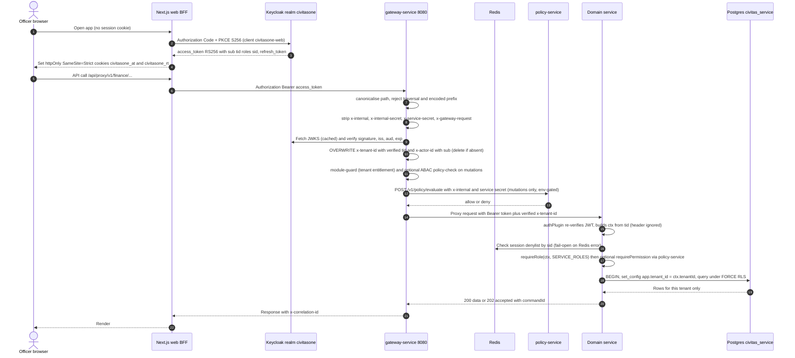
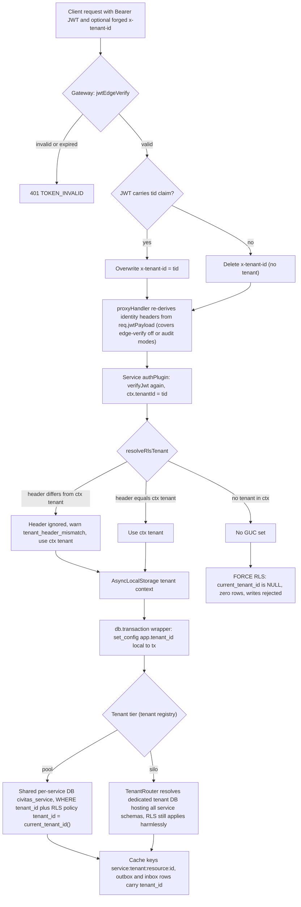
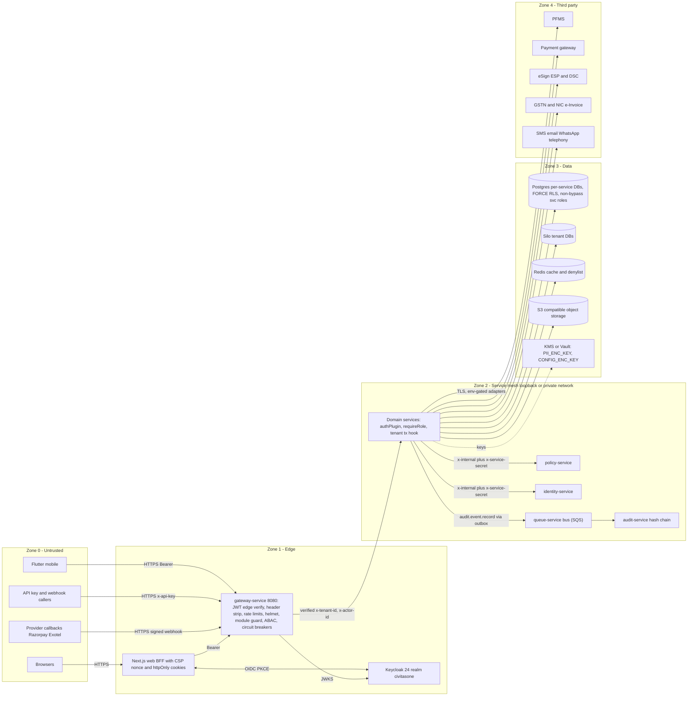

# CivitasOne Suite — Security Architecture

| | |
|---|---|
| **Document** | Security Architecture (formal design document) |
| **System** | CivitasOne Suite — multi-tenant ERP for Indian Government, PSU, Section-8, cooperative and small-office tenants |
| **Baseline** | `civitasone-suite` @ `0a5843762` (main) |
| **Status** | Draft for review. Descriptive of the code at the baseline commit; not a certification. |
| **Companions** | `DATA-ARCH.md`, `INTEGRATION-ARCH.md` |
| **Evidence convention** | Every control below cites a doc or a source path. Where doc and code disagree, the code is treated as authoritative and the disagreement is listed in Appendix A. |

---

## 1. Introduction and scope

### 1.1 Purpose
This document describes how CivitasOne authenticates principals, authorises actions, isolates tenants, protects data, proves what happened, and what threats and compliance obligations those controls answer. It is written for security reviewers, auditors (CERT-In, STQC/GIGW, C&AG) and engineers extending the platform.

### 1.2 Scope
In scope: the edge (`apps/web` BFF, `services/gateway-service`), the identity provider (Keycloak 24 in the dev compose / 25.0 in the prod compose, realm `civitasone`), the service fleet (68 service directories under `services/`, 66 with their own migrations), shared security packages (`packages/auth`, `packages/db`, `packages/data-governance`, `packages/kms`, `packages/render`, `packages/outbox`, `packages/search`), and the data tier (Postgres 16, Redis, SQS, S3-compatible storage).

Out of scope: physical/network hardening of a specific customer data centre, the contents of Keycloak production secrets, and third-party systems' own security.

### 1.3 Security posture (from `docs/SECURITY.md` §1)
Trust-first: security by default, least privilege, explicit trust boundaries, auditable control operation. Controls are classed *platform-owned*, *tenant-configurable* or *operationally enforced*. Claims must map to a control owner and verifiable evidence.

### 1.4 Non-negotiable invariants
1. A tenant identity is derived **only** from a signature-verified JWT (`tid` claim) or a gateway-verified API key — never from a client-supplied header.
2. Authorisation is enforced **in the service** (route guard), not only in the UI.
3. Tenant isolation is defence in depth: application `WHERE tenant_id` predicates remain the primary control and `FORCE ROW LEVEL SECURITY` is a backstop. FORCE RLS migrations exist across 66 services, but table-level coverage has not been audited and is not proven by counting migration files. `_outbox.messages` has RLS dropped (migration 0051) and 11 `BYPASSRLS` scanner pools exist.
4. Money is `bigint` paise; audit is append-only and hash-chained; consequential actions are maker-checker.
5. External integrations are env-gated and fail closed in production when unconfigured.

---

## 2. Authentication

### 2.1 Identity provider
Keycloak 24 (dev compose) / **25.0 (prod compose)**, realm **`civitasone`** (`infra/keycloak/civitasone-realm.json`). The realm export is **not hardened to the level the flow column suggests**: see the weaknesses below the table. Clients:

| Client | Type | Flow | Notes |
|---|---|---|---|
| `civitasone-web` | public | Authorization Code + PKCE S256 intended; **`directAccessGrantsEnabled=true` (Resource Owner Password / password grant) is also enabled** on this public client; redirect URIs include `http://localhost:3000/*` | Mappers: `tenant-id-mapper` (user attribute `tenantId` → claim **`tid`**), `realm-roles-mapper` (→ claim **`roles`**), `audience-account` |
| `civitasone-mobile` | public | Authorization Code + PKCE S256 (`flutter_appauth`); `webOrigins` is `["*"]` and a redirect URI is `http://localhost:*` | Same `tid` and `roles` mappers |
| `civitasone-services` | confidential | `client_credentials` (service accounts) | `roles` mapper only |
| `civitasone-admin-cli` | confidential | service account; **`directAccessGrantsEnabled` also on** | `roles` and `tid` mappers (operations tooling) |

Realm settings of note: `accessTokenLifespan` = **1800 s** (30 min, meets the CERT-In ≤30 min note in VAPT-004), SSO session idle 1800 s, SSO session max 28 800 s, brute-force protection on, `sslRequired=external`, password policy `length(12) + upper + lower + digit + special + passwordHistory(5)`. Realm roles: **79** (platform, tenant and domain roles — see §3.2).

**Realm weaknesses in the export (open items, understated claims removed):** (1) ROPC / password grant is enabled on the public web client and on admin-cli, bypassing the browser PKCE flow and any step-up; (2) localhost redirect URIs (`http://localhost:3000/*`, `http://localhost:*`) and wildcard `webOrigins ["*"]` on mobile are present in the production-intended realm export; (3) **no OTP policy and no required actions are configured, so MFA is unenforced** (VAPT-010 open); (4) Keycloak `eventsEnabled`/`adminEventsEnabled` are unset, so there is **no Keycloak authentication or admin event log**. Treat the PKCE-only posture as a design intent, not an enforced property.

### 2.2 Token model
Tokens are **RS256** JWTs. `@civitasone/auth` (`packages/auth/src/index.ts`) `verifyJwt`:
- resolves keys from the realm JWKS (cached singleton), `algorithms: ["RS256"]`, checks `iss = {KEYCLOAK_URL}/realms/{realm}`;
- validates `aud` (`JWT_AUDIENCE`, else `KEYCLOAK_CLIENT_ID`); in production an unset audience is a fail-closed error (SAST-004);
- **HS256 shared-secret mode is forbidden in production** (`resolveAlgorithm`, SEC-1) and is available only when `NODE_ENV` is explicitly `development` or `test` (`isDevOrTestEnv`); `assertDevPostureNotInProduction()` runs at boot in every service (F2).

Claims consumed (`CivitasJwtPayload`): `sub` (actor), **`tid`** (tenant), `roles` (string array), `sid` (Keycloak session id), `exp`. A dev-only `tenantId` alias exists. For an RS256 token with no `tid`, `toRequestContext` yields an **empty tenant** and never falls back to a header (SEC-2, F2 follow-up); only HS256 dev/test tokens may take a header tenant.

### 2.3 Two-layer verification
1. **Gateway edge** (`services/gateway-service/src/jwt-edge.ts`): `GATEWAY_JWT_EDGE_VERIFY` = `true` (default, reject with 401 `TOKEN_INVALID`) | `audit` (log and pass) | `off`. Path canonicalisation (`path-guard.ts`) runs *before* the mode check so a malformed or `%2e%2e` path is refused even when verification is off.
2. **Every service** (`packages/auth/src/plugin.ts`, `authPlugin`): re-verifies the Bearer token; the gateway's verified claims are deliberately **not** forwarded as trusted headers. A service reached directly (bypassing the gateway) therefore still authenticates.

Bearer-exempt surfaces are an explicit allow-list shared by gateway and web BFF (`@civitasone/types` `gatewayPublic.ts`: `PUBLIC_PREFIXES`, exact `PUBLIC_ROUTES`, device-token routes, billing and telephony webhook prefixes). Webhook routes authenticate by provider signature over the raw body (`x-razorpay-signature`, `x-twilio-signature`/`x-exotel-token`), and the gateway drops any client identity headers on them.

### 2.4 Non-interactive principals
- **API keys**: `x-api-key` is resolved against identity-service (`POST /internal/apikeys/verify`, with scope check). Only a server-set boolean `req.apiKeyAuthenticated` plus identity-service-supplied tenant/actor can substitute for a Bearer token (`api-key-auth.ts`, SEC-023/024).
- **Service accounts** (`civitasone-services`): `client_credentials`; role `service_account`.
- **Service-to-service**: `x-internal: 1` plus `x-service-secret` = `INTERNAL_SERVICE_SECRET` (§5.4).
- **Visitor devices**: opaque device bearer tokens on an exact route allow-list; tenant and actor come from the device record upstream, never from headers (UAT FQ9 #16).

### 2.5 Sessions
- **Web** (`apps/web/src/lib/auth/config.ts`, `sessionCookies.ts`, `middleware.ts`): cookies `civitasone_at` / `civitasone_rt`, **httpOnly, SameSite=Strict, Secure in production**; scopes `openid profile email` only — **no `offline_access`**, so a web session cannot outlive the SSO session (A11Y-01). Middleware refreshes ~60 s before expiry through a **single-flight** refresh cache (Keycloak revokes a session on refresh-token reuse), and treats an undecodable cookie as unauthenticated. A per-request **nonce CSP** is set in middleware (`script-src 'self' 'nonce-…'`, `frame-ancestors 'none'`).
- **Revocation** (`packages/auth/src/denylist.ts`, SEC-006): identity-service writes the revoked session's `sid` to a shared Redis keyspace with TTL `ACCESS_TOKEN_LIFESPAN_SECONDS`; every service's `authPlugin` checks it per request. **Design decision: fail-open on Redis error** (logged), because the denylist is defence-in-depth over signature+expiry and a Redis blip must not log out the fleet.
- **Step-up and device trust**: headers `x-step-up-token`, `x-device-id`, `x-device-trust-token` are forwarded by the gateway; identity-service issues step-up tokens (`POST /v1/devices/step-up`).
- **MFA**: **unenforced** at the baseline. `scripts/ops/configure-mfa-keycloak.sh` exists to configure an OTP policy and `mfa_enforced` for privileged roles, but the realm export carries no OTP policy or required actions (VAPT-010 **open**, §7.3).

### 2.6 Diagram — authentication and authorisation request flow


---

## 3. Authorisation

### 3.1 Model overview
CivitasOne uses layered authorisation, each layer independently enforced:

| Layer | Where | Mechanism | Default |
|---|---|---|---|
| L1 Module entitlement | gateway `module-guard.ts` | Is the module licensed/enabled for the tenant (admin-service composition projection). Modes `off` / `shadow` / `enforce` per tenant | `off` (legacy fail-open) until a tenant is flipped |
| L2 ABAC | gateway `policy-check.ts` → policy-service `/v1/policy/evaluate` | Mutations only (POST/PUT/PATCH/DELETE); skips `identity`, `policy`, `audit`, `install`, `admin` routes | `POLICY_ENFORCE=off` (also `audit`, `true`) |
| L3 Role guard | every service route | `requireRole(ctx, ROLE_CONST)` → `hasAnyRole` exact-string match against the verified `roles` claim | **Always on** — the authoritative control |
| L4 Permission key | service code via `@civitasone/auth/permissions` | `requirePermission(ctx, "resource.action")` → policy-service; `super_admin` fast path; policy outage ⇒ 503 `POLICY_UNAVAILABLE` (fail closed) | Used where fine-grained rules apply |
| L5 Record scope | service domain code | Self-scope (employee sees own), classification clearance (eOffice), maker-checker | Per module |

The gateway layers L1/L2 are defence in depth and are **runtime-togglable and default-off**; a reviewer must not credit them as always-on. The always-on controls are L3 plus RLS (§4).

### 3.2 Role model and tiers
Roles are Keycloak **realm roles** carried in the `roles` claim (79 in the realm export). There is no single formal tier registry; tiering is by convention and is visible in service role constants (for example `services/hrms-service/src/shared/roles.ts`, and the web mirrors in `apps/web/src/lib/auth/*`). The conventions are:

| Tier | Examples | Typical power |
|---|---|---|
| T0 Platform | `super_admin`, `platform_admin`, `migration_admin`, `security_admin`, `install_admin` | Cross-tenant operations; `super_admin` short-circuits ABAC permission checks |
| T1 Tenant administration | `tenant_admin`, `admin` | Tenant configuration, user and role administration |
| T2 Domain admin | `finance_admin`, `hr_admin`, `payroll_admin`, `procurement_admin`, `estab_admin`, `works_admin`, `asset_admin`, `billing_admin`, `crm_admin`, `legal_admin` | Full control of one module, including PII reveal where granted |
| T3 Domain officer / approver | `finance_officer`, `hr_officer`, `payroll_officer`, `procurement_officer`, `estab_officer`, `section_officer`, `dept_head`, `supervising_officer`, `reviewing_officer`, `vigilance_officer` | Operate and approve within module; maker-checker participants |
| T4 Staff and self-service | `employee`, `manager`, `officer`, `observer`, `store_officer`, `inspector` | Own-record access and team views |
| T5 External | `citizen`, `data_principal`, careers applicants | Own applications only; denied by staff-only route groups |
| T6 Machine | `service_account`, internal elevation (§3.4) | Service-to-service |

Guard definition (every service has its own copy of the helper, e.g. `services/hrms-service/src/shared/context.ts`):
```
requireRole(ctx, roles): if !hasAnyRole(ctx, roles) -> 403 FORBIDDEN "requires one of: …"
```
`hasAnyRole` is an **exact string match with no `super_admin` fast path** (documented in `plugin.ts`); a route that should admit `super_admin` must list it. Route-level constants such as `READER_ROLES`, `HR_ROLES`, `DIRECTORY_ROLES`, `OFFICER_ROLES` are the unit of review.

### 3.3 Web gate versus service guard
These are two different controls with different purposes and must not be conflated.

| | **Web gate** | **Service guard** |
|---|---|---|
| Location | Next.js layouts/middleware, `lib/auth/roleGuard.ts`, `navRoles.ts`, `workRoles.ts`, module visibility | Fastify route handlers, `requireRole` / `requirePermission` |
| Input | Roles decoded from the access-token cookie **without signature verification** (`decodeJwtPayload`) | Roles from the **signature-verified** token (`ctx.roles`) |
| Purpose | Navigation and UX: hide menus, redirect, avoid dead ends | **Security boundary** |
| Bypass | Trivially bypassed by calling the API directly | Not bypassable through the gateway or directly |
| Failure mode if wrong | Cosmetic (user sees a link that 403s, or cannot see one they may use) | Privilege escalation or lock-out |

Rules that follow: (a) UI gating is never cited as a security control (Threat Model T2: "no frontend-only enforcement"); (b) the web role lists *mirror* the service lists and must be kept in step — the code comments say so (`STAFF_ROLES` "Mirrors the /hr layout boundary … keep in sync"), and drift has occurred and been fixed (`docs/HUMAN-REVIEW-BACKLOG.md` item 2a: server `ADMIN_ROLES` lacked `tenant_admin` that the UI gate admitted); (c) server lists are the source of truth.

### 3.4 Internal elevation path
A request carrying `x-internal: 1` **and** a tenant header is accepted only if `x-service-secret` equals `INTERNAL_SERVICE_SECRET` under constant-time comparison (`plugin.ts`, R12). It is then given actor `00000000-0000-0000-0000-000000000099`, type `service_account`, and the real-role set `super_admin, tenant_admin, dept_head, officer, auditor, citizen, service_account`, with an `internal_service_elevation` log line (caller, tenant, path). Safeguards:
- The gateway strips `x-internal`, `x-internal-secret`, `x-internal-caller`, `x-service-secret`, `x-gateway-request` from inbound traffic and **never** attaches the real secret to proxied traffic (that previously handed any signed-in user a working internal credential for admin-service composition routes).
- `isInternalServicePath` blocks any `/api/[v1/]<svc>/internal/**` route group with 403 at the gateway.
- Production boot fails if `INTERNAL_SERVICE_SECRET` is empty (`assertInternalServiceSecret`).
- Direct-only gateway routes can call `assertGatewayRequest` (requires `x-gateway-request: 1` + secret).

### 3.5 Policy service and permission keys
`services/policy-service` modules: `abac`, `bindings`, `evaluate`, `policies`, `role-features`, `roles`, `tenant-provision`. A **permission key** is `{resource}.{action}` with at least three dot-separated parts (the final segment is the action, the rest is the resource; `parsePermissionKey`). `evaluateDecision` allows when `super_admin`, or a granted `allow` binding matches resource+action for one of the actor's roles; otherwise deny, cacheable with a TTL. Callers handle `503 POLICY_UNAVAILABLE` as deny.

### 3.6 Search permission drift guard (`packages/search`)
Global search indexes records from ten entity types (`finance.voucher`, `finance.bill`, `finance.vendor`, `hrms.employee`, `procurement.indent`, `procurement.po`, `contracts.contract`, `meeting.meeting`, `estab.file`, `citizen.application`). Each catalogue entry carries `readRoles`, a *copy* of the owning service's read guard. A copy can drift: a role added to the service route would silently leave search too narrow, one removed would leave search too wide (a leak).

`packages/search/tests/global-role-drift.test.ts` is the control: it **parses the owning service's source** (`resolveRoles` resolves `const NAME = [...]` including spreads), compares to the catalogue in both directions, requires an entry for every catalogue type (a new type cannot ship unguarded), and permits the catalogue to be a deliberate *subset* of the route guard only where a per-record scope cannot be mirrored in an index (e.g. citizen applications keep officer roles only; `hrms.employee` uses the narrower directory guard). It is a CI test, not a runtime check.

---

## 4. Multi-tenant isolation

### 4.1 Tenant identity — `tid` from the verified JWT, never from a header
The defence against a forged `x-tenant-id` is applied at three independent points:

1. **Gateway `jwtEdgeVerify`**: after verification, *unconditionally* sets `x-tenant-id = payload.tid`, or **deletes** the header when the token has no `tid`; likewise `x-actor-id` from `sub` (SEC-P0, SEC-021). The delete-on-absent branch matters: a token can verify yet carry no `tid` (a Keycloak account missing the tenant attribute — a real, previously observed condition), and an `if (tid)` guard would leave the forged header intact.
2. **Gateway `proxyHandler`**: re-derives both headers from `req.jwtPayload` (or from an API-key-verified request) *again*, because `jwtEdgeVerify` returns early in `off` mode and after a failed verification in `audit` mode; if neither source is verified the headers are deleted (GAP2-SHELL-PROXY-01). Public prefixes are exempt by design (e.g. the careers portal lets an anonymous applicant name the tenant).
3. **Service `resolveRlsTenant`** (`packages/db/src/tenant-tx.ts`, F2): the RLS GUC is scoped to `req.ctx.tenantId` (derived from the verified token). A mismatching `x-tenant-id` is **ignored and logged** (`tenant_header_mismatch`), not honoured. With no verified tenant, no GUC is set and `FORCE RLS` denies. **Exception by design:** for anonymous/public requests (`actorId === 'anonymous'`) the caller-supplied `x-tenant-id` header *is* the tenant source and sets the RLS GUC (`tenant-tx.ts` ~line 108), so public routes scope RLS to the header tenant.

The **rate-limit key** follows the same rule (SEC-008): per-tenant and per-user buckets key on `jwtPayload.tid/sub`, or API-key-verified tenant, else client IP — never the raw header.

### 4.2 Row-level security
- Pattern (`docs/DATABASE-SCHEMA.md` §5): `ENABLE` + `FORCE ROW LEVEL SECURITY`; policy `USING (tenant_id = current_tenant_id()) WITH CHECK (tenant_id = current_tenant_id())`; `current_tenant_id()` is predominantly `current_setting('app.tenant_id', true)::uuid` (missing-ok, returns NULL ⇒ deny rather than raise); a minority of services (18, e.g. hrms `0201_workforce_core.sql`) still contain the raising `false` form. Both fail closed.
- GUC wiring: request path — `createTenantTxHook` stores the verified tenant in `AsyncLocalStorage`; `wrapWithTenantGuc` / `createTenantDbWithGuc` make every `db.transaction()` issue `SELECT set_config('app.tenant_id', $tenant, true)` (transaction-local, so safe under PgBouncer). Consumer path — `runWithTenant(msg.tenantId, …)` or `withTenantScope/tenantTransaction`. `tenantId` is UUID-validated before use.
- Scale (migration count only, not proof of table-level coverage): at the baseline, 691 migration files contain `FORCE ROW LEVEL SECURITY` (2 165 statements) across 1 710 SQL migrations; 53 services reference the tenant-scope helpers in `src`.
- Role posture (TX-012): every `*_svc` login role is `NOSUPERUSER NOBYPASSRLS` in a freshly bootstrapped cluster (verified for CI/test roles; **there is no fleet startup assertion on `rolbypassrls`**, so engine-level isolation depends on correct deployment role setup); only the deliberate `*_scanner` roles (cross-tenant maintenance loops such as outbox relay and scheduled purge) and the bootstrap superuser bypass. `scripts/ops/scan-bare-rls-writes.mjs` flags writes made outside a tenant scope, and the CI bootstrap comment states the L3 lane asserts no `*_svc` role can bypass RLS.
- Deliberate non-RLS tables: `_outbox.messages` and `_inbox.command_results` carry **no RLS** (per-service `*_outbox_messages_drop_rls.sql` migrations) because the relay polls across tenants with no GUC and would otherwise stall. `getCommandOutcome` therefore filters `tenant_id` explicitly. Global reference tables (admin `composition.module_registry`, `module_bundle`, `org_profile`) have no `tenant_id` by design.
- Guardrail: the application-layer `WHERE tenant_id = $1` predicate stays; RLS is the backstop (`RLS-ENGAGEMENT-RUNBOOK.md`, Guardrails).

### 4.3 Pool and silo tiers (`docs/architecture/MULTI-TENANCY.md`)
| | Pool (default) | Silo (regulated tenants) |
|---|---|---|
| Isolation | Logical: `tenant_id` + FORCE RLS in the shared per-service DB | Physical: a dedicated database holding **every** service's pg schemas for one tenant |
| Routing | Shared per-service pool | `TenantRouter` (`packages/db/src/tenant-router.ts`) returns a cached, LRU-capped client for the tenant's DSN |
| Registry | `tenant.isolation_tier = 'pool'` | `tenant.isolation_tier = 'silo'`, `db_dsn_ref`, `kms_key_ref`, `region` (tenant-service migration 0004) |
| Provisioning | n/a | `tenant.tenant.isolation_changed` → install-service `silo_provisions` state machine; a privileged runner (`scripts/dev/provision-silo-tenant.mjs`) creates the DB and applies all migrations |
| Erasure | field anonymisation via `eraseFields` (null/tombstone/hash, ids and audit preserved); **crypto-shredding is [DESIGN-ONLY / not implemented]** (no per-tenant key lifecycle; only mentioned in MULTI-TENANCY.md) | drop the database |
| Status | In production use | Router, registry, provisioning state machine built; **only estab-service** is converted to `dbFor(tenantId)`; Redis-backed resolver, outbox/consumer silo routing, KMS/BYOK and residency wiring are open |

A tenant's tier is a data flag, not a code fork; with no silo tenants configured behaviour is identical to the pool model. RLS still applies in silo (harmlessly: one tenant per database).

### 4.4 Other tenant boundaries
Cache keys `{service}:{tenant}:{resource}:{id}`; queue envelopes carry `tenantId` and malformed envelopes are dead-lettered before any handler runs; idempotency ids are tenant-scoped (`idempotentId` hashes `tenantId:key` so two tenants' identical `x-idempotency-key` cannot collide); search uses tenant tokens (`packages/search/src/global/tenant-token.ts`); analytics reads only its own `fact_events` projection.

### 4.5 Diagram — tenant isolation


---

## 5. Data protection

### 5.1 Encryption in transit
- Public ingress terminates TLS at the load balancer or gateway ingress; the policy is TLS 1.2+ (prefer 1.3) (`SELF-HOSTING.md` §3), **but no shipped config enforces a TLS version** (no ssl-protocols/minTLS in ingress, Helm, compose or Next config; Postgres SSL not configured), so the TLS version is deployment-dependent [DOCUMENTED, policy only]. RDS `rds.force_ssl` and Redis in-transit encryption are [PATTERN] only (no Terraform for primary RDS). `@fastify/helmet` at the gateway sets HSTS, `X-Content-Type-Options`, `X-Frame-Options` and a CSP (`default-src 'self'`, `script-src 'self'`, `frame-ancestors 'none'`, `object-src 'none'`). The web app adds a per-request nonce CSP. Cookies are `Secure` in production.
- Internal traffic: services bind loopback/private addresses and are reached only via the gateway; mTLS or a service mesh is **recommended** for medium/large tiers, not enforced by code.
- Postgres access is SCRAM-SHA-256 via PgBouncer (`auth_query`); outbound calls to providers use HTTPS with per-adapter timeouts (`packages/gov-adapters/src/timeout.ts`).

### 5.2 Encryption at rest
| Layer | Control | Evidence |
|---|---|---|
| Sensitive fields | **AES-256-GCM** field encryption, key `PII_ENC_KEY` (32-byte base64), fail-closed without key; searchable fields use a **blind index** | `services/hrms-service/src/shared/pii-crypto.ts`, `blind-index.ts`, `encryptedText("pan")`, `encryptedText("bank_account_no")`; crm, court, citizen carry equivalents; Threat Model T15 |
| Secrets at rest (integration credentials, webhook secrets) | AES-256-GCM sealed with `CONFIG_ENC_KEY`; resolved through `@civitasone/integration-config` | `services/admin-service/src/shared/secret-crypto.ts`, `webhooks/secret-store.ts` |
| Envelope encryption | `@civitasone/kms` `LocalKmsProvider` (real AES-GCM envelope); `AwsKmsProvider` is an **honest unconfigured stub** (the KMS layer is a local-provider stub; there is no per-tenant key lifecycle and no crypto-shredding) [SHIPPED: local only] | `packages/kms/src` |
| Volume/database | `storage_encrypted` / `kms_key_id` are variables of the RDS Terraform module; encryption of on-prem volumes is a deployment responsibility | `infra/aws/modules/rds-replica/main.tf` |
| Object storage | S3-compatible via `@civitasone/storage`, server-side encryption specified in the BRD RTM (DM-003) | `docs/BHARAT-SAMPARK-RTM.md` |
| Backups | pg_dump (shipped script: 33 of 66 DBs, no keycloak) + WAL archive [DOCUMENTED, not configured in shipped config]; encryption of the backup medium is deployment-defined | `SELF-HOSTING.md` §4 |

### 5.3 PII masking and audited reveal
- **Coverage is per-service, not fleet-wide:** `applyMasking` is used only in crm, hrms, citizen and estab (`shared/data-governance.ts`); audited reveal exists only in hrms and crm. Other services do not inherit it.
- **Masking engine** (`packages/data-governance/src/masking.ts`): per-field `MaskStrategy` (`redact`, `partial4`, `email`, `hash`, `none`, or custom) with `allowRoles`; `applyMasking` returns masked copies for callers lacking an allowed role. Retention helpers (`retention.ts`) and consent (`consent.ts`) live beside it.
- **Default-masked reads (hrms)**: employee `pan`, `bankAccountNo`, `mobile` are masked on every read path; the HR directory shows only name, department, designation, grade and work email (`SECURITY.md` §4.1).
- **Audited reveal** (`services/hrms-service/src/modules/employee/pii-reveal.ts`; crm has the same contract at `POST /v1/crm/pii/reveal`): (1) role gate, fail closed (PAN/Aadhaar/bank account: `hr_admin`, `super_admin`; UAN also payroll roles); (2) server-side field allow-list; (3) tenant-scoped existence check (404); (4) mandatory reason ≥ 10 characters; (5) **audit first, fail closed** — the audit command is durably published *before* the value is returned and carries actor/subject/field/reason, never the value; the consumer dedupes with `markProcessed` and writes the audit outbox row in one transaction.
- **AI path**: ai-agent-service stores only guardrail-sanitised text (redaction at write time), so no consumer can recover raw personal data (`DATABASE-SCHEMA.md`, ai-agent).
- **Logs**: pino with safe serializers (`safe-error-log.ts`); credential-bearing query parameters are redacted from gateway access logs (`redactedReqSerializer`); PII is never logged in plaintext.

### 5.4 Secrets management
| Secret | Use | Handling |
|---|---|---|
| `INTERNAL_SERVICE_SECRET` | Service-to-service elevation (§3.4) | Required non-empty in production (boot assertion); constant-time compare; never sent on proxied client traffic; never logged |
| `PII_ENC_KEY` | Field encryption | Env/secret manager; services fail closed without it |
| `CONFIG_ENC_KEY` | Integration-registry and webhook secret sealing | Shared by admin-service and `integration-config` |
| Keycloak client secrets, `JWT_AUDIENCE` | Auth | Env / secret manager; HS256 `JWT_SECRET` dev-test only |
| Payroll bank-file signing keys | Signed H2H files | `DevFileSigningKeyProvider` (mode-600 file) in dev; production `KeystoreSigningKeyProvider` is a stub that fails closed |
| Provider credentials (`PFMS_*`, Razorpay, Exotel, carriers) | Integrations | Per-tenant registry or env; adapters throw when unconfigured outside mock/sandbox |
Policy: secrets are never committed (gitleaks in CI), never exposed to plugins/themes, rotation ≤ 90 days (`SECURITY.md` §4); enforcement of the rotation schedule is operational, not code.

---

## 6. Audit and non-repudiation

### 6.1 Audit service and hash chain
All services emit `audit.event.record` through their transactional outbox; `audit-service` (`civitas_audit`) appends events as a **per-tenant SHA-256 chain** (`modules/events/domain.ts`):
```
eventHash = SHA-256( id : tenantId : type : prevHash : occurredAt : SHA-256(canonicalJson{actor,target,payload}) )
```
- `canonicalJson` sorts keys recursively so the hash is reproducible from the stored `jsonb` (V4-G-05); `nextOccurredAt` forces strictly increasing instants per tenant so chain order is unambiguous.
- A verifier re-walks the chain and reports `linkBreaks` (prevHash ≠ preceding eventHash) and `hashMismatches` (stored hash not reproducible).
- Each record carries CERT-In fields (IP, user agent, old/new value, severity, correlation id) and `retainUntil` = occurredAt + **180 days** (consumer default), meeting the CERT-In log-retention direction; longer legal retention is a tenant policy.
- **Delivery is guaranteed for audit topics**: `audit.event.record`/`audit.event.ingest` are published with `requireSubscribers`, and their published outbox rows are retained (`AUDIT_OUTBOX_RETENTION_DAYS`, default 30) so events the broker accepted but later lost can be replayed (UAT B10-F83).
- Scope of audit (SECURITY.md §6): auth events, role/policy changes, exports, support/break-glass access, plugin lifecycle, theme publish, install/bootstrap, queue replays, PII reveals.

### 6.2 Maker-checker and segregation of duties
Maker-checker is a platform pattern rather than a single library; it appears in finance (sanctions, payments), payroll, procurement, admin (webhook secret rotation, composition plan apply, data corrections), citizen (certificate issuance, eligibility rule publish, refunds, appeals), notification templates, and others (≈30 services reference it). Representative enforcement:
- Workflow self-approval blocked: creator ≠ approver in `completeTask` (VAPT-003).
- Support data corrections: `assertCorrectionApproverDistinct(proposer, approver)`.
- Enforced in the **consumer** (write path) so a bypassed API cannot approve; a violation surfaces as `NonRetryableError` `MAKER_CHECKER_VIOLATION` and is recorded as a `rejected` command outcome.

### 6.3 Break-glass
Cross-tenant or elevated support access is a time-boxed grant in admin-service `support` module: **2-hour TTL** (`BREAK_GLASS_TTL_MS`), statuses `active | ended | auto_expired`, closed by a TTL sweeper, fully audited; access without an active grant is an SRE-alertable event (`SECURITY.md` §3).

### 6.4 Digital signatures and eSign
| Capability | Implementation | State |
|---|---|---|
| PDF DSC signing | `packages/render/src/dsc-signer.ts`: PKCS#7 detached (`adbe.pkcs7.detached`), SHA-256, PKCS#12 keystore via node-forge; `pdf-verify.ts`, `dsc-detached-verify.ts` | Software signing built and tested. **No NIC DSC middleware / HSM integration** (VAPT-012, High, open) |
| Aadhaar eSign | `connector-framework/ports/esign.ts` (`EsignProvider.initiate/verify`; only the SHA-256 of the document leaves the system; signer referenced by opaque ref, never Aadhaar number) | **Mock in sandbox; `RealEsignStub` in production.** `REAL_ADAPTER_PROVIDERS` is empty — no real ESP adapter at the baseline |
| DSC signer port | `connector-framework/ports/dsc.ts` (`DscSigner.sign`, token slot/HSM label, never key material) | Same: mock / stub |
| Bank/payment file signing | payroll `bank-file-signing` (`pgp_detached` default, `xml_dsig`, `pkcs7_detached`; `none` refused in production) | Dev provider real; production keystore stub ⇒ generation fails closed (503) |
| eOffice noting immutability | Frozen notings hash-chain `dscHash = SHA-256(notingId+body+officerId+timestamp)`, `prevHash`; DB trigger rejects UPDATE/DELETE of frozen notings (estab migration `0007_module_linkage_immutability.sql`); mandatory eSign gate before DFA dispatch (AC7) | Built; cryptographic eSign on notes is "Phase 2 trust" in the NIC comparison doc |

Non-repudiation therefore rests today on: authenticated identity (Keycloak) + hash-chained audit + immutable notings. Legally-recognised cryptographic signatures (DSC/Aadhaar eSign) are **designed and mocked but not production-wired**.

---

## 7. Threat model summary and VAPT posture

### 7.1 Trust boundaries (THREAT-MODEL §1)
1. Public ingress → gateway (only public surface). 2. Gateway → internal services (client-supplied `x-internal*`/`x-service-secret` stripped; tenant/actor headers overwritten from the verified token; services re-verify the JWT; `x-service-secret` is only for internal service-to-service calls). 3. Service → its own DB (per-service login role). 4. Service → SQS (tenant- and service-scoped envelopes, idempotent consumers). 5. Tenant isolation boundary (`tenantId` on every entity, cache key and message). 6. Admin/break-glass boundary. 7. Third-party integration boundary (PFMS, Keycloak, eSign ESP, S3).

Crown jewels: citizen/employee PII, financial ledgers and sanctions, eOffice files and notings, the audit trail, auth secrets/JWKS, tenant-isolation invariants.

### 7.2 Threat catalogue (`docs/security/THREAT-MODEL.md`, 2026-06-30)
| ID | Threat | Principal mitigations | Status |
|---|---|---|---|
| T1 | Cross-tenant leakage | tid-derived tenant, WHERE predicate, FORCE RLS (backstop, coverage not audited), scoped cache keys, DB-per-service | Moderate-Strong (RLS is defence in depth, not proven) |
| T2 | Privilege escalation | Backend `requireRole`/ABAC; no frontend-only enforcement; header strip | Strong |
| T3 | Object-level authz (IDOR) | Per-route role + tenant scope; clearance gate | Expand object-level tests (open) |
| T4 | `x-internal` forgery | Strip at edge; constant-time secret compare | Strong |
| T5 | Compromised/replayed session | RS256/JWKS, 30-min tokens, `sid` denylist, MFA-capable | Verify RS256 in deploy env (open) |
| T6 | API abuse / DoS | 3-tier gateway rate limit, quotas, queue concurrency | Add per-tenant SLO (open) |
| T7 | Queue poisoning | Envelope validation → DLQ before handler; `markProcessed`; `NonRetryableError` | Strong |
| T8 | Event replay | Idempotent consumers, transactional outbox | Strong |
| T9 | Insecure install/bootstrap | Dev-login and memory-queue prod guards | No guided first-run wizard (open) |
| T10 | Exfiltration via export | Role-gated, audited exports | Add volume alerts (open) |
| T11 | Destructive admin misuse | Maker-checker, immutable notings | Strong |
| T12 | Audit tampering | Append-only (REVOKE UPDATE/DELETE, truncate guard) + per-tenant hash chain; tamper-**evident**, not tamper-proof; no external anchoring/WORM; superuser or scanner role can bypass; verifier is on-demand | Moderate-Strong (tamper-evident only) |
| T13 | Supply chain | pnpm lockfile, SAST/CodeQL, Trivy, gitleaks | Add pin/provenance gate (open) |
| T14 | Insider | Break-glass, role separation | Strong |
| T15 | PII at rest | AES-256-GCM + blind index, fail-closed | Strong |
| T16 | Plugin/theme abuse | No third-party execution path enabled | N/A until extension model ships |
| T17 | Classification bypass | Operator `clearance_level`, denial audited | Strong |
| T18 | Financial integrity | bigint paise, double-entry zero-sum, 3-way match | Strong |

Ten abuse cases (AC1–AC10) map each to an expected control behaviour and a test (tenant read attempt, low-priv admin call, replayed message, support bypass, insecure install, clearance, mandatory eSign, over-export, forged `x-internal`, malformed envelope).

### 7.3 VAPT posture (`docs/compliance/VAPT-ASSESSMENT-2026.md`, 2026-06-21)
Methodology: OWASP ASVS L2, CERT-In guidelines, manual + automated. Overall rating **Medium** — acceptable for a controlled pilot; remediate High before GA. 0 Critical open, 3 High open, 8 Medium, 12 Low. Sign-off: Security Lead *conditional pass (pilot)*, CTO *conditional GO*, CERT-In alignment *partial*.

| Open at assessment | Severity | Observation at the baseline commit |
|---|---|---|
| VAPT-010 MFA not mandatory for privileged roles | High | Script exists (`configure-mfa-keycloak.sh`); enforcement not evidenced in the realm export — **open** |
| VAPT-011 No proven restore drill | High | `dr-drill.yml` runs weekly (backup + restore of Tier-0/1 DBs, report published); SLO doc marks it done — **largely addressed; confirm with a drill report** |
| VAPT-012 DSC signing is a stub | High | Software PKCS#7 signing exists; no NIC middleware/HSM — **open before PFMS go-live** |
| VAPT-013 Session idle > 15 min | Medium | Realm SSO idle is 1800 s — **open** |
| VAPT-014 Central logging not deployed | Medium | Observability stack (Loki, Prometheus, Alertmanager, Grafana) exists in `infra/observability`; deployment per environment |
| VAPT-015 Rate limit not on all routes | Medium | Gateway applies global + tenant + user tiers to `/api/*`; per-route-class budgets partial |
| VAPT-016 CSP not enforced on web | Medium | Nonce CSP in web middleware and gateway helmet CSP are present — **code remediated; not re-tested** |
| VAPT-018 No security.txt | Low | `/.well-known` is public in web middleware, which cites RFC 9116 — **likely remediated; not re-tested** |
Remediated items (VAPT-001..009) include X-Internal bypass, invalid-JWT 500, workflow SoD, 30-minute token TTL, password policy, nodemailer SSRF, citizen PII masking, sanction exhaustion and cross-tenant gaps.

### 7.4 Security SDLC and assurance
`.github/workflows/security.yml` — dependency audit, **Trivy** container scans (gateway/finance/hrms images), **CodeQL** SAST, **ZAP** baseline scan, **gitleaks**. The ZAP job runs against a **mock gateway** (`scripts/ci/start-mock-gateway.mjs`), not the real service, and is **non-blocking** (`continue-on-error: true`, `fail_action: false`), so it is advisory only; there is no authenticated DAST of real services. The stated SAST gate (`SECURITY.md` §8: new Critical/High findings block merge) is policy; CodeQL blocking behaviour has not been verified here. Trivy covers only the gateway, finance and hrms images. Regression suites cover `x-internal` bypass, gateway security, cross-tenant isolation, RLS role posture, search role drift, and queue poison/idempotency. An external pen-test before GA is the stated next VAPT cycle.

### 7.5 Diagram — trust zones


---

## 8. Compliance

### 8.1 Regulation to control map
| Regulation | Requirement | Control | Evidence |
|---|---|---|---|
| **DPDP Act 2023** | Consent | Consent manager (`data-governance/consent.ts`); processing gated on consent state; changes audited | `audit_events`, consent tables |
| | Erasure/correction | Erasure by anonymisation (`eraseFields`, modes null/tombstone/hash) preserving ids and audit; silo tenants drop the DB; pool tenants are erased by field anonymisation only (crypto-shredding is [DESIGN-ONLY / not implemented]) | `retention.ts`, MULTI-TENANCY §7 |
| | PII protection | AES-256-GCM, masking, audited reveal, redaction at write for AI | §5 |
| | Purpose limitation | DB-per-service + RLS + least-privilege roles | §4 |
| | Residency | Self-hostable in Indian data centres (Helm chart `infra/onprem/helm/civitasone`); silo `region` | `COMPLIANCE.md` §2 |
| | Breach notice ≤ 72 h | Hash-chained audit + central logs make breaches detectable; breach runbook | `SECURITY.md` §7 |
| **CERT-In directions** | 6-hour incident report | Alerting (Prometheus/Alertmanager) and a documented 6-step response; **automated CERT-In reporting is claimed in `SECURITY.md` §6 but rated Partial in the GIGW checklist** | see Appendix A |
| | 180-day logs | `retainUntil` = +180 d; central log retention ≥ 180 d (operational) | audit consumer |
| | NTP time sync | Operational requirement on hosts | `SELF-HOSTING.md` |
| | Token lifetime ≤ 30 min | Realm `accessTokenLifespan=1800` | realm export |
| **GFR 2017** | Maker-checker, sanctions, financial precision | §6.2; bigint paise; 3-way match | `COMPLIANCE.md` §4 |
| **CSMOP / eOffice** | Noting, file movement, accountability | eOffice backbone, frozen notings, hash chain | `EOFFICE-INTEGRATION-ARCHITECTURE.md` |
| **IT Act §65B** | Admissible electronic records | Re-verifiable SHA-256 chain, attribution to Keycloak identity; a §65B certificate is a human process built on this | `COMPLIANCE.md` §6 |
| **RBI / PFMS** | e-payment traceability | Maker-checker, exact amounts, audited reconciliation, signed bank files | `COMPLIANCE.md` §7, `BANK-FILE-SIGNING.md` |
| **ISO 27001 / SOC 2** | Access control, change mgmt | Scoped RBAC, SSO/MFA, release gates, migration controls | control mapping aid only, not a certification |

### 8.2 GIGW 3.0 and WCAG 2.2 AA
`docs/GIGW-COMPLIANCE-CHECKLIST.md` (internal self-assessment; formal certification requires STQC) maps the four real GIGW 3.0 sections — **Quality (25 attributes), Accessibility (50), Cybersecurity (3), Lifecycle management (10)**:
- *Quality*: bilingual EN/HI (next-intl), consistent navigation, no dead controls (CI `verify-screens` gate), error pages, print/PDF statutory documents. Help-tip coverage is partial.
- *Accessibility* (built on WCAG 2.2 AA): skip links, keyboard-operable tables and dialogs with focus trap, ARIA live regions, contrast helper with a CI token test, non-colour-only status, accessible names, table captions, chart data tables, required-field semantics, and an **axe-core CI gate with ratcheted baseline**. **Not done:** manual assistive-technology testing (screen reader, switch); native mobile accessibility review.
- *Cybersecurity*: HSTS/headers at gateway, dependency+container scanning, ZAP baseline (mock gateway, non-blocking), secret scanning; CERT-In readiness Partial.
- *Lifecycle*: eOffice approval lifecycle, tamper-evident audit, DR drilled (see Appendix A for RPO/RTO figures), `/v1`→`/v2` 90-day deprecation policy. **Not done:** recurring STQC re-certification cadence; GIGW conformity dashboard.
- Public compliance pages (accessibility statement, screen-reader access, website/privacy/hyperlink/copyright/content policies, sitemap) are anonymous routes in web middleware.

### 8.3 Operational resilience as a compliance control
RPO ≤ 15 min / RTO ≤ 4 h are **targets** (`SELF-HOSTING.md`, `SLO-SLI-RUNBOOKS.md`) [DOCUMENTED]: nightly `pg_dump` (the shipped `backup-databases.sh` covers only 33 of 66 DBs and excludes keycloak), WAL archiving **documented but not configured** in shipped config (no `archive_*` in `infra/postgres/postgresql.conf`), weekly automated restore drill (ephemeral Postgres).

---

## Appendix A — Documented drift and gaps (verify before relying)

*Evidence tags: this document cites paths inline rather than using the CLOUD/INFRA `[SHIPPED]`/`[DOCUMENTED]`/`[PATTERN]` scheme; where a claim is not shipped it is tagged inline ([DESIGN-ONLY], [DOCUMENTED], [PATTERN]). MFA, crypto-shredding, TLS enforcement, eSign/DSC/HSM and WAL archiving are NOT shipped.*

| # | Topic | Observation |
|---|---|---|
| A1 | RLS "dormant" (`PLATFORM-REVIEW-2026-06.md` R1 is stale for the same reason) | `RLS-ENGAGEMENT-RUNBOOK.md` states the GUC is never set and RLS is dormant. The code at the baseline wires it (`createTenantTxHook`, `wrapWithTenantGuc`, `runWithTenant`, 691 FORCE-RLS migrations). Treat the runbook's "Current state" as historical. |
| A2 | `citizen_svc` BYPASSRLS | **Settled:** `services/admin-service/migrations/0018_nobypassrls_service_roles.sql` runs `ALTER ROLE citizen_svc NOBYPASSRLS` (also asset, billing, helpdesk, notification, …); `DATABASE-SCHEMA.md` is stale. Scanner roles (`meeting_scanner`, `visitor_scanner`, 11 BYPASSRLS scanner pools wired) intentionally keep BYPASSRLS. A live environment may still differ — verify with `SELECT rolname, rolsuper, rolbypassrls FROM pg_roles`. |
| A3 | Tenant claim name | `API-GUIDE.md` says `tenant_id`; code and realm use **`tid`** (and `roles`, not `realm_access.roles`). |
| A4 | Token lifetime | API guide says ~5 min typical; realm sets 1800 s; denylist default TTL is 3600 s (conservative superset). |
| A5 | TLS version | `SECURITY.md`/`docs/SECURITY.md` say TLS 1.3 mandatory; `SELF-HOSTING.md` says TLS 1.2+ (prefer 1.3). 1.2+ (prefer 1.3) is the single value used here. Neither is enforced by any shipped config; both are policy. |
| A6 | CERT-In 6-hour reporting | Claimed automated in `SECURITY.md` §6; GIGW checklist rates readiness Partial. Not verified in code here. |
| A7 | RPO/RTO | `SELF-HOSTING.md` and SLO doc: 15 min / 4 h (canonical; targets, not shipped capability: WAL archiving is not configured). GIGW checklist cites 1 h / 30 min and "drilled quarterly" from a steering file: stale (DR drill is weekly); the checklist needs correcting. |
| A8 | Service counts | Docs say 33 services / 32 databases; the repo has 68 service directories (66 DB-backed services + queue-service + `adapters/` container), ~66 databases, 134 PM2 processes. |
| A9 | Immutable-noting migration | Doc names `0007_immutable_notings.sql`; the file is `services/estab-service/migrations/0007_module_linkage_immutability.sql`. |
| A10 | Gateway ABAC / module guard | Default-off runtime flags; production setting not verifiable from source. |
| A11 | Production DSC / eSign / HSM | Stubs only; no real provider adapter registered. |
| A12 | Key rotation ≤ 90 days, NTP, central log retention | Stated policy; no code enforcement found. |
| A13 | Keycloak realm posture | Realm export enables ROPC on `civitasone-web` and `admin-cli`, includes localhost redirect URIs and wildcard mobile `webOrigins`, has no OTP policy/required actions (MFA unenforced, VAPT-010 open) and no Keycloak login/admin event logging. |
| A14 | Crypto-shredding | Not implemented anywhere in code; pool-tier erasure is anonymisation (`eraseFields`); KMS is a local-provider stub. |
| A15 | DAST | ZAP runs against a mock gateway and is non-blocking. |
| A16 | RLS caveats | `_outbox.messages` RLS dropped (0051); 11 BYPASSRLS scanner pools; no startup assertion on `rolbypassrls`; masking/audited reveal not fleet-wide. |
